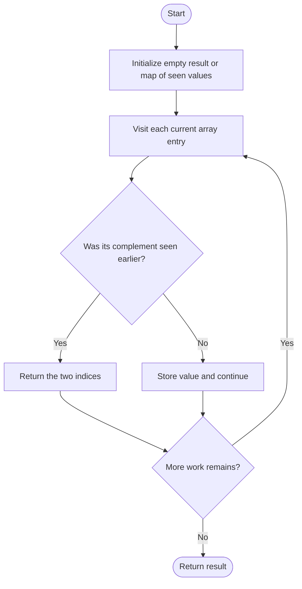
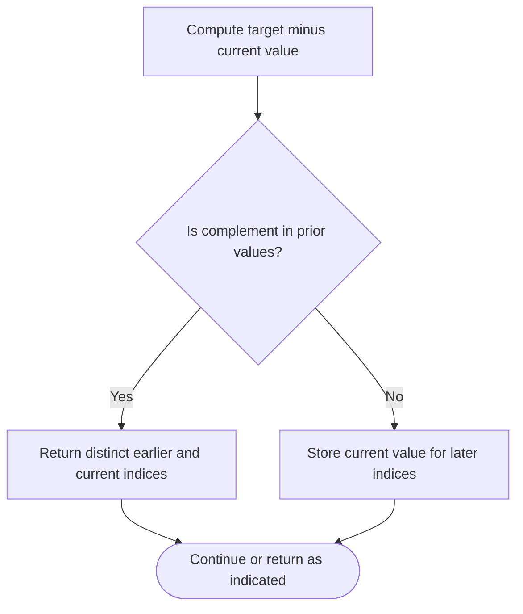

# Two Sum — LeetCode 1

## Problem and judge interface

`vector<int> twoSum(vector<int>& nums, int target)`; return indices of two distinct entries summing to target. Source methods are named twoSumOriginal and twoSumOptimized.

## Identification evidence

Both implementations search for a complement and return the matching indices, identifying problem 1.

## Main flow



## Important branch / loop



## Core logic and invariants

Original scans each suffix for a complement. Optimized checks a hash map of earlier values before inserting the current value, preventing reuse of one index.

## Complexity

Original O(n^2) time and O(1) space; hash version expected O(n) time and O(n) space.

## Comparison and optimization

Hash lookup removes repeated suffix scans. Adapt method name to judge-required twoSum; helper returns empty if no pair.

## Compile and run

The `.cpp` is the original standalone source, including its local `main()` demonstration where present. Compile and run from the repository root with a C++17 compiler:

```text
g++ -std=c++17 LeetCode\1\1.cpp -o solution.exe
.\solution.exe
```

For LeetCode, adapt the implementation to the required class/method signature and omit the local `main()` and demonstration helpers; use the judge-provided node types. Notes above identify method-name or behavior differences. The moved source bytes have not been edited.

