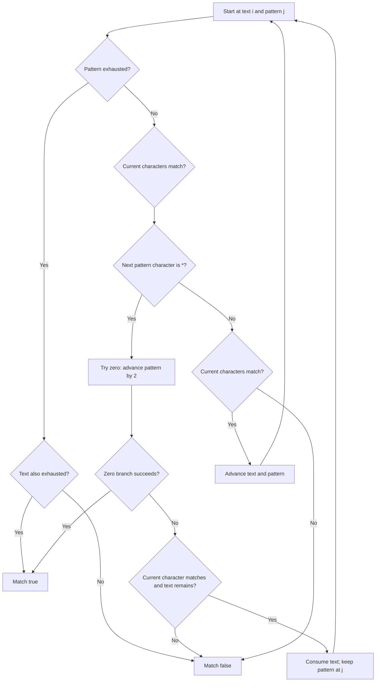

# 10. Regular Expression Matching

## 1. Problem Understanding

Given text `s` and pattern `p`, return whether the **entire** text matches the **entire** pattern. Pattern `.` matches exactly one character; `*` means zero or more copies of the character immediately before it. This is not substring search. Udaharan: pattern `a*` means zero or many `a` characters, not “any characters.”

## 2. Example Understanding

- `s = "aa", p = "a"` → false: pattern ends after one `a`, but text has two.
- `s = "aa", p = "a*"` → true: `a*` consumes both `a`s.
- `s = "ab", p = ".*"` → true: `.*` can consume any sequence.
- `s = "aab", p = "c*a*b"` → true: `c*` consumes zero, `a*` consumes two `a`s, then `b` consumes `b`.
- Edge: `s = "", p = "a*b*"` → true; each starred token may represent zero characters.

## 3. Problem Identification

### Pattern Recognition Cheat Sheet

| Clue in Question                             | Possible Pattern                  | Why?                                                       |
| -------------------------------------------- | --------------------------------- | ---------------------------------------------------------- |
| Match whole string with wildcard rules       | String DP                         | Current match depends on suffixes/prefixes of both strings |
| `*` can mean zero OR repeated previous token | Recursion with branching, then DP | Overlapping `(text index, pattern index)` states           |
| Need exact yes/no match                      | Boolean DP                        | Each state represents whether two remaining portions match |

Ask: Are we matching the whole input? What does `*` repeat? Does a choice consume text, pattern, or both? Experienced approach: define a state before coding, then enumerate the zero-use and one-more-use cases for `*`.

## 4. Different Approaches

1. **Plain recursion:** State `(i,j)`. If next pattern symbol is `*`, branch to skip its pair (`j+2`) or consume a matching text character while keeping `j`. Correct, but repeated states make it exponential.
2. **Memoization:** Cache each `(i,j)` result. Same recurrence, each state computed once; extra table memory.
3. **Tabulation:** Fill suffix DP from bottom-right. `dp[i][j]` means `s[i..]` matches `p[j..]`. For `x*`, use `dp[i][j+2]` (zero) or `firstMatch && dp[i+1][j]` (consume one and keep `*`).
4. **Space-optimized DP (provided final variant):** Keep current and next text rows. It is correct because row `i` depends only on row `i+1` and later columns in current row.
   | Approach | Time | Space | Pros | Cons |
   |---|---:|---:|---|---|
   | Recursion | Exponential worst case | O(m+n) stack | Directly mirrors rules | Repeats subproblems |
   | Memoization | O(mn) | O(mn) + stack | Natural and efficient | Recursion/table |
   | Tabulation | O(mn) | O(mn) | Iterative and clear | Full table |
   | Two-row DP | O(mn) | O(m) | Lowest practical memory | Update order matters |
   `m=|s|`, `n=|p|`. Greedy wildcard matching is not generally safe here because `*` can match zero or many and backtracking may be required.

## 5. Flowchart

`*` branch madhye zero occurrences first try; otherwise matching text consume karun same token parat try karto. Every recursive move advances text or pattern, so it terminates.

## 6. Algorithm / Intuition

Use state `(i,j)`. `firstMatch` is true if text remains and `s[i]==p[j]` or `p[j]=='.'`. For `p[j+1]=='*'`, matching is either skip the token pair or consume one character and stay on the same pattern token. Without `*`, both indices advance together.

## 7. Code Explanation

In [`10.cpp`](./10.cpp), `solveRecursive`, `solveMemo`, `isMatchTabulation`, and `isMatchSpaceOptimized` implement these levels. The final implementation's `next` row represents text suffix `i+1`; `curr[j+2]` handles zero repetitions and `next[j]` handles another repetition. Base `next[m]=true` means both suffixes exhausted; initialization handles starred tokens matching empty text. The demo `main` compares all variants; LeetCode submission normally needs only `Solution::isMatch`.

## 8. Dry Run

For `s="aa", p="a*"`:
| Step | Variables | Condition | Action | Result |
|---|---|---|---|---|
| 1 | `i=0,j=0` | `a` matches; next is `*` | Try zero (`j=2`) | Fails: text remains |
| 2 | `i=0,j=0` | `a` matches | Consume one (`i=1,j=0`) | Continue at `a*` |
| 3 | `i=1,j=0` | `a` matches; next is `*` | Try zero (`j=2`) | Fails: one `a` remains |
| 4 | `i=1,j=0` | `a` matches | Consume one (`i=2,j=0`) | Continue |
| 5 | `i=2,j=0` | Text exhausted | Skip `a*` | Both exhausted → true |

## 9. Complexity Analysis

Memoized, tabulated, and optimized DP evaluate at most `(m+1)(n+1)` states: **O(mn)** time. Table uses O(mn); two-row version uses **O(n)** memory plus O(1) per-row overhead. Plain recursion can be exponential because choices are revisited.

## 10. Why This Solution Works

For each suffix pair, any valid match involving `x*` either uses zero `x`s (skip both pattern symbols) or uses at least one (consume a matching text character and reconsider the same `x*`). These cases are exhaustive and disjoint by number of consumed copies. Non-star tokens must match one character. Thus DP records exactly all legal ways; indices only move forward and the state space is finite.

## 11. Common Mistakes & Interview Traps

- `*` applies to the **previous** pattern character, not the next one.
- Matching a prefix is insufficient; both strings must be exhausted.
- In the repeat branch keep `j` unchanged; moving to `j+1` loses further repetitions.
- Empty text can match patterns such as `a*b*`; initialize/compute this explicitly.
- Constraint guarantees pattern syntax is valid (no leading `*`).
- Follow-up: add `?` or character classes; first define their state transitions before changing code.

## 12. Revision Notes (Quick Recall)

- **Pattern:** String DP / regex token matching.
- **Clue:** Whole-string match, wildcard and zero-or-more repetition.
- **Intuition:** For `x*`, skip it or consume a matching character and stay.
- **Algorithm:** DP over text and pattern positions; base both exhausted.
- **Complexity:** O(mn) time; O(n) space optimized.
- **Trap:** `*` repeats the preceding token; `.` matches one character.
- **Takeaway:** Branch on the pattern operator, not on arbitrary text positions.

## 13. Similar Problem Recognition

Compare with wildcard matching (`?`, `*` where `*` matches any sequence): same suffix-DP framing, different `*` semantics. Edit distance also uses two string indices and transitions, but operations are insertion/deletion/replacement. If only substring matching were requested, extra start positions or a different automaton would be needed. Similar LeetCode patterns: Wildcard Matching, Edit Distance, Distinct Subsequences.

## 14. Final Self-Assessment

1. Why is `s="ab"` matched by `".*"`?
2. What are the two branches for `x*`?
3. Why is a greedy first match not enough?
4. What is the meaning of `dp[i][j]`?
5. Why can empty text still match a non-empty pattern?
