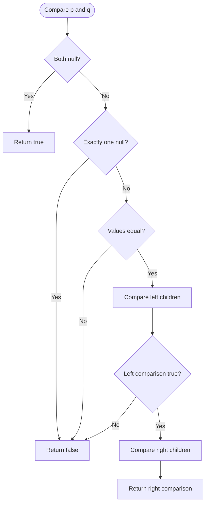

# Same Tree — LeetCode 100

## 1. Understanding

दोन binary trees ची structure आणि प्रत्येक corresponding node value समान आहेत का ते ठरवा. दोन्ही null trees समान.

## 2. Worked examples and edges

- समान `[1,2,3]` trees → true.
- Left child विरुद्ध right child → false (structure वेगळी).
- एकाच positionवर values वेगळ्या → false; `(nullptr,nullptr)` → true.

## 3. Pattern identification + cheat sheet

| Clue                         | Pattern              | कारण                           |
| ---------------------------- | -------------------- | ------------------------------ |
| Compare two tree nodes       | Paired recursion     | Corresponding children compare |
| Shape and values both matter | Structural traversal | Null positionsही महत्त्वाच्या  |
| Null base cases              | Recursive tree DP    | Subtree equality composition   |

## 4. Approaches

- Recursive paired DFS: O(n) time, O(h) stack; source method.
- Iterative queue of node pairs: O(n) time, O(w) space.
- Serialize both trees then compare — valid but extra O(n) storage.
- फक्त inorder values compare करणे चुकीचे; वेगवेगळ्या shapesचे inorder समान होऊ शकतात.

## 5. Flowchart

प्रत्येक subtreeमध्ये null, value, left आणि right या चारही बाबी तपासल्या जातात.

## 6. Algorithm / intuition

Pairwise nodes compare करा. दोन्ही null म्हणजे त्या positionवर agreement; एकच null किंवा value mismatch म्हणजे false; अन्यथा left आणि right recursively दोन्ही true हवेत.

## 7. Code explanation

`getAllNode(p,q)` base casesनंतर values तपासतो आणि `left && right` वापरतो. `isSameTree` helper call परतवतो. Source मध्ये local `TreeNode` आणि demonstration `main()` आहेत.

## 8. Dry run

> **मराठी:** प्रत्येक महत्त्वाच्या step नंतर variable ची value trace करा.
> `p=1(left=2)`, `q=1(right=2)`:
> | pair | null/value check | result |
> |---|---|---|
> | `(1,1)` | values equal | compare children |
> | `(2,null)` | exactly one null | false |
> | root | left result false | false; right recursion unnecessary |

## 9. Complexity

O(n) time, `n` म्हणजे दोन्ही treesमध्ये भेटलेल्या nodesची संख्या. Recursion O(h) stack, worst-case skewed treeमध्ये O(n).

## 10. Correctness

दोन trees समान असण्यासाठी root presence/value समान आणि दोन्ही corresponding subtrees समान असणे आवश्यक. Helper हेच cases तपासतो; induction ने base null subtree पासून संपूर्ण tree equality सिद्ध होते.

## 11. Mistakes and interview traps

- Null structure तपासल्याशिवाय values पुरेसे नाहीत.
- `left && right` short-circuit केल्याने false आल्यावर पुढचा subtree आवश्यक नाही.
- Empty pair true आहे.
- Tree recursion depth skewed treeमध्ये मोठी असू शकते.

## 12. Quick revision

> **मराठी:** दोन मिनिटांच्या revision साठी pattern, मुख्य कल्पना आणि complexity आठवा.
> Both null→true; one null/value mismatch→false; else compare left and right.

## 13. Related problems / variations

> **मराठी:** प्रश्नात काय दिले आहे आणि नेमके काय शोधायचे आहे, हे आधी स्पष्ट करा.
> Symmetric Tree, Subtree of Another Tree, Same Tree iteratively, serialize/deserialize binary tree.

## 14. Self-assessment

1. `(nullptr,nullptr)` चे उत्तर?
2. Inorder equality पुरेशी का नाही?
3. Worst-case recursion stack किती?
4. Iterative पर्यायात कोणती data structure वापराल?
