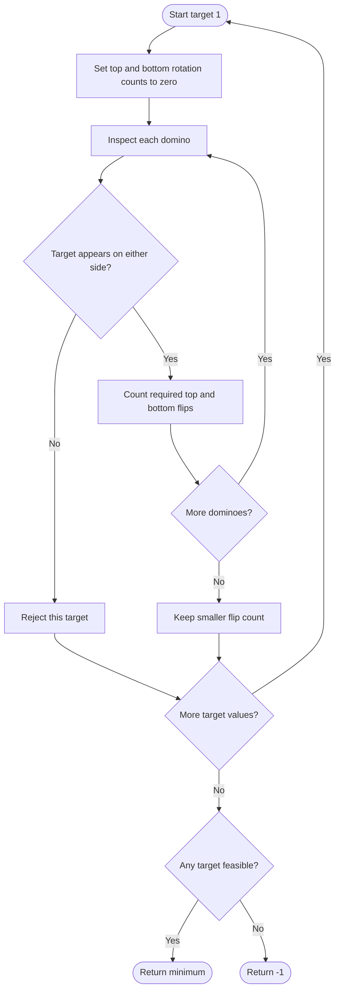

# 1007. Minimum Domino Rotations For Equal Row

Source: `1007.cpp`; two candidate-checking/counting variants.

## 1. Understanding

> **मराठी:** प्रश्नात काय दिले आहे आणि नेमके काय शोधायचे आहे, हे आधी स्पष्ट करा.
> Rotate selected dominoes so every top value or every bottom value is the same. Return the minimum rotations, or `-1` if impossible.

## 2. Worked examples and edges

> **मराठी:** प्रश्नात काय दिले आहे आणि नेमके काय शोधायचे आहे, हे आधी स्पष्ट करा.
> `tops=[2,1,2,4,2,2]`, `bottoms=[5,2,6,2,3,2]`: target 2 can be made all top in 2 rotations. If a domino contains neither candidate, no solution. Already-equal row returns 0.

## 3. Pattern identification + cheat sheet

> **मराठी:** या clues मुळे योग्य pattern ओळखता येतो; constraints आणि relations नीट तपासा.
> The common value must appear on at least one side of every domino; test only possible face values.
> | Clue | Pattern |
> |---|---|
> | Values restricted to 1..6 | Enumerate candidates |
> | Need all tops or all bottoms | Count flips both ways |
> | One domino cannot be changed to target | Reject candidate |

## 4. Approaches

> **मराठी:** सोप्या उपायापासून सुरुवात करा आणि constraints नुसार योग्य optimization निवडा.

- **Try every rotation combination — exponential and unnecessary.**
- **Enumerate target values 1..6 — used and optimal for this bounded domain:** `O(6n)` time, `O(1)` space.
- `minDominoRotations_v1` uses counts and union coverage; `v2` directly validates each target and counts rotations.

## 5. Flowchart

> **मराठी:** Flowchart मधील decision, loop आणि termination condition क्रमाने समजून घ्या.

For a fixed target, each domino can be oriented independently.

## 6. Algorithm and intuition

> **मराठी:** मुख्य observation समजल्यावर algorithm चे steps लक्षात ठेवणे सोपे होते.
> For target `x`, it must occur in every pair (`tops[i]==x || bottoms[i]==x`). Count top flips (`tops[i]!=x`) and bottom flips (`bottoms[i]!=x`); choose the smaller. Try all 1..6.

## 7. Code explanation

> **मराठी:** Code मधील variable आणि condition यांचा algorithm मधील उद्देश समजून घ्या.
> `v1` computes top/bottom frequencies and shared positions; union coverage is `topsCount+bottomsCount-commonIndexCount == n`. `v2` uses direct per-target validation. Both return the minimum orientation count for a feasible candidate.

## 8. Dry run

> **मराठी:** प्रत्येक महत्त्वाच्या step नंतर variable ची value trace करा.
> | Domino | Top has 2? | Bottom has 2? | Top flip | Bottom flip |
> |---|---|---|---:|---:|
> | `(2,5)` | yes | no | 0 | 1 |
> | `(1,2)` | no | yes | 1 | 0 |
> | `(2,6)` | yes | no | 0 | 1 |
> | Result across all | — | — | top total 2 | bottom total 3 |

## 9. Complexity

> **मराठी:** Input size आणि प्रत्येक operation कितीदा चालतो यावरून complexity ठरवा.
> `O(6n)=O(n)` time and `O(1)` auxiliary space. The face domain is fixed at six.

## 10. Correctness

> **मराठी:** Invariant किंवा तर्क वापरून algorithm योग्य उत्तर देतो हे समजून घ्या.
> Any uniform row must use a value that appears on at least one side of every domino. The algorithm tests every possible face value and rejects exactly those failing that condition. For a feasible value, the two counters equal the flips needed to make all tops or all bottoms equal to it; taking their minimum and then the minimum over candidates is optimal.

## 11. Mistakes / interview traps

> **मराठी:** Boundary, duplicate आणि off-by-one cases स्वतंत्रपणे तपासा.

- Check both possible uniform rows.
- Count a rotation only when that side does not already equal target.
- The target must occur somewhere on every domino.
- Return `-1` if no target covers every position.

## 12. Quick revision

Try each face value; validate all pairs; count top/bottom flips; take min; no candidate → `-1`.
प्रत्येक dominoमध्ये target किमान एका बाजूला असणे गरजेचे.

## 13. Related problems / variations

> **मराठी:** प्रश्नात काय दिले आहे आणि नेमके काय शोधायचे आहे, हे आधी स्पष्ट करा.
> Minimum flips to make binary rows uniform; candidate-and-validate problems; set cover on a fixed tiny domain.

## 14. Self-assessment

> **मराठी:** उत्तर न पाहता प्रश्न सोडवा आणि तुमच्या निवडीचे कारण सांगा.

1. Why can the candidate set be restricted to values 1..6?
2. Why is union coverage necessary?
3. How do the two rotation counters differ?
4. Why is there no need to test combinations of domino rotations?
