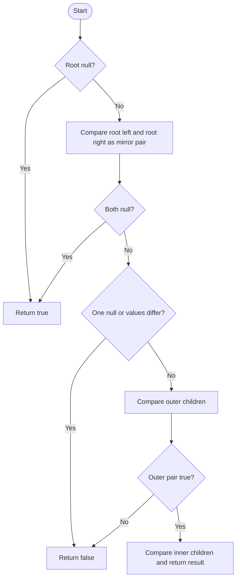

# Symmetric Tree — LeetCode 101

## 1. Understanding

Root भोवती binary tree mirror image आहे का ते ठरवा. डाव्या subtree मधील प्रत्येक node उजव्या subtreeच्या mirrored positionशी जुळला पाहिजे.

## 2. Worked examples and edges

- `[1,2,2,3,4,4,3]` → true.
- `[1,2,2,null,3,null,3]` → false; child positions mirror नाहीत.
- Empty tree → true; एकच root → true.

## 3. Pattern identification + cheat sheet

| Clue                      | Pattern                   | कारण                              |
| ------------------------- | ------------------------- | --------------------------------- |
| Tree mirror check         | Paired recursion          | Opposite child directions compare |
| Left/right correspondence | Symmetry invariant        | left.left ↔ right.right           |
| Null structure matters    | Recursive structural test | Missing child mismatch            |

## 4. Approaches

- Recursive `isMirror`: O(n) time, O(h) call stack; source implementation.
- Queue/stack of node pairs: O(n) time, O(w) space; avoids recursion.
- Same tree checker with left↔left comparison चुकीचे; mirror मध्ये cross-pairing आवश्यक.

## 5. Flowchart

Outer आणि inner child pairs उलट दिशेने तपासल्याने mirror relation टिकते.

## 6. Algorithm / intuition

`isMirror(a,b)` मध्ये दोन्ही null true, एक null false. अन्यथा value समान आणि `a.left` विरुद्ध `b.right`, तसेच `a.right` विरुद्ध `b.left` recursively तपासा.

## 7. Code explanation

`isSymmetric(root)` null rootवर true; नाहीतर `isMirror(root->left,root->right)`. `isMirror` ची `&&` अट तिन्ही conditions अनिवार्य करते. Source custom `TreeNode` आणि local test `main()` देतो.

## 8. Dry run

> **मराठी:** प्रत्येक महत्त्वाच्या step नंतर variable ची value trace करा.
> Root children `2,2`, outer grandchildren `3,3`, inner `4,4`:
> | Pair | Comparison | Result |
> |---|---|---|
> | root left/right | `2 == 2` | continue |
> | outer: left.left/right.right | `3 == 3` | true |
> | inner: left.right/right.left | `4 == 4` | true |
> | combined | both mirror pairs true | true |

## 9. Complexity

O(n) time, O(h) recursion space; skewed treeमध्ये h=n. Iterative pair traversal O(n) auxiliary space.

## 10. Correctness

Mirror subtreesमध्ये roots समान असतात आणि त्यांचे बाहेरील/आतील child pairs एकमेकांचे mirrors असतात. `isMirror` हीच recurrence तपासतो; null base cases योग्य correspondence निश्चित करतात.

## 11. Mistakes and interview traps

- Same Tree प्रमाणे left-left तुलना करू नका; cross compare आवश्यक.
- Values समान असून shape mismatch असल्यास false.
- Root एकटाच असेल तर symmetric.
- Recursion depth विचारात घ्या.

## 12. Quick revision

> **मराठी:** दोन मिनिटांच्या revision साठी pattern, मुख्य कल्पना आणि complexity आठवा.
> Compare root.left with root.right. Recurse outer pair and inner pair. Null/null true.

## 13. Related problems / variations

> **मराठी:** प्रश्नात काय दिले आहे आणि नेमके काय शोधायचे आहे, हे आधी स्पष्ट करा.
> Same Tree, Flip Equivalent Binary Trees, level-order symmetry, mirror a binary tree.

## 14. Self-assessment

1. Mirror test मध्ये कोणते grandchildren pair होतात?
2. एकाच pair मध्ये एक node null असल्यास?
3. Empty tree symmetric का?
4. Iterative पद्धतीत queueमध्ये काय ठेवता?
