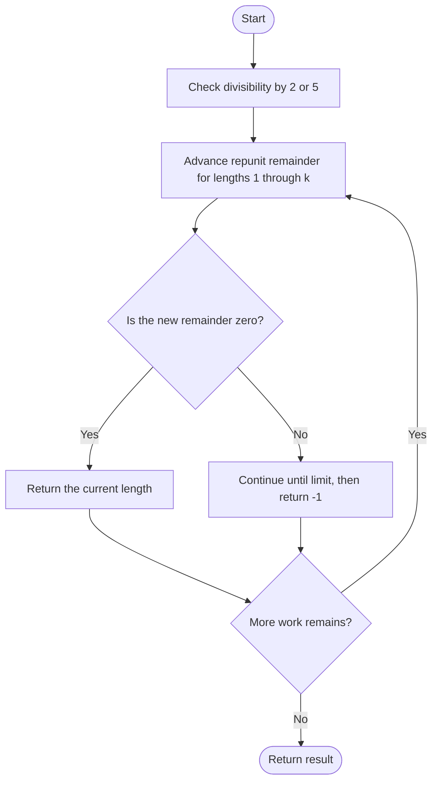

# Smallest Integer Divisible by K — LeetCode 1015

## Problem and judge interface

int smallestRepunitDivByK(int k); return the digit count of the smallest repunit divisible by k, or -1.

## Identification evidence

It rejects k divisible by 2 or 5 and advances the repunit remainder using (remainder\*10+1)%k, uniquely identifying problem 1015.

## Main flow



## Important branch / loop

```mermaid
flowchart TD
 A[Update remainder as (remainder*10+1) mod k] --> B{Did the remainder become zero?}
 B -- Yes --> C[Return this length]
 B -- No --> D[Try the next length]
 C --> E([Continue or return as indicated])
 D --> E
```

## Core logic and invariants

A full repunit is never built. Each step computes the next remainder; zero returns the current length. A bounded scan of lengths through k suffices.

## Complexity

O(k) time and O(1) auxiliary space.

## Comparison and optimization

Remainders avoid constructing huge numbers and overflow. Divisibility by 2 or 5 makes a repunit impossible.

## Compile and run

The `.cpp` is the original standalone source, including its local `main()` demonstration where present. Compile and run from the repository root with a C++17 compiler:

```text
g++ -std=c++17 LeetCode\1015\1015.cpp -o solution.exe
.\solution.exe
```

For LeetCode, adapt the implementation to the required class/method signature and omit the local `main()` and demonstration helpers; use the judge-provided node types. Notes above identify method-name or behavior differences. The moved source bytes have not been edited.
