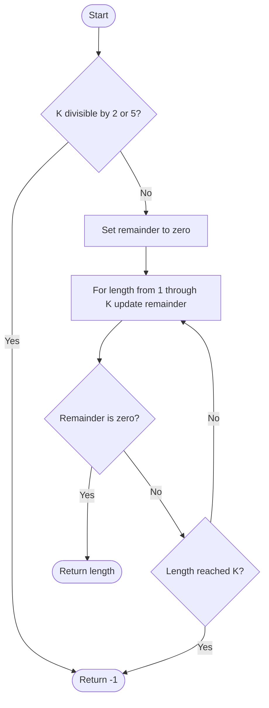

# 1015. Smallest Integer Divisible by K

Source: `1015.cpp`; `smallestRepunitDivByK(int k)`.

## 1. Understanding

> **मराठी:** प्रश्नात काय दिले आहे आणि नेमके काय शोधायचे आहे, हे आधी स्पष्ट करा.
> Find the length of the smallest positive number consisting only of digit 1 that is divisible by `k`. Return `-1` if none exists.

## 2. Worked examples and edges

> **मराठी:** प्रश्नात काय दिले आहे आणि नेमके काय शोधायचे आहे, हे आधी स्पष्ट करा.
> For `k=3`, `111` is divisible, answer 3. `k=2` or `5` cannot divide any all-ones number, so return `-1`. For `k=1`, answer 1.

## 3. Pattern identification + cheat sheet

> **मराठी:** या clues मुळे योग्य pattern ओळखता येतो; constraints आणि relations नीट तपासा.
> Repunit values grow exponentially, but divisibility needs only the remainder.
> | Need | Pattern |
> |---|---|
> | Append digit 1 | `remainder = (remainder*10+1)%k` |
> | Avoid giant integer | Modular arithmetic |
> | Prove finite search | Pigeonhole / repeated remainder |

## 4. Approaches

> **मराठी:** सोप्या उपायापासून सुरुवात करा आणि constraints नुसार योग्य optimization निवडा.

- **Construct `1,11,111,...` as integers — incorrect for large length due to overflow.**
- **Store large values as strings and divide — correct but inefficient.**
- **Remainder recurrence — used and optimal:** `O(k)` time, `O(1)` space.

## 5. Flowchart

> **मराठी:** Flowchart मधील decision, loop आणि termination condition क्रमाने समजून घ्या.

Every step stores the remainder of the current repunit, never the number itself.

## 6. Algorithm and intuition

> **मराठी:** मुख्य observation समजल्यावर algorithm चे steps लक्षात ठेवणे सोपे होते.
> Appending digit 1 to a number with remainder `r` gives new remainder `(10r+1)%k`. If `k` has factor 2 or 5, no repunit is divisible by it. Otherwise a solution exists; at most `k` remainder steps suffice.

## 7. Code explanation

> **मराठी:** Code मधील variable आणि condition यांचा algorithm मधील उद्देश समजून घ्या.
> The method rejects `k%2==0 || k%5==0`, initializes remainder zero, and tests lengths 1 through `k`. At each step it appends one in modular form and returns immediately at remainder zero.

## 8. Dry run

> **मराठी:** प्रत्येक महत्त्वाच्या step नंतर variable ची value trace करा.
> | Length | Update for `k=3` | Remainder |
> |---:|---|---:|
> | 1 | `(0·10+1)%3` | 1 |
> | 2 | `(1·10+1)%3` | 2 |
> | 3 | `(2·10+1)%3` | 0 → answer 3 |

## 9. Complexity

> **मराठी:** Input size आणि प्रत्येक operation कितीदा चालतो यावरून complexity ठरवा.
> At most `k` iterations: `O(k)` time and `O(1)` extra space.

## 10. Correctness

> **मराठी:** Invariant किंवा तर्क वापरून algorithm योग्य उत्तर देतो हे समजून घ्या.
> By induction, after each iteration `remainder` is the current all-ones number modulo `k`. A zero remainder therefore identifies a divisible repunit, and because lengths are checked in increasing order it is the smallest. Factors 2 or 5 make divisibility impossible because repunits end in 1. For coprime-to-10 `k`, a repunit exists within the bounded search; repeated nonzero remainders would otherwise make future states cycle.

## 11. Mistakes / interview traps

> **मराठी:** Boundary, duplicate आणि off-by-one cases स्वतंत्रपणे तपासा.

- Do not build the repunit in an integer type.
- Check factors 2 and 5.
- Start length at 1; the empty repunit is not allowed.
- Update modulo at every digit append.

## 12. Quick revision

Reject multiples of 2 or 5; repeatedly `r=(10r+1)%k`; first zero remainder gives length.
मोठा repunit तयार न करता फक्त remainder ठेवा.

## 13. Related problems / variations

> **मराठी:** प्रश्नात काय दिले आहे आणि नेमके काय शोधायचे आहे, हे आधी स्पष्ट करा.
> Modular arithmetic; repeated-digit divisibility; cycle detection in finite-state remainder sequences.

## 14. Self-assessment

> **मराठी:** उत्तर न पाहता प्रश्न सोडवा आणि तुमच्या निवडीचे कारण सांगा.

1. Why do factors 2 and 5 make a solution impossible?
2. What number does the remainder represent after each loop?
3. Why is modulo applied immediately?
4. Why can the search be bounded by `k`?
