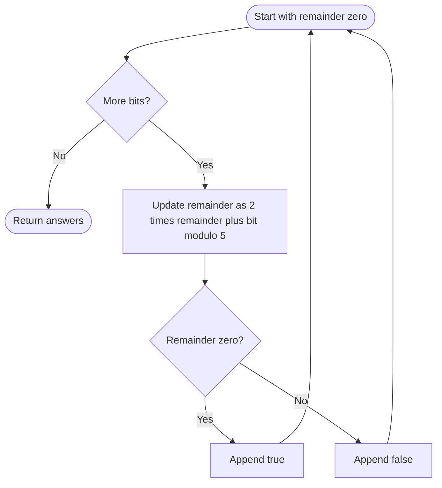

# 1018. Binary Prefix Divisible By 5

Source: `1018.cpp`; `prefixesDivBy5(vector<int>& nums)`.

## 1. Understanding

> **मराठी:** प्रश्नात काय दिले आहे आणि नेमके काय शोधायचे आहे, हे आधी स्पष्ट करा.
> Given bits from most-significant to least-significant, return for each prefix whether its binary value is divisible by 5.

## 2. Worked examples and edges

> **मराठी:** प्रश्नात काय दिले आहे आणि नेमके काय शोधायचे आहे, हे आधी स्पष्ट करा.
> For `[0,1,1]`, prefixes are binary `0`, `01` (1), `011` (3), so outputs are `[true,false,false]`. An empty bit vector returns an empty result.

## 3. Pattern identification + cheat sheet

> **मराठी:** या clues मुळे योग्य pattern ओळखता येतो; constraints आणि relations नीट तपासा.
> Streaming number construction with a small fixed modulus.
> | Need | Pattern |
> |---|---|
> | Append next binary digit | `value = 2*value + bit` |
> | Only divisibility matters | Keep remainder modulo 5 |
> | One result per prefix | Append boolean each step |

## 4. Approaches

> **मराठी:** सोप्या उपायापासून सुरुवात करा आणि constraints नुसार योग्य optimization निवडा.

- **Build each prefix as a full integer — can overflow and repeats work.**
- **Recompute each prefix from scratch — correct but `O(n²)`.**
- **Remainder streaming — used and optimal:** `O(n)` time, `O(1)` working space, plus output.

## 5. Flowchart

> **मराठी:** Flowchart मधील decision, loop आणि termination condition क्रमाने समजून घ्या.

Only remainder is needed because values with the same remainder stay equivalent after appending the same bit.

## 6. Algorithm and intuition

> **मराठी:** मुख्य observation समजल्यावर algorithm चे steps लक्षात ठेवणे सोपे होते.
> If current prefix has remainder `r`, appending bit `b` produces value `2·prefix+b`; its remainder is `(2r+b)%5`. Record whether that remainder is zero.

## 7. Code explanation

> **मराठी:** Code मधील variable आणि condition यांचा algorithm मधील उद्देश समजून घ्या.
> `curr` stores the remainder (always 0..4). Each input bit updates it and `ans.push_back(curr==0)` records that prefix's divisibility.

## 8. Dry run

> **मराठी:** प्रत्येक महत्त्वाच्या step नंतर variable ची value trace करा.
> | Bit | Calculation | Remainder | Divisible? |
> |---:|---|---:|---|
> | 0 | `(0·2+0)%5` | 0 | true |
> | 1 | `(0·2+1)%5` | 1 | false |
> | 1 | `(1·2+1)%5` | 3 | false |

## 9. Complexity

> **मराठी:** Input size आणि प्रत्येक operation कितीदा चालतो यावरून complexity ठरवा.
> `O(n)` time; `O(1)` auxiliary state excluding the `O(n)` output vector.

## 10. Correctness

> **मराठी:** Invariant किंवा तर्क वापरून algorithm योग्य उत्तर देतो हे समजून घ्या.
> Initially the empty prefix has remainder zero. If the stored remainder matches the current prefix modulo 5, then appending a bit transforms both actual value and remainder by `2x+b`, preserving congruence modulo 5. Thus each recorded zero test is true exactly when that prefix is divisible by 5.

## 11. Mistakes / interview traps

> **मराठी:** Boundary, duplicate आणि off-by-one cases स्वतंत्रपणे तपासा.

- Process bits in their given order (most significant first).
- Use `2*remainder+bit`, not `remainder+bit`.
- Reduce modulo each step to avoid overflow.
- Store one answer for every input bit.

## 12. Quick revision

`rem=(2*rem+bit)%5`; append `rem==0`. Stream, no big integer needed.
प्रत्येक bit नंतर remainder लहान राहतो आणि overflow टळतो.

## 13. Related problems / variations

> **मराठी:** प्रश्नात काय दिले आहे आणि नेमके काय शोधायचे आहे, हे आधी स्पष्ट करा.
> Binary Prefix Divisible by K; streaming decimal remainder; online modular arithmetic.

## 14. Self-assessment

> **मराठी:** उत्तर न पाहता प्रश्न सोडवा आणि तुमच्या निवडीचे कारण सांगा.

1. Why is the update `2r+b`?
2. Why does storing only remainder suffice?
3. What is the maximum possible value of `curr` after modulo?
4. How would this work for arbitrary divisor `k`?
