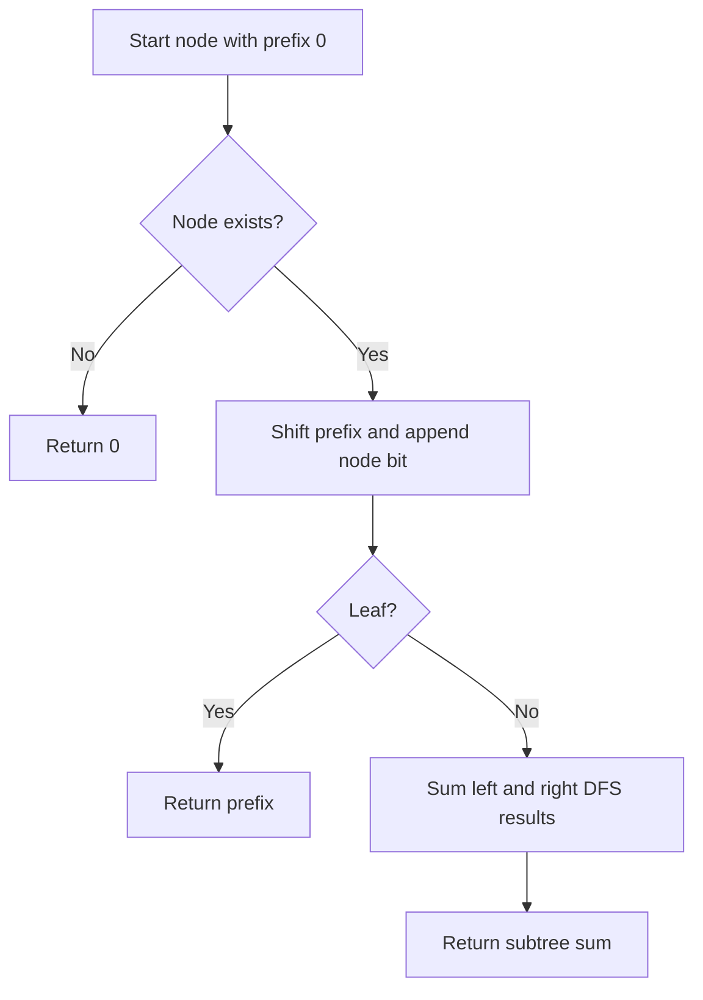

# Sum of Root To Leaf Binary Numbers — LeetCode 1022

## Problem, constraints आणि examples

प्रत्येक root-to-leaf path मधील `0/1` bits एक binary number बनवतात; सर्व path values ची बेरीज return करा. Tree रिकामा असू शकतो (या solution मध्ये उत्तर `0`), आणि node values फक्त `0` किंवा `1` आहेत.
Example: root `1`, children `0,1`; left leaf path `10₂=2`, right leaf `11₂=3`, total `5`. Single node `1` असल्यास total `1`; root `0` असल्यास leading zero normal आहे.

## Pattern clues

| Clue                             | Pattern                             |
| -------------------------------- | ----------------------------------- |
| प्रत्येक पूर्ण root-to-leaf path | DFS/tree traversal                  |
| binary prefix पुढे वाढतो         | `value = 2*value + bit` / bit shift |
| प्रत्येक leaf चे स्वतंत्र योगदान | leaf aggregation                    |

## Approaches

| Method                                      | योग्य?                                            | Cost / note                                      |
| ------------------------------------------- | ------------------------------------------------- | ------------------------------------------------ |
| Recursive DFS with prefix                   | Best fit; path value parameter मध्ये              | `O(N)` time, `O(H)` stack                        |
| Iterative DFS stack                         | योग्य; प्रत्येक stack entry मध्ये node आणि prefix | `O(N)` time, `O(H)` pending nodes (worst `O(N)`) |
| BFS queue                                   | योग्य, पण level queue मोठी होऊ शकते               | `O(N)` time, `O(N)` space                        |
| प्रत्येक path string करून नंतर binary parse | Correct पण unnecessary allocation                 | `O(N)` nodes plus path processing                |

Brute force असं काही नाही जे उपयोगी ठरेल; path scan आधीपासून linear आहे. Prefix न जतन करता leaf value-हरू मोजणे incorrect.

## Flowchart

Traversalमध्ये absent child ला `0` contribution मिळतो; leaf वरच accumulated binary value sum मध्ये जोडतो.

## Selected algorithm, intuition आणि code

Source मधील `sumRootToLeaf_Recursive` निवडा. `sum = (sum << 1) | node->val` म्हणजे आधीच्या bits ला जागा देऊन नवीन bit जोडणे; recursive return left+right leaf totals. `sumRootToLeaf_IterativeDFS` आणि `sumRootToLeaf_BFS` हाच invariant अनुक्रमे stack/queueने राखतात. `main` फक्त तीन पद्धतींची तुलना करतो.
Dry run (`1` root, children `0,1`):
| Node | Prefix before | Prefix after | Leaf contribution |
|---|---:|---:|---:|
| root 1 | 0 | 1 | — |
| left 0 | 1 | 2 (`10₂`) | 2 |
| right 1 | 1 | 3 (`11₂`) | 3 |

## Edge cases

> **मराठी:** Boundary, duplicate आणि off-by-one cases स्वतंत्रपणे तपासा.
> Empty tree returns 0; a single-node tree contributes its bit; a skewed tree makes recursion depth O(N).

## Complexity, correctness, traps

Recursive method: `O(N)` time; `O(H)` recursion stack (`H` tree height). Correctness: prefix प्रत्येक root-to-current path चे binary value ठेवतो; प्रत्येक leaf एकदा भेटतो आणि त्याचे अचूक value एकदाच sum होते. Iterative DFS auxiliary stack worst `O(N)`; BFS queue `O(N)`.
Mistakes: internal node value sum करू नका; prefix प्रत्येक siblingसाठी स्वतंत्र pass करा; path stringचे decimal अर्थ लावू नका. Interview trap: DFS depth skewed tree मध्ये `O(N)` होऊ शकते.

## Quick revision, variations, self-check

पुनरावलोकन: prefixमध्ये पुढचा bit जोडा; leaf valuesचा sum करा.
Formula `prefix*2 + bit`; leaf वर add; traversal `O(N)`. Related: Path Sum, root-to-leaf path enumeration, trie prefix traversal.

1. `1→0→1` path चे value किती?
2. Single node leaf का आहे?
3. BFS space DFSपेक्षा कधी जास्त असते?
4. दोन sibling paths prefix share करतात का?
