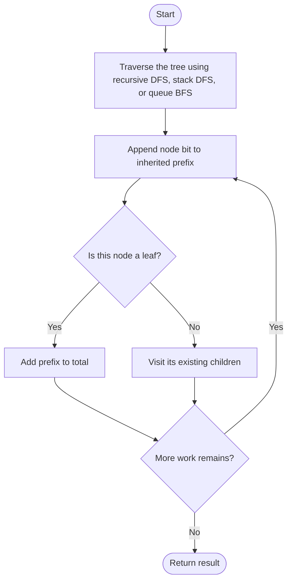
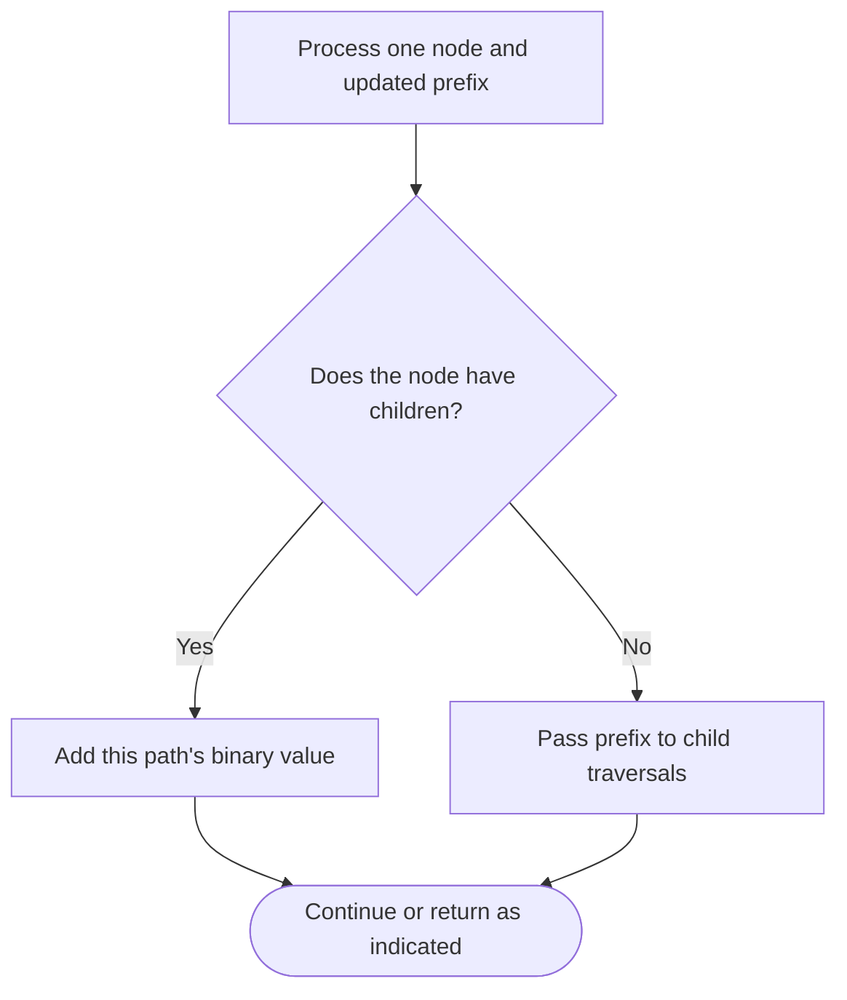

# Sum of Root To Leaf Binary Numbers — LeetCode 1022

## Problem and judge interface

int sumRootToLeaf(TreeNode* root); sum integer values encoded by root-to-leaf binary paths.

## Identification evidence

The source comment explicitly names problem 1022; recursive DFS, iterative DFS and BFS all build path binary values.

## Main flow



## Important branch / loop



## Core logic and invariants

At a node append its bit by shifting the prefix left and OR-ing in the bit. Add the accumulated value at leaves. Three traversal variants are demonstrated by main.

## Complexity

O(N) time. Recursive and explicit DFS use O(H) auxiliary space; BFS queue uses O(W), up to O(N).

## Comparison and optimization

The source exposes `sumRootToLeaf_Recursive`, `sumRootToLeaf_IterativeDFS`, and `sumRootToLeaf_BFS`; adapt a chosen traversal to `sumRootToLeaf`. All maintain the same prefix invariant. Recursive DFS is concise; iterative DFS avoids recursion; BFS stores a level frontier.

## Compile and run

The `.cpp` is the original standalone source, including its local `main()` demonstration where present. Compile and run from the repository root with a C++17 compiler:

```text
g++ -std=c++17 LeetCode\1022\1022.cpp -o solution.exe
.\solution.exe
```

For LeetCode, adapt the implementation to the required class/method signature and omit the local `main()` and demonstration helpers; use the judge-provided node types. Notes above identify method-name or behavior differences. The moved source bytes have not been edited.

