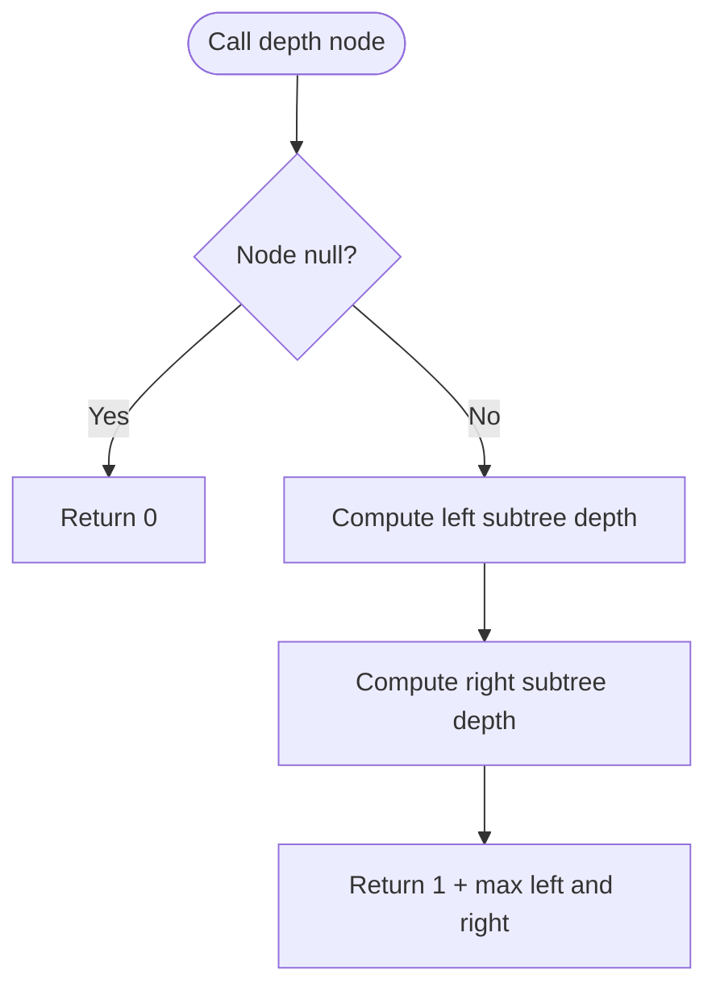

# Maximum Depth of Binary Tree — LeetCode 104

## 1. Understanding

Binary tree root-to-leaf path मधील maximum number of nodes (depth) शोधा. Empty treeची depth 0.

## 2. Worked examples and edges

- Root `1`, children `2,3`, and `2.left=4` → depth 3.
- Single node → 1; `nullptr` → 0.
- Skewed treeमध्ये depth = node count.

## 3. Pattern identification + cheat sheet

| Clue                       | Pattern         | कारण                     |
| -------------------------- | --------------- | ------------------------ |
| Maximum root-to-leaf level | Tree DFS        | प्रत्येक subtreeची depth |
| Left/right alternatives    | Max aggregation | मोठी depth निवडा         |
| Empty subtree              | Base case       | depth 0                  |

## 4. Approaches

- Recursive DFS (`LastDepth`): O(n) time/O(h) stack; source method.
- BFS level-order: O(n) time/O(w) queue; count levels.
- Repeated traversal per node inefficient; tree एकदाच visit करा.

## 5. Flowchart

Current nodeसाठी दोन्ही subtreesची माहिती आवश्यक.

## 6. Algorithm / intuition

Depth(node) = 0 if null; अन्यथा `1 + max(depth(left), depth(right))`. Leafला `1+max(0,0)=1`.

## 7. Code explanation

`LastDepth(TreeNode*)` recursive helper आहे; `maxDepth(root)` त्याला call करतो. Source local `TreeNode` constructors, sample trees आणि demonstration `main()` पुरवतो.

## 8. Dry run

> **मराठी:** प्रत्येक महत्त्वाच्या step नंतर variable ची value trace करा.
> Tree `1` with left `2` → `2.left=4`, right `3`:
> | Node | left depth | right depth | returned depth |
> |---|---:|---:|---:|
> | 4 | 0 | 0 | 1 |
> | 2 | 1 | 0 | 2 |
> | 3 | 0 | 0 | 1 |
> | 1 | 2 | 1 | 3 |

## 9. Complexity

> **मराठी:** Input size आणि प्रत्येक operation कितीदा चालतो यावरून complexity ठरवा.
> O(n) time, each node visited once; O(h) recursion stack (worst O(n), balanced O(log n)).

## 10. Correctness

प्रत्येक root-to-leaf path current nodeमधून जात असल्यास उर्वरित path left किंवा right subtreeमध्ये असतो. त्या दोन्ही maximum depthsमधील मोठी निवडून current nodeचा एक स्तर जोडल्यास exact maximum depth मिळते.

## 11. Mistakes and interview traps

- Depth nodes मोजते, edges नाही; single node answer 1.
- Null base case 0.
- `min` वापरू नका; deeper branch आवश्यक.
- Deep skewed treeमध्ये recursive stack वाढतो.

## 12. Quick revision

> **मराठी:** दोन मिनिटांच्या revision साठी pattern, मुख्य कल्पना आणि complexity आठवा.
> `nullptr→0`; otherwise `1+max(left,right)`.

## 13. Related problems / variations

> **मराठी:** प्रश्नात काय दिले आहे आणि नेमके काय शोधायचे आहे, हे आधी स्पष्ट करा.
> Minimum Depth of Binary Tree, Diameter of Binary Tree, balanced tree check, level-order traversal.

## 14. Self-assessment

1. Single-node treeची depth?
2. Recurrence काय?
3. Balanced treeची recursion stack किती?
4. BFSने depth कशी मोजाल?
