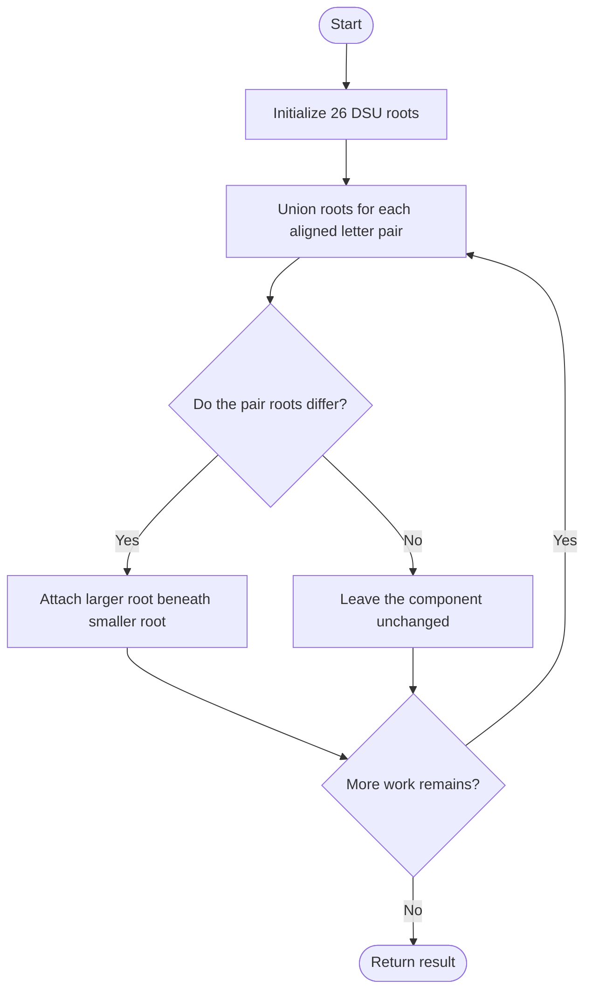
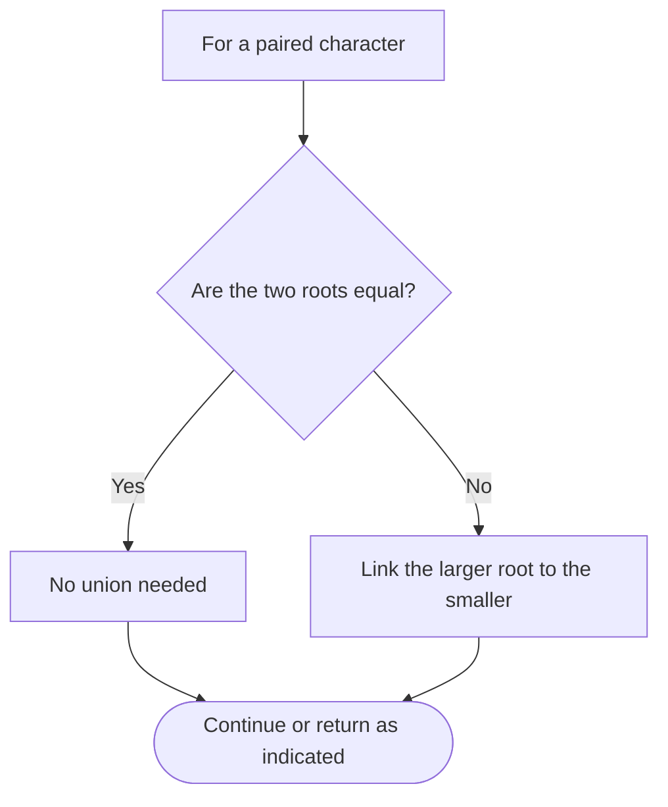

# Lexicographically Smallest Equivalent String — LeetCode 1061

## Problem and judge interface

string smallestEquivalentString(string s1, string s2, string baseStr); paired letters define equivalence and each base character maps to its smallest equivalent.

## Identification evidence

The function unions lowercase-letter equivalence classes and rewrites baseStr using the minimum representative, uniquely identifying problem 1061.

## Main flow



## Important branch / loop



## Core logic and invariants

The DSU has 26 roots. Union attaches the larger root to the smaller, preserving the smallest letter as canonical representative. The optimized find uses path compression; the original copies the parent vector and does not compress paths.

## Complexity

Optimized: O((length(s1)+length(baseStr)) alpha(26)) time in practice and O(26) space. Original find can traverse longer chains and copies parent storage.

## Comparison and optimization

Path compression and reference-based find avoid repeated copying and shorten paths.

## Compile and run

The `.cpp` is the original standalone source, including its local `main()` demonstration where present. Compile and run from the repository root with a C++17 compiler:

```text
g++ -std=c++17 LeetCode\1061\1061.cpp -o solution.exe
.\solution.exe
```

For LeetCode, adapt the implementation to the required class/method signature and omit the local `main()` and demonstration helpers; use the judge-provided node types. Notes above identify method-name or behavior differences. The moved source bytes have not been edited.
