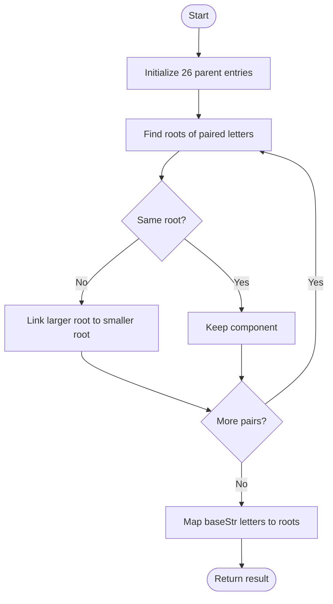

# 1061 — Lexicographically Smallest Equivalent String

## 1. Understanding

Each paired character in `s1` and `s2` is equivalent; equivalence is transitive. Replace every letter in `baseStr` with the smallest letter in its equivalence class. म्हणजे प्रत्येक group चा minimum अक्षर वापरायचा.

## 2. Worked examples and edge cases

> **मराठी:** प्रश्नात काय दिले आहे आणि नेमके काय शोधायचे आहे, हे आधी स्पष्ट करा.
> `s1="abc", s2="cde", baseStr="eed"` joins `{a,c,e}` and `{b,d}`; output is `aab`. Unconnected letters remain unchanged; repeated pairs do not change a component.

## 3. Pattern identification + cheat sheet

> **मराठी:** या clues मुळे योग्य pattern ओळखता येतो; constraints आणि relations नीट तपासा.
> This is **Disjoint Set Union (DSU)**: pairwise relations, transitivity, and queries for a component representative.
> | Clue | Pattern |
> |---|---|
> | Merge equivalent items | Union-Find |
> | Need smallest member | Keep minimum root |
> | Many root lookups | Path compression |

## 4. Approaches

> **मराठी:** सोप्या उपायापासून सुरुवात करा आणि constraints नुसार योग्य optimization निवडा.

- Repeatedly search the whole equivalence graph per character: correct but inefficient.
- DSU without compression: correct; source keeps this as `findOriginal` (it also copies the parent vector).
- Source's optimized DSU: correct; path-compressed `findOptimized`, with the larger root linked to the smaller.

## 5. Mermaid flowchart and explanation

Each pair is unioned; then each base character is replaced by its root. Diagram मध्ये root minimum राखतो.

## 6. Algorithm / intuition

> **मराठी:** मुख्य observation समजल्यावर algorithm चे steps लक्षात ठेवणे सोपे होते.
> Start with 26 singleton sets. Union each aligned pair; always make the smaller root the parent. Since roots are minima, replacing each base letter by its root gives the lexicographically smallest valid string.

## 7. Code explanation

> **मराठी:** Code मधील variable आणि condition यांचा algorithm मधील उद्देश समजून घ्या.
> `findOriginal` is uncompressed and takes `uf` by value; `findOptimized` uses a reference and compresses the path. `smallestEquivalentString` selects either via its optional flag, unions `s1[i]`/`s2[i]`, then constructs the output. Local `main()` is a demo; for LeetCode omit it and use the judge signature.

## 8. Dry run

> **मराठी:** प्रत्येक महत्त्वाच्या step नंतर variable ची value trace करा.
> For relation `a~c`, `c~e`: roots evolve `{a,c}` then `{a,c,e}`.
> | Letter in `baseStr` | Root | Output |
> |---|---|---|
> | `e` | `a` | `a` |
> | `e` | `a` | `a` |
> | `d` | `d` | `d` |

## 9. Complexity

> **मराठी:** Input size आणि प्रत्येक operation कितीदा चालतो यावरून complexity ठरवा.
> With path compression: `O((|s1|+|baseStr|) α(26))` time and `O(26)` DSU space, plus output. Without compression, finds can be linear in tree height; this source's original finder also copies 26 entries per call.

## 10. Correctness

> **मराठी:** Invariant किंवा तर्क वापरून algorithm योग्य उत्तर देतो हे समजून घ्या.
> Union preserves exactly the given equivalence closure; transitive membership follows from shared roots. The smaller-root rule keeps each root equal to its component's minimum. Thus each replaced character is the smallest equivalent character, independently minimizing every output position.

## 11. Mistakes / interview traps

> **मराठी:** Boundary, duplicate आणि off-by-one cases स्वतंत्रपणे तपासा.

- A relation is symmetric and transitive, not just a one-way replacement.
- Do not union arbitrary nodes without finding their roots.
- Preserve the minimum-root invariant if using root directly as the answer.
- `findOriginal` copies its vector; it is intentionally less efficient.

## 12. Quick revision

26-element DSU → union pairs by minimum root → replace each base letter with root. लक्षात ठेवा: root itself is the canonical smallest letter.

## 13. Related problems / variations

> **मराठी:** प्रश्नात काय दिले आहे आणि नेमके काय शोधायचे आहे, हे आधी स्पष्ट करा.
> Accounts Merge, Number of Provinces, Satisfiability of Equality Equations; variation: store component size/rank instead of minimum and query the minimum separately.

## 14. Self-assessment

> **मराठी:** उत्तर न पाहता प्रश्न सोडवा आणि तुमच्या निवडीचे कारण सांगा.

1. Why does unioning only the given pairs capture transitive equivalence?
2. Why must the smaller root remain the parent?
3. What work does path compression save?
4. What changes if the required representative is the largest letter?
