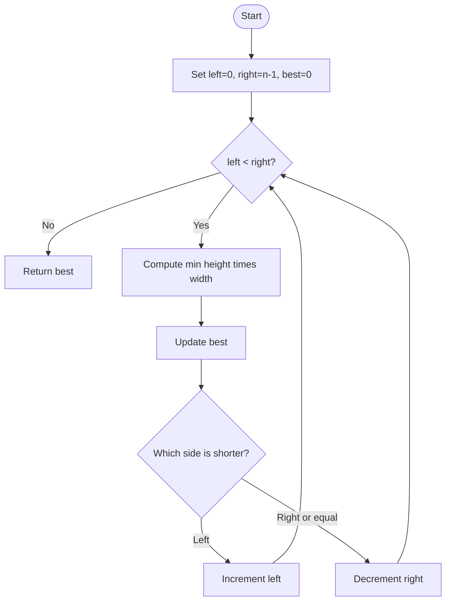

# Container With Most Water — LeetCode 11

## 1. Understanding

`height` मधील दोन lines निवडून सर्वाधिक पाणी धारण करणारे container area शोधा. Area = smaller height × indices मधील अंतर.

## 2. Worked examples and edges

- `[1,8,6,2,5,4,8,3,7]` → 49 (`height 8,7`, width 7).
- `[1,1]` → 1; `[4,3,2,1,4]` → 16.
- रिकामी/एक-element list असल्यास valid pair नाही; typical platformsवर source loop skip करून 0 देतो. Robust implementationने empty input आधी handle करावा (`size()-1` unsigned arithmetic आहे).

## 3. Pattern identification + cheat sheet

| Clue                                | Pattern              | कारण                       |
| ----------------------------------- | -------------------- | -------------------------- |
| Pair of indices, width shrinks      | Two pointers         | दोन्ही टोकांपासून सुरू     |
| Area min of pair heights × distance | Greedy discard       | कमी उंचीची line bottleneck |
| Maximize pair objective             | Brute force baseline | सर्व pairs तपासून optimal  |

## 4. Approaches

- Brute force सर्व `i<j` pairs — O(n²), O(1).
- Source चा `maxArea` two pointers वापरतो — O(n), O(1), optimal.
- कमी उंचीऐवजी जास्त उंचीची pointer हलवणे सुरक्षित नाही; width कमी होताना संभाव्य उंची वाढवण्याची संधी वाया जाते.

## 5. Flowchart

Shorter side हलवतो; त्याच बाजूचा height bottleneck असल्याने दुसरा side तसाच ठेवून मोठी area मिळणार नाही.

## 6. Algorithm / intuition

प्रत्येक pair चे area पाहा. Width नेहमी कमी होणार; म्हणून कमी height असलेली line काढून टाका आणि तिच्यापेक्षा उंच line शोधा.

## 7. Code explanation

`maxArea` मध्ये `left`, `right`, `maxWater` राखले आहेत. `h=min(height[left],height[right])`, `w=right-left`; area update नंतर छोटा height असलेला pointer हलतो (equal असता right).

## 8. Dry run

> **मराठी:** प्रत्येक महत्त्वाच्या step नंतर variable ची value trace करा.
> `[1,8,6,2,5,4,8,3,7]`:
> | left height | right height | width | area | best / move |
> |---:|---:|---:|---:|---|
> | 1 | 7 | 8 | 8 | 8; left++ |
> | 8 | 7 | 7 | 49 | 49; right-- |
> | 8 | 3 | 6 | 18 | 49; right-- |

## 9. Complexity

> **मराठी:** Input size आणि प्रत्येक operation कितीदा चालतो यावरून complexity ठरवा.
> Two pointers O(n) time, O(1) auxiliary space. Brute force O(n²), O(1).

## 10. Correctness

समजा सध्याच्या pair मध्ये left height लहान आहे. Left ला right पेक्षा आतल्या कोणत्याही index शी जोडल्यास width कमी आणि limiting height जास्तीत जास्त जुन्या left height इतकाच; त्यामुळे area सध्याच्या pair पेक्षा चांगला होऊ शकत नाही. म्हणून left discard सुरक्षित; symmetric case right साठी.

## 11. Mistakes and interview traps

- Area मध्ये height minimum असतो, maximum नाही.
- Width `right-left`.
- फक्त छोटा pointer हलवायचा; equal असता कुठलाही एक हलवता येतो.
- Source `int` वापरतो; problem constraints मधील area `int` मध्ये बसतो हे गृहीत.

## 12. Quick revision

Ends पासून scan, area काढा, best राखा, shorter wall move करा. O(n)/O(1).

## 13. Related problems / variations

> **मराठी:** प्रश्नात काय दिले आहे आणि नेमके काय शोधायचे आहे, हे आधी स्पष्ट करा.
> Trapping Rain Water, Two Sum II, maximum distance/area with two pointers.

## 14. Self-assessment

1. कमी height असलेली बाजूच का हलवतो?
2. Width कशी बदलते?
3. `[1,1]` चा area किती?
4. Brute-force pair count आणि complexity काय?
