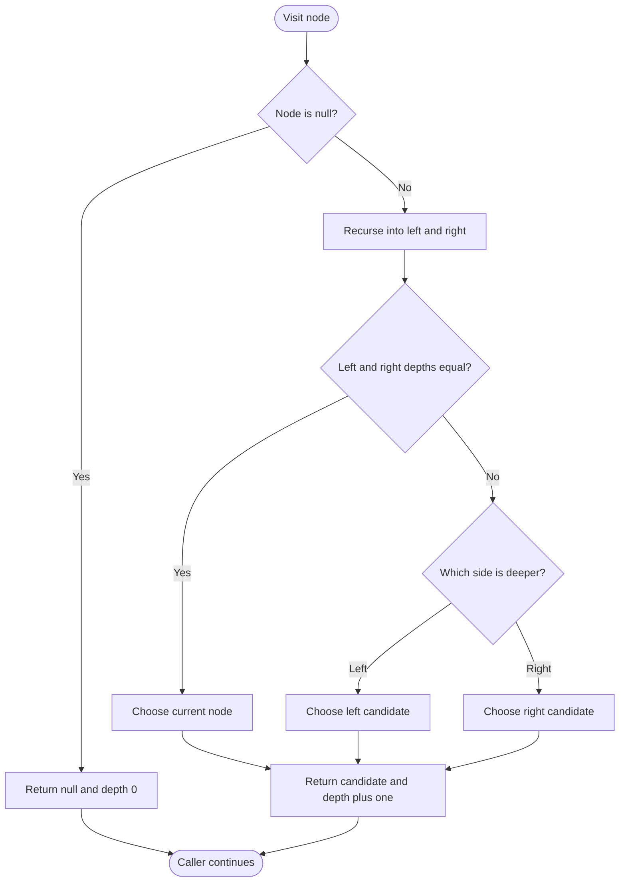

# 1123 — Lowest Common Ancestor of Deepest Leaves

## 1. Understanding

> **मराठी:** प्रश्नात काय दिले आहे आणि नेमके काय शोधायचे आहे, हे आधी स्पष्ट करा.
> Find the deepest leaf depth, then return the lowest node that is an ancestor of every leaf at that depth. If one deepest leaf exists, it is its own answer.

## 2. Worked examples and edge cases

> **मराठी:** प्रश्नात काय दिले आहे आणि नेमके काय शोधायचे आहे, हे आधी स्पष्ट करा.
> For `[3,5,1,6,2,0,8,null,null,7,4]`, deepest leaves `7` and `4` share ancestor `2`, so return `2`. A one-node tree returns its root; the helper returns null for an empty subtree.

## 3. Pattern identification + cheat sheet

> **मराठी:** या clues मुळे योग्य pattern ओळखता येतो; constraints आणि relations नीट तपासा.
> This is a **postorder tree DP**: each subtree reports both a depth and a candidate answer.
> | Subtree comparison | Answer |
> |---|---|
> | Equal deepest depths | Current node |
> | Left deeper | Left candidate |
> | Right deeper | Right candidate |

## 4. Approaches

> **मराठी:** सोप्या उपायापासून सुरुवात करा आणि constraints नुसार योग्य optimization निवडा.

- Find global depth, collect deepest leaves, then find their LCA: correct but needs multiple traversals.
- Source's one-pass recursive postorder: optimal `O(n)` time.
- Repeatedly compute subtree heights at each node: correct but may take `O(n²)` on a skewed tree.

## 5. Mermaid flowchart and explanation

> **मराठी:** Flowchart मधील decision, loop आणि termination condition क्रमाने समजून घ्या.
> Each recursive result carries the deepest candidate upward; equal depths meet at their LCA.

## 6. Algorithm / intuition

> **मराठी:** मुख्य observation समजल्यावर algorithm चे steps लक्षात ठेवणे सोपे होते.
> `FindLCA` returns `(candidate, height)` where height counts nodes from the current node down to the deepest leaf. If both sides tie, deepest leaves occur on both sides, so current node is their lowest common ancestor; otherwise inherit the deeper side's candidate.

## 7. Code explanation

> **मराठी:** Code मधील variable आणि condition यांचा algorithm मधील उद्देश समजून घ्या.
> The helper's `pairint` is `(TreeNode*, int)`. Null gives `(nullptr,0)`; non-null returns selected child candidate (or itself on tie) and `1 + deeperHeight`. `lcaDeepestLeaves` returns the candidate. The remaining helpers/main build demo trees; LeetCode supplies `TreeNode`.

## 8. Dry run

> **मराठी:** प्रत्येक महत्त्वाच्या step नंतर variable ची value trace करा.
> At node `2`, its leaf children `7` and `4` have equal height:
> | Node | Left height | Right height | Candidate returned |
> |---|---:|---:|---|
> | `7` leaf | 0 | 0 | `7`, height 1 |
> | `4` leaf | 0 | 0 | `4`, height 1 |
> | `2` | 1 | 1 | `2`, height 2 |

## 9. Complexity

> **मराठी:** Input size आणि प्रत्येक operation कितीदा चालतो यावरून complexity ठरवा.
> Every node is visited once: `O(n)` time. Recursion stack is `O(h)` (`O(n)` worst case), excluding the input tree.

## 10. Correctness

> **मराठी:** Invariant किंवा तर्क वापरून algorithm योग्य उत्तर देतो हे समजून घ्या.
> Induct on subtree height. A leaf correctly returns itself as the deepest leaf and height one. For an internal node, if child heights tie, deepest leaves exist in both child subtrees and their lowest shared ancestor is this node. If unequal, all deepest leaves are in the deeper subtree, whose recursively correct candidate is also the answer for this subtree.

## 11. Mistakes / interview traps

> **मराठी:** Boundary, duplicate आणि off-by-one cases स्वतंत्रपणे तपासा.

- Compare subtree depths, not node values or leaf counts.
- Height here counts nodes; null height is zero.
- In the tie case return the current node, not either child.
- Do not use the demo's `NULL`/tree builder in judge code.

## 12. Quick revision

Postorder returns `(deepest-LCA, height)`; tie → current node, otherwise deeper child's answer. एका passमध्ये दोन्ही माहिती मिळते.

## 13. Related problems / variations

> **मराठी:** प्रश्नात काय दिले आहे आणि नेमके काय शोधायचे आहे, हे आधी स्पष्ट करा.
> Diameter of Binary Tree, Subtree with Maximum Average, Maximum Depth of Binary Tree; variation: return depth and any aggregate from each child.

## 14. Self-assessment

> **मराठी:** उत्तर न पाहता प्रश्न सोडवा आणि तुमच्या निवडीचे कारण सांगा.

1. Why does a depth tie make the current node the LCA?
2. What should the null helper return?
3. What is the recursion-stack complexity for a skewed tree?
4. How would you also return the deepest depth from the root?
