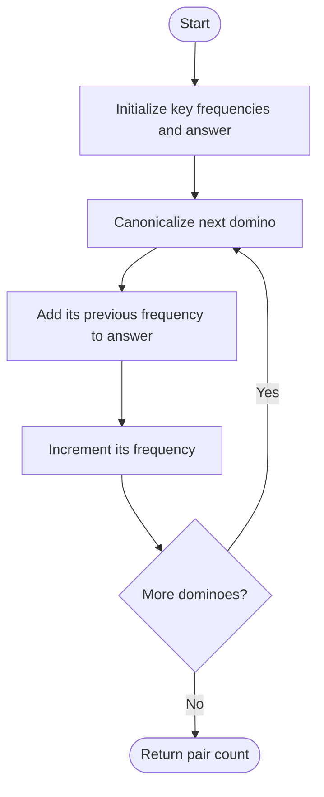

# 1128 — Number of Equivalent Domino Pairs

## 1. Understanding

> **मराठी:** प्रश्नात काय दिले आहे आणि नेमके काय शोधायचे आहे, हे आधी स्पष्ट करा.
> Count unordered pairs of dominoes equal after flipping either one: `[a,b]` equals `[b,a]`. Each pair must be counted once.

## 2. Worked examples and edge cases

> **मराठी:** प्रश्नात काय दिले आहे आणि नेमके काय शोधायचे आहे, हे आधी स्पष्ट करा.
> `[[1,2],[2,1],[1,2]]` has three pairs. A group of `k` equivalent dominoes contributes `k(k-1)/2`; identical sides such as `[2,2]` need no special case.

## 3. Pattern identification + cheat sheet

> **मराठी:** या clues मुळे योग्य pattern ओळखता येतो; constraints आणि relations नीट तपासा.
> Canonicalize each item, then count prior occurrences with a hash map.
> | Situation | Technique |
> |---|---|
> | Order-insensitive pair | Sort/canonicalize endpoints |
> | Count all matching pairs | Add previous frequency |
> | Fixed small key domain | Array counter can replace map |

## 4. Approaches

> **मराठी:** सोप्या उपायापासून सुरुवात करा आणि constraints नुसार योग्य optimization निवडा.

- Compare every two dominoes: correct, `O(n²)`.
- Sort each domino and count equivalent pairs: correct, `O(n log n)` if sorting all.
- Source packs ordered ends into an integer key and accumulates prior counts: expected `O(n)`.

## 5. Mermaid flowchart and explanation

> **मराठी:** Flowchart मधील decision, loop आणि termination condition क्रमाने समजून घ्या.
> The frequency is read before incrementing, so it counts only earlier partners.

## 6. Algorithm / intuition

For `[a,b]`, form `(min(a,b), max(a,b))`; source encodes it as `min*10+max` (valid for the problem's 1–9 labels). If `f` identical canonical dominoes appeared earlier, current one forms `f` new pairs. त्यामुळे combination formula incremental होते.

## 7. Code explanation

> **मराठी:** Code मधील variable आणि condition यांचा algorithm मधील उद्देश समजून घ्या.
> `unordered_map<int,int> count` stores frequencies. `result += count[key]` precedes `count[key]++`. `main()` only demonstrates examples; judge expects `Solution::numEquivDominoPairs`.

## 8. Dry run

> **मराठी:** प्रत्येक महत्त्वाच्या step नंतर variable ची value trace करा.
> Input `[[1,2],[2,1],[1,2]]`:
> | Domino | Key | Prior count | Added pairs | New count |
> |---|---:|---:|---:|---:|
> | `[1,2]` | 12 | 0 | 0 | 1 |
> | `[2,1]` | 12 | 1 | 1 | 2 |
> | `[1,2]` | 12 | 2 | 2 | 3 |

## 9. Complexity

> **मराठी:** Input size आणि प्रत्येक operation कितीदा चालतो यावरून complexity ठरवा.
> Expected `O(n)` time and `O(u)` extra space for `u` distinct domino types; hash worst case can degrade. Key encoding assumes digit labels 1–9, as in the problem.

## 10. Correctness

> **मराठी:** Invariant किंवा तर्क वापरून algorithm योग्य उत्तर देतो हे समजून घ्या.
> Canonicalization maps both orientations to the same key and distinct equivalence classes to distinct keys under the label constraints. At each step, every earlier match forms exactly one pair with the current item; no pair is counted again later except when its later endpoint is processed.

## 11. Mistakes / interview traps

> **मराठी:** Boundary, duplicate आणि off-by-one cases स्वतंत्रपणे तपासा.

- Do not count ordered pairs or count each pair twice.
- Normalize endpoints before making the key.
- Use a collision-safe pair key if label bounds change; `min*10+max` is not universal.
- Add frequency before incrementing.

## 12. Quick revision

Normalize → add old count → increment. `k` matches total to `k(k−1)/2`. लक्षात ठेवा: unordered pair.

## 13. Related problems / variations

> **मराठी:** प्रश्नात काय दिले आहे आणि नेमके काय शोधायचे आहे, हे आधी स्पष्ट करा.
> Two Sum multiplicity, equal pairs in an array, tuple counting; variation: canonicalize unordered edges or pairs before frequency counting.

## 14. Self-assessment

> **मराठी:** उत्तर न पाहता प्रश्न सोडवा आणि तुमच्या निवडीचे कारण सांगा.

1. Why do we add the prior frequency rather than one?
2. How many pairs does a group of five contribute?
3. When can the packed integer key collide?
4. Why is the pair unordered?
