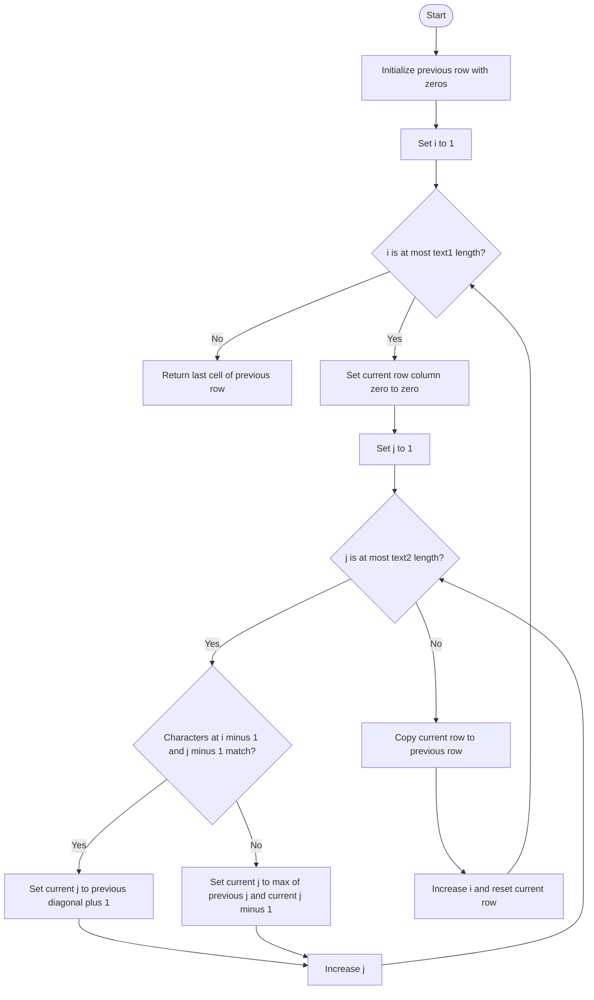

# 1143. Longest Common Subsequence

## 1. Problem Understanding

दोन strings `text1` आणि `text2` दिले आहेत. दोन्ही strings मध्ये **त्याच relative order मध्ये** दिसणाऱ्या characters ची सर्वात मोठी sequence length शोधायची. Sequence काढताना characters मधे असलेले इतर characters skip करू शकतो; पण उरलेला order बदलू शकत नाही. सलग असणे गरजेचे नाही.
फक्त length return करायची आहे. Common subsequence नसेल तर उत्तर `0`.
**Constraints:** दोन्ही strings मध्ये lowercase English letters असतात आणि प्रत्येकाची length जास्तीत जास्त `1000`; त्यामुळे `O(mn)` DP व्यवहार्य आहे.

## 2. Example Understanding

### Example 1

```text
text1 = "abcde", text2 = "ace"
Output: 3
```

`"ace"` दोन्ही strings मध्ये ह्याच order ने मिळतो: `a`, `c`, `e`. `text1` मधील `b`, `d` skip होतात; म्हणून length `3`.

### Example 2

```text
text1 = "abc", text2 = "abc"
Output: 3
```

पूर्ण string समान आहे, म्हणून सर्व 3 characters common subsequence आहेत.

### Example 3

```text
text1 = "abc", text2 = "def"
Output: 0
```

एकही common character नाही.
**Subsequence vs substring:** `"ace"` हा `"abcde"` चा subsequence आहे, पण substring नाही—कारण characters सलग नाहीत.

## 3. Problem Identification

“Longest”, “two sequences/strings”, आणि “relative order राखून characters delete/skip करता येतात” हे **LCS dynamic programming** चे clues आहेत. प्रत्येक position pair साठी suffixes/prefixes मधला best answer विचारता येतो.
स्वतःला विचारा:

1. दोन्ही current characters समान असतील तर त्यांना एकत्र match करता येईल का? हो.
2. वेगळे असतील तर कोणत्या बाजूचा character skip करून best मिळेल हे कसे ठरवू? दोन्ही पर्याय compare करा.
3. एक string संपल्यावर आणखी common characters मिळू शकतात का? नाही; base answer `0`.
4. हेच `(i,j)` states पुन्हा येतात का? हो; memoization/DP वापरा.

### Pattern Recognition Cheat Sheet

| Clue in Question                             | Possible Pattern               | Why?                                              |
| -------------------------------------------- | ------------------------------ | ------------------------------------------------- |
| Longest common ordered sequence              | LCS DP                         | दोन sequences मधील matching order राखायचा         |
| Characters skip करू शकतो, पण reorder नाही    | Subsequences                   | Contiguous नसले तरी relative order fixed          |
| दोन strings मधील pair of indices             | 2D DP                          | State दोन्ही strings मधील positions वर अवलंबून    |
| Same character at both ends of current state | Diagonal transition            | Match केल्यावर दोन्ही indices पुढे जातात          |
| Different characters                         | Skip one side and take maximum | एक बाजूचा character optimal answer मध्ये नसू शकतो |

Edit Distance आणि Shortest Common Supersequence हेही दोन stringsवरील related DP patterns आहेत.

## 4. Different Approaches

### A. Plain recursion — brute force

Current characters समान असतील तर `1 + solve(i+1,j+1)`. वेगळे असतील तर text1 मधला character skip करा किंवा text2 मधला; दोन्ही answers मधील maximum घ्या.

- Time: worst-case exponential, `O(2^(m+n))` हा loose upper bound.
- Space: `O(m+n)` recursion stack.
- Pros: recurrence आणि decisions समजायला सोपे.
- Cons: समान states पुन्हा पुन्हा सोडवले जातात; मोठ्या strings साठी slow.
- Use: recurrence derive करायला किंवा अतिशय लहान strings साठी.

### B. Memoization — top-down DP

प्रत्येक `(i,j)` result cache करा. प्रत्येक pair जास्तीत जास्त एकदा compute होतो.

- Time: `O(mn)`.
- Space: `O(mn)` cache + `O(m+n)` recursion stack.
- Pros: recursive formulation तशीच ठेवून repeated work काढते.
- Cons: recursion आणि table दोन्ही लागतात.

### C. Tabulation — bottom-up DP

`dp[i][j]` = `text1` चे पहिले `i` आणि `text2` चे पहिले `j` characters यांचा LCS length. Empty prefix साठी row/column zero. Characters समान असतील तर diagonal + 1; नाहीतर वर/डावीकडील maximum.

- Time: `O(mn)`, space: `O(mn)`.
- Pros: iterative, base cases आणि transitions स्पष्ट.
- Cons: पूर्ण table ठेवतो.

### D. Space-optimized DP

प्रत्येक row फक्त मागील row आणि current row च्या डाव्या cell वर अवलंबून असते. त्यामुळे code `prev` आणि `curr` असे दोन arrays ठेवतो.

- Time: `O(mn)`, space: `O(n)` जिथे `n = text2.size()` (दिलेला code strings swap करून कमी dimension निवडत नाही).
- Pros: table पेक्षा कमी memory.
- Cons: फक्त length मिळते; पूर्ण table नसल्याने subsequence reconstruct करणे कठीण.
- Recommended: length-only answer साठी `longestCommonSubsequenceOptimized`.
  | Approach | Time | Space | Pros | Cons |
  |---|---:|---:|---|---|
  | Recursion | Exponential | `O(m+n)` stack | Recurrence सोपी | Repeated work |
  | Memoization | `O(mn)` | `O(mn)` + stack | Natural top-down DP | Recursion overhead |
  | Tabulation | `O(mn)` | `O(mn)` | सर्व states inspect करता येतात | Full matrix memory |
  | Two-row DP | `O(mn)` | `O(n)` | Memory efficient | Length व्यतिरिक्त reconstruction साठी पुरेसे नाही |
  Brute force logic बरोबर पण inefficient. **फक्त matching characters greedily घेणे चुकीचे ठरू शकते**, कारण कोणती match सर्वोत्तम subsequence देते हे पुढील characters वर अवलंबून असते.

## 5. Flowchart



प्रत्येक cell मध्ये दोन prefix चा LCS ठेवतो. Match झाला तर diagonal answer वाढतो; mismatch झाला तर एका prefix मधील शेवटचा character वगळून मोठा answer घेतो.

## 6. Algorithm / Intuition

**Key observation:** दोन्ही current characters समान असतील तर त्या match ला LCS मध्ये घेता येते. वेगळे असतील तर optimal subsequence मध्ये किमान एका बाजूचा current character नसतो.

1. `prev[j]` ला मागील `text1` prefix row चा result माना.
2. नवीन `text1[i-1]` साठी `curr[0]=0`.
3. प्रत्येक `text2[j-1]` शी तुलना करा.
4. Match: `curr[j] = prev[j-1] + 1`.
5. Mismatch: `curr[j] = max(prev[j], curr[j-1])`.
6. Row पूर्ण झाल्यावर `prev = curr`; शेवटी `prev[n]` return करा.

## 7. Code Explanation

`dfs` आणि `memoDFS` दोन्ही strings मधील current indices वापरतात. `longestCommonSubsequenceMemo` ची table `m × n` आहे; base case table lookup च्या आधी येतो, त्यामुळे रिकाम्या string साठीही helper सुरक्षितपणे `0` देतो.
`longestCommonSubsequenceDP` prefix lengths वापरते, त्यामुळे table `m+1 × n+1`; `i-1`, `j-1` ने actual characters मिळतात. `longestCommonSubsequenceOptimized` हाच transition ठेवतो, पण फक्त दोन rows. प्रत्येक row नंतर `curr` zeros ने भरला जातो.
**Submission note:** LeetCode ला `longestCommonSubsequence` नावाचा method लागतो; या file मध्ये comparison methods आणि local `main` आहेत. Judge साठी योग्य method signature expose/rename करावा. दिलेल्या transitions मध्ये logical bug दिसत नाही.

## 8. Dry Run

`text1 = "abcde"`, `text2 = "ace"`. Rows म्हणजे `text1` prefix; columns म्हणजे `text2` prefix. प्रत्येक cell हा त्या दोन prefixes चा LCS length.
| Prefix of `text1` \ Prefix of `text2` | `""` | `a` | `ac` | `ace` |
|---|---:|---:|---:|---:|
| `""` | 0 | 0 | 0 | 0 |
| `a` | 0 | 1 | 1 | 1 |
| `ab` | 0 | 1 | 1 | 1 |
| `abc` | 0 | 1 | 2 | 2 |
| `abcd` | 0 | 1 | 2 | 2 |
| `abcde` | 0 | 1 | 2 | 3 |
| Step | Variables | Condition | Action | Result |
|---:|---|---|---|---|
| 1 | `i=1,j=1`, `a`,`a` | Match | Diagonal `0+1` | `dp[1][1]=1` |
| 2 | `i=2,j=2`, `b`,`c` | Mismatch | max(top `1`, left `1`) | `dp[2][2]=1` |
| 3 | `i=3,j=2`, `c`,`c` | Match | Diagonal `dp[2][1]+1` | `dp[3][2]=2` |
| 4 | `i=5,j=3`, `e`,`e` | Match | Diagonal `dp[4][2]+1` | `dp[5][3]=3` |
Final answer `3`, subsequence `"ace"`.

## 9. Complexity Analysis

`m` आणि `n` lengths असल्यास प्रत्येक `(i,j)` pair एकदा compute होतो: **`O(mn)` time**. Full table / memoization: **`O(mn)` space** (memoization मध्ये recursion stack `O(m+n)` अतिरिक्त). दिलेल्या two-row version मध्ये दोन `n+1` arrays: **`O(n)` space**.
LeetCode constraints साठी quadratic table time स्वीकारार्ह आहे; length-only result साठी optimized version memory कमी करतो. LCS string स्वतः reconstruct करायचा असल्यास predecessor information/table लागेल.

## 10. Why This Solution Works

`dp[i][j]` invariant म्हणजे दोन prefixes चा LCS length. Character समान असेल तर दोन्ही sequences मधून ते character match करून diagonal prefix च्या optimal solution ला जोडता येते. वेगळे असतील तर optimal solution मध्ये `text1[i-1]` नसतो किंवा `text2[j-1]` नसतो; म्हणून वर/डावीकडील दोन्ही possibilities मधील maximum घेतल्याने optimum चुकत नाही. Empty prefix चा LCS `0` असल्याने base cases बरोबर आहेत. Dependencies आधीच्या row/left cell मधून येतात, म्हणून table क्रमाने भरतो आणि algorithm terminate होतो.

## 11. Common Mistakes & Interview Traps

- **Subsequence** ला substring समजणे; subsequence मध्ये gaps चालतात.
- Mismatch वर `min` वापरणे; आपल्याला longest हवा आहे म्हणून max.
- Match वर diagonal ऐवजी top/left वापरणे.
- `i`/`j` prefix lengths असताना character access मध्ये `i-1`/`j-1` विसरणे.
- Space optimization करताना `curr` row च्या आधीच्या cell वर dependency आहे हे विसरणे.
- Strict order राखला पाहिजे; characters sort/rearrange करू नका.
- Follow-up: actual LCS परत करायचा असेल तर table वरून मागे traceback करा; दोन-row-only state पुरेसा नसतो.

## 12. Revision Notes (Quick Recall)

- **Pattern:** Two-string 2D DP — LCS.
- **Clues:** longest common ordered subsequence; gaps allowed, reorder नाही.
- **Intuition:** match → diagonal + 1; mismatch → skip one side, max.
- **Transition:** `match ? prev[j-1]+1 : max(prev[j], curr[j-1])`.
- **Complexity:** `O(mn)` time; full table `O(mn)`, two rows `O(n)`.
- **Mistakes:** substring समजणे, mismatch वर min, index offset.
- **Takeaway:** दोन sequences मध्ये order-preserving common structure शोधताना pair-of-indices DP विचारात घ्या.

## 13. Similar Problem Recognition

Edit Distance मध्ये mismatch वर insert/delete/replace पैकी minimum cost घेतो; LCS मध्ये skip पर्यायांपैकी maximum length घेतो. Shortest Common Supersequence length `m+n-LCS` आहे. Actual LCS पाहिजे असल्यास full table/backtracking; एकच length हवी असल्यास two-row DP पुरेसे. Similar state design stringsची dimensions व operation semantics नुसार बदला.

## 14. Final Self-Assessment

1. Subsequence आणि substring यातला मुख्य फरक काय?
2. Characters वेगळे असताना दोन transitions पैकी maximum का घेतो?
3. `dp[i][j]` ची prefix-based definition काय आहे?
4. Two-row optimization मध्ये `curr[j-1]` का आवश्यक आहे?
5. LCS length मिळाल्यावर actual sequence परत मिळवण्यासाठी आणखी काय लागेल?
