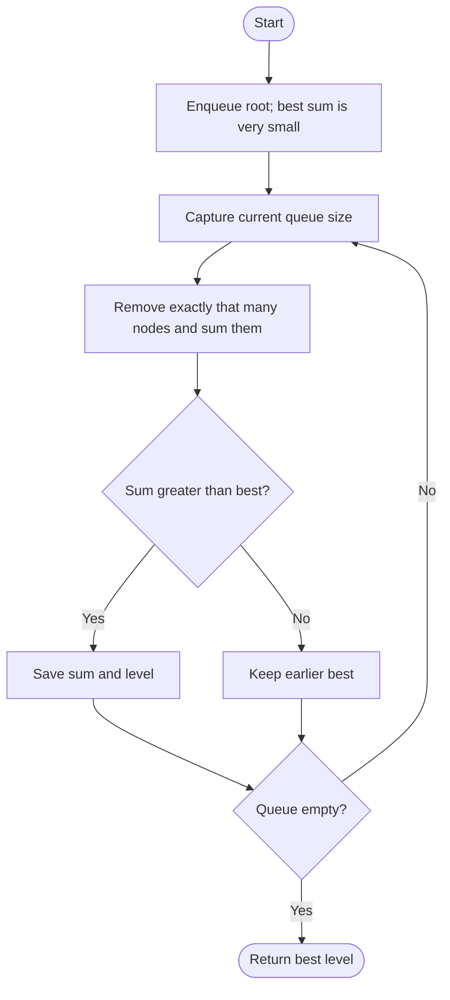

# 1161 — Maximum Level Sum of a Binary Tree

## 1. Understanding

या प्रश्नाचा गाभा म्हणजे पातळीच्या बेरजेची तुलना.

> **मराठी:** प्रश्नात काय दिले आहे आणि नेमके काय शोधायचे आहे, हे आधी स्पष्ट करा.
> Return the 1-based level with the largest sum of node values. If sums tie, choose the smallest level.

## 2. Worked examples and edge cases

उदाहरणे आणि सीमाप्रकरणांत पातळीच्या बेरजेची तुलना कशी लागू होते ते पाहा.

> **मराठी:** उदाहरणातील input पासून output पर्यंत प्रत्येक बदल समजून घ्या.
> For root `1`, children `7,0`, and grandchildren `7,-8`, sums are `1, 7, -1`; answer is level `2`. Negative values are allowed; a one-node tree returns `1`.

## 3. Pattern identification + cheat sheet

येथे मुख्य pattern म्हणजे BFS ने प्रत्येक पातळीची बेरीज मोजणे; वरील तुलना लक्षात घ्या.

> **मराठी:** या clues मुळे योग्य pattern ओळखता येतो; constraints आणि relations नीट तपासा.
> This is **level-order tree traversal** or DFS with a level-indexed accumulator.
> | Need | Pattern |
> |---|---|
> | Aggregate one level at a time | BFS queue |
> | Aggregate by depth | DFS + sums array |
> | Earliest tie | Update only on strict `>` |

## 4. Approaches

पद्धतींची तुलना करताना BFS ने प्रत्येक पातळीची बेरीज मोजणे याचा वेळ आणि जागेवरील परिणाम पाहा.

> **मराठी:** सोप्या उपायापासून सुरुवात करा आणि constraints नुसार योग्य optimization निवडा.

- Source includes DFS and BFS; both are correct `O(n)`.
- BFS naturally processes levels and uses `O(w)` queue space.
- Recompute each level's sum separately: correct but can repeat visits and be `O(nh)`.

## 5. Mermaid flowchart and explanation

आकृतीमध्ये BFS ने प्रत्येक पातळीची बेरीज मोजणे ही प्रक्रिया क्रमाने दाखवली आहे.

> **मराठी:** Flowchart मध्ये प्रत्येक decision, loop आणि loop कधी थांबतो ते पाहा.
> The BFS loop captures queue size before processing so newly enqueued nodes belong to the next level.

## 6. Algorithm / intuition

मूळ कल्पना: BFS ने प्रत्येक पातळीची बेरीज मोजणे.

> **मराठी:** मुख्य observation समजल्यावर algorithm चे steps लक्षात ठेवणे सोपे होते.
> For each depth, sum all nodes and compare with the best seen so far. Since levels are visited in ascending order, strict comparison preserves the first level on ties. The DFS version stores sums by depth then scans them.

## 7. Code explanation

Code मधील state आणि updates हे BFS ने प्रत्येक पातळीची बेरीज मोजणे या कल्पनेशी जोडून वाचा.

> **मराठी:** Code मधील variable आणि condition यांचा algorithm मधील उद्देश समजून घ्या.
> `maxLevelSumBFS` tracks `level`, `bestLevel`, and `maxSum`; `sz=q.size()` isolates one level. `maxLevelSumDFS` calls `dfs(root,0,sums)`. Both methods are in the source; local tree builders and `main()` are demos only.

## 8. Dry run

Dry run मध्ये BFS ने प्रत्येक पातळीची बेरीज मोजणे कसे घडते ते प्रत्येक टप्प्यावर तपासा.

> **मराठी:** प्रत्येक महत्त्वाच्या step नंतर variable ची value trace करा.
> For level sums `[1,7,-1]`:
> | Level | Sum | Best level after comparison |
> |---:|---:|---:|
> | 1 | 1 | 1 |
> | 2 | 7 | 2 |
> | 3 | -1 | 2 |

## 9. Complexity

BFS ने प्रत्येक पातळीची बेरीज मोजणे यासाठी लागणारा वेळ आणि अतिरिक्त जागा वरील bounds मध्ये दिली आहेत.

> **मराठी:** Input size आणि प्रत्येक operation कितीदा चालतो यावरून complexity ठरवा.
> Both approaches take `O(n)` time. BFS uses `O(w)` queue space (`w` maximum width); DFS uses `O(h)` call stack plus `O(h)` level sums.

## 10. Correctness

योग्यतेचा युक्तिवाद BFS ने प्रत्येक पातळीची बेरीज मोजणे यावर आधारित आहे; वरील अटी तपासा.

> **मराठी:** Invariant किंवा तर्क वापरून algorithm योग्य उत्तर देतो हे समजून घ्या.
> BFS processes every node exactly once and groups nodes by depth using the captured queue size, so each computed sum is exact. Comparing all sums finds the maximum; strict `>` keeps the smallest level in a tie. DFS's level-indexed sum has the same grouping property.

## 11. Mistakes / interview traps

लक्षात ठेवा: समान बेरीज असल्यास आधीची पातळी ठेवायची.

> **मराठी:** Boundary, duplicate आणि off-by-one cases स्वतंत्रपणे तपासा.

- Return a 1-based level, not the vector's zero-based index.
- Initialize max sum below all possible sums (`INT_MIN`), since values may be negative.
- Capture queue size before adding children.
- Strict `>` is intentional for tie behavior.

## 12. Quick revision

थोडक्यात, BFS ने प्रत्येक पातळीची बेरीज मोजणे. समान बेरीज असल्यास आधीची पातळी ठेवायची.

> **मराठी:** दोन मिनिटांच्या revision साठी pattern, मुख्य कल्पना आणि complexity आठवा.
> BFS by fixed queue-size batches → sum → update only if greater. Negative nodes matter; tie means earlier level.

## 13. Related problems / variations

संबंधित प्रश्नांत पातळीच्या बेरजेची तुलना यासारखी अट बदलल्यास योग्य पद्धतही तपासा.

> **मराठी:** Related problem मध्ये constraints बदलल्यास approach कसा बदलेल ते विचारा.
> Binary Tree Level Order Traversal, Average of Levels in Binary Tree, Deepest Leaves Sum; variation: track min, average, or node count per level.

## 14. Self-assessment

वरील प्रश्न स्वतः सोडवून पातळीच्या बेरजेची तुलना याची उजळणी करा.

> **मराठी:** उत्तर न पाहता प्रश्न सोडवा आणि तुमच्या निवडीचे कारण सांगा.

1. Why capture queue size before the inner loop?
2. What tie rule does strict `>` implement?
3. Why is `INT_MIN` safer than starting max sum at zero?
4. Compare BFS queue and DFS stack space.
