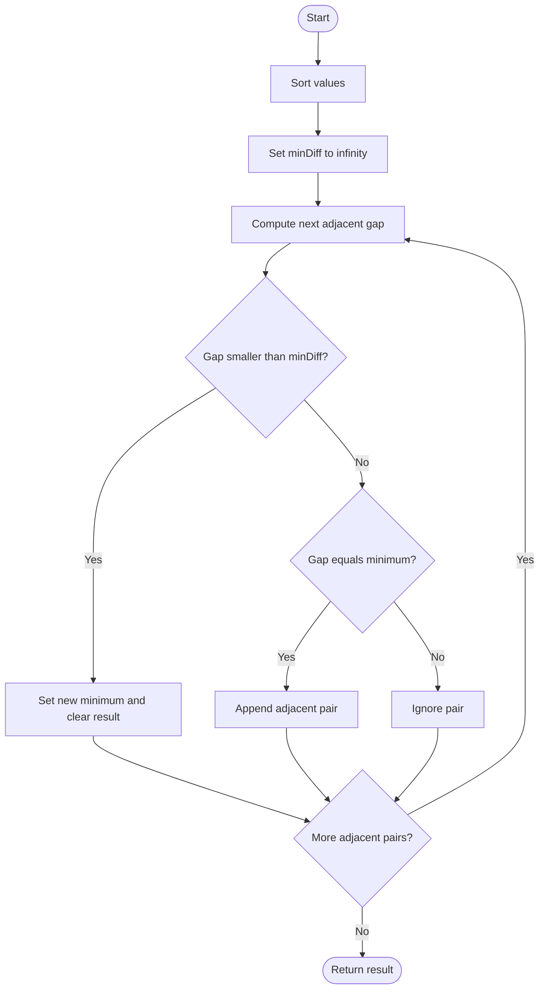

# 1200 — Minimum Absolute Difference

## 1. Understanding

> **मराठी:** प्रश्नात काय दिले आहे आणि नेमके काय शोधायचे आहे, हे आधी स्पष्ट करा.
> Return every pair with the smallest absolute difference, with values in ascending order and result pairs lexicographically ordered.

## 2. Worked examples and edge cases

> **मराठी:** प्रश्नात काय दिले आहे आणि नेमके काय शोधायचे आहे, हे आधी स्पष्ट करा.
> `[4,2,1,3]` sorts to `[1,2,3,4]`; all adjacent gaps are `1`, so return `[[1,2],[2,3],[3,4]]`. Duplicates yield gap `0` and must all be included.

## 3. Pattern identification + cheat sheet

> **मराठी:** या clues मुळे योग्य pattern ओळखता येतो; constraints आणि relations नीट तपासा.
> Sorting makes nearest values adjacent; scan adjacent gaps.
> | Goal | Technique |
> |---|---|
> | Minimum pair difference | Sort then adjacent scan |
> | Keep all ties | Clear on a new minimum; append on equal |
> | Sorted output | Scan sorted input order |

## 4. Approaches

> **मराठी:** सोप्या उपायापासून सुरुवात करा आणि constraints नुसार योग्य optimization निवडा.

- Compare every pair: correct `O(n²)` then sort output if needed.
- Source map-based method: sort, store every adjacent pair by gap, then return the minimum-gap bucket; correct but extra storage.
- Source optimized method: sort and maintain only the current minimum and its pairs; preferred.

## 5. Mermaid flowchart and explanation

> **मराठी:** Flowchart मधील decision, loop आणि termination condition क्रमाने समजून घ्या.
> When a smaller gap appears, previous pairs cannot be answers and are discarded.

## 6. Algorithm / intuition

> **मराठी:** मुख्य observation समजल्यावर algorithm चे steps लक्षात ठेवणे सोपे होते.
> After sorting, any closest pair must be adjacent; a value between a non-adjacent pair can only reduce or tie the distance. Scan once, resetting the result when a strictly smaller gap appears and appending ties.

## 7. Code explanation

> **मराठी:** Code मधील variable आणि condition यांचा algorithm मधील उद्देश समजून घ्या.
> `minimumAbsDifference_Optimized` uses `minDiff`, `result.clear()`, and adjacent pair insertion. `minimumAbsDifference_Map` stores pairs by gap. Both take the vector by value, so sorting does not alter the caller's vector.

## 8. Dry run

> **मराठी:** प्रत्येक महत्त्वाच्या step नंतर variable ची value trace करा.
> Sorted input `[1,2,4,6]`:
> | Pair | Gap | Action |
> |---|---:|---|
> | `(1,2)` | 1 | New minimum; save |
> | `(2,4)` | 2 | Ignore |
> | `(4,6)` | 2 | Ignore |

## 9. Complexity

> **मराठी:** Input size आणि प्रत्येक operation कितीदा चालतो यावरून complexity ठरवा.
> Sorting is `O(n log n)`; scan is `O(n)`. Optimized extra storage is `O(k)` for `k` returned pairs (plus sorting implementation); map version stores all adjacent pairs, `O(n)`.

## 10. Correctness

> **मराठी:** Invariant किंवा तर्क वापरून algorithm योग्य उत्तर देतो हे समजून घ्या.
> In sorted order, for any indices `i<j` with `j>i+1`, the gap `a[j]-a[i]` is at least one adjacent gap inside that interval. Therefore a global minimum occurs among adjacent pairs. The scan records exactly all pairs attaining the smallest such gap.

## 11. Mistakes / interview traps

> **मराठी:** Boundary, duplicate आणि off-by-one cases स्वतंत्रपणे तपासा.

- Do not compare only original neighbors before sorting.
- Keep every tie; do not overwrite equal minima.
- Clear old answers only when the minimum gets strictly smaller.
- Duplicate values correctly give zero.

## 12. Quick revision

Sort → scan `a[i]-a[i-1]` → reset on `<`, append on `==`. सगळी ties जपायची.

## 13. Related problems / variations

> **मराठी:** प्रश्नात काय दिले आहे आणि नेमके काय शोधायचे आहे, हे आधी स्पष्ट करा.
> 3Sum Closest, Minimum Difference Between Largest and Smallest Value in Three Moves, closest pair; variation: return one pair or count all minimum-gap pairs.

## 14. Self-assessment

> **मराठी:** उत्तर न पाहता प्रश्न सोडवा आणि तुमच्या निवडीचे कारण सांगा.

1. Why is a closest pair adjacent after sorting?
2. What happens when a new smaller gap is found?
3. Why are duplicate values important?
4. What extra work does the map approach do?
