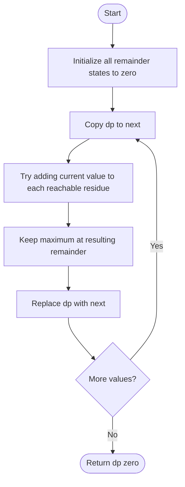

# 1262 — Greatest Sum Divisible by Three

## 1. Understanding

या प्रश्नाचा गाभा म्हणजे तीनने भाग जाणारी कमाल बेरीज.

> **मराठी:** प्रश्नात काय दिले आहे आणि नेमके काय शोधायचे आहे, हे आधी स्पष्ट करा.
> Choose a subset with the greatest sum divisible by three; choosing nothing gives sum `0`. The source uses a compact three-state DP.

## 2. Worked examples and edge cases

उदाहरणे आणि सीमाप्रकरणांत तीनने भाग जाणारी कमाल बेरीज कशी लागू होते ते पाहा.

> **मराठी:** उदाहरणातील input पासून output पर्यंत प्रत्येक बदल समजून घ्या.
> For `[3,6,5,1,8]`, the best sum is `18`. For `[2]`, answer is `0`; the source leaves `dp[0]` at zero and stores `2` in remainder two.

## 3. Pattern identification + cheat sheet

येथे मुख्य pattern म्हणजे प्रत्येक बाकीकरिता सर्वोत्तम बेरीज राखणे; वरील तुलना लक्षात घ्या.

> **मराठी:** या clues मुळे योग्य pattern ओळखता येतो; constraints आणि relations नीट तपासा.
> This is **DP by remainder**: keep the best sum for each residue modulo 3.
> | State | Meaning |
> |---|---|
> | `dp[r]` | Best reachable sum with remainder `r` |
> | Add value `x` | Move to `(r+x)%3` |
> | Unreachable state | A negative sentinel makes reachability explicit |

## 4. Approaches

पद्धतींची तुलना करताना प्रत्येक बाकीकरिता सर्वोत्तम बेरीज राखणे याचा वेळ आणि जागेवरील परिणाम पाहा.

> **मराठी:** सोप्या उपायापासून सुरुवात करा आणि constraints नुसार योग्य optimization निवडा.

- Enumerate subsets: correct but exponential `O(2^n)`.
- Remove the smallest one/two numbers needed to fix a total sum's remainder: can be optimized, but careful edge cases.
- Standard three-state DP: `O(n)` time. A clear invariant uses `dp={0,-∞,-∞}`; source initializes all three to zero, which is safe for the problem's positive values but less explicit about reachability.

## 5. Mermaid flowchart and explanation

आकृतीमध्ये प्रत्येक बाकीकरिता सर्वोत्तम बेरीज राखणे ही प्रक्रिया क्रमाने दाखवली आहे.

> **मराठी:** Flowchart मध्ये प्रत्येक decision, loop आणि loop कधी थांबतो ते पाहा.
> The source transitions from a snapshot so each value is used at most once.

## 6. Algorithm / intuition

मूळ कल्पना: प्रत्येक बाकीकरिता सर्वोत्तम बेरीज राखणे.

> **मराठी:** मुख्य observation समजल्यावर algorithm चे steps लक्षात ठेवणे सोपे होते.
> For each number, either skip it or add it to each previous best sum. Retain the maximum sum for each resulting remainder; smaller sums with the same remainder are never more useful for maximizing a later nonnegative continuation. A negative-infinity sentinel for unreachable states makes the invariant explicit; the source's zero placeholders only duplicate singleton candidates already generated from the empty subset for positive inputs.

## 7. Code explanation

Code मधील state आणि updates हे प्रत्येक बाकीकरिता सर्वोत्तम बेरीज राखणे या कल्पनेशी जोडून वाचा.

> **मराठी:** Code मधील variable आणि condition यांचा algorithm मधील उद्देश समजून घ्या.
> `maxSumDivThree` initializes `dp(3,0)`, copies to `curr`, transitions from each old sum, then returns `dp[0]`. For positive inputs, zero placeholders for unreachable residues do not raise a false divisible sum; initializing unreachable states to negative infinity states the invariant more directly. `main()` is a local demo.

## 8. Dry run

Dry run मध्ये प्रत्येक बाकीकरिता सर्वोत्तम बेरीज राखणे कसे घडते ते प्रत्येक टप्प्यावर तपासा.

> **मराठी:** प्रत्येक महत्त्वाच्या step नंतर variable ची value trace करा.
> Correct DP for `[2]`:
> | Step | `dp[0]` | `dp[1]` | `dp[2]` |
> |---|---:|---:|---:|
> | Start | 0 | 0 (unreachable placeholder) | 0 (unreachable placeholder) |
> | Use 2 or skip | 0 | 0 | 2 |

## 9. Complexity

प्रत्येक बाकीकरिता सर्वोत्तम बेरीज राखणे यासाठी लागणारा वेळ आणि अतिरिक्त जागा वरील bounds मध्ये दिली आहेत.

> **मराठी:** Input size आणि प्रत्येक operation कितीदा चालतो यावरून complexity ठरवा.
> DP: `O(n)` time and `O(1)` state space (the source creates a three-element copy per item, still constant space).

## 10. Correctness

योग्यतेचा युक्तिवाद प्रत्येक बाकीकरिता सर्वोत्तम बेरीज राखणे यावर आधारित आहे; वरील अटी तपासा.

> **मराठी:** Invariant किंवा तर्क वापरून algorithm योग्य उत्तर देतो हे समजून घ्या.
> For each reachable remainder, induction shows its state is the maximum subset sum: a subset either omits the new value or appends it to a prior subset. The source's zero placeholders represent no positive sum; with positive inputs they can only reproduce a singleton candidate that the reachable empty-sum state already produces, so they do not increase the returned divisible sum.

## 11. Mistakes / interview traps

लक्षात ठेवा: नवीन DP अवस्था बनवताना मागील अवस्थाच वापरायच्या.

> **मराठी:** Boundary, duplicate आणि off-by-one cases स्वतंत्रपणे तपासा.

- A robust general DP uses `-∞` for unreachable remainders and skips those states.
- The source's zero placeholders rely on the problem's positive values; don't copy that shortcut blindly to variants with negative values.
- Copy old DP before transitions to avoid using one number multiple times.

## 12. Quick revision

थोडक्यात, प्रत्येक बाकीकरिता सर्वोत्तम बेरीज राखणे. नवीन DP अवस्था बनवताना मागील अवस्थाच वापरायच्या.

> **मराठी:** दोन मिनिटांच्या revision साठी pattern, मुख्य कल्पना आणि complexity आठवा.
> Remainder DP, old-state snapshot, maximize. Clear initialization: `0,-∞,-∞`; source uses `{0,0,0}` safely under the given positive-value constraint.

## 13. Related problems / variations

संबंधित प्रश्नांत तीनने भाग जाणारी कमाल बेरीज यासारखी अट बदलल्यास योग्य पद्धतही तपासा.

> **मराठी:** Related problem मध्ये constraints बदलल्यास approach कसा बदलेल ते विचारा.
> Partition Equal Subset Sum, Ones and Zeroes, largest sum divisible by `k`; variation: track maximum per residue modulo arbitrary `k`.

## 14. Self-assessment

वरील प्रश्न स्वतः सोडवून तीनने भाग जाणारी कमाल बेरीज याची उजळणी करा.

> **मराठी:** उत्तर न पाहता प्रश्न सोडवा आणि तुमच्या निवडीचे कारण सांगा.

1. What does each remainder state represent?
2. Why is a negative sentinel useful for unreachable states?
3. Why use a copy of the previous DP?
4. What should the answer be for `[2]`?
