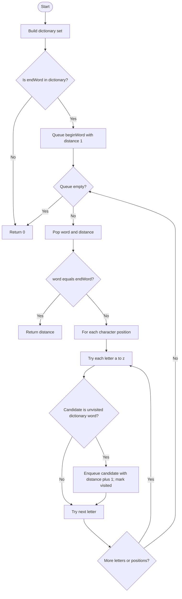

# 127. Word Ladder

## 1. Problem Understanding

We are given `beginWord`, `endWord`, and a dictionary `wordList`. एका word मधून दुसऱ्या word मध्ये जाताना **एका वेळी फक्त एक character बदलायचा**; प्रत्येक intermediate word dictionary मध्ये असला पाहिजे. `beginWord` पासून `endWord` पर्यंतच्या shortest transformation sequence मधील **words ची संख्या** return करा. असा sequence नसेल तर `0`.
Words ची length सारखी असते आणि lowercase English letters वापरले जातात. `beginWord` हा dictionary मध्ये असणे आवश्यक नाही; पण `endWord` असणे आवश्यक आहे.

## 2. Example Understanding

### Example 1

```text
beginWord = "hit", endWord = "cog"
wordList = ["hot","dot","dog","lot","log","cog"]
Output: 5
```

```text
hit -> hot -> dot -> dog -> cog
```

प्रत्येक arrow मध्ये एकच letter बदलतो. Sequence मध्ये `hit`, `hot`, `dot`, `dog`, `cog` असे 5 words आहेत; म्हणून answer `5`. `lot` मार्गानेही 5 words चा sequence शक्य आहे.

### Example 2

```text
beginWord = "hit", endWord = "cog"
wordList = ["hot","dot","dog","lot","log"]
Output: 0
```

`cog` dictionary मध्ये नाही, त्यामुळे तो legal transformation म्हणून वापरता येत नाही.

### Edge cases

- `endWord` missing असेल: लगेच `0`.
- Dictionary मधून पोहोचण्याजोगा path नसेल: search पूर्ण झाल्यावर `0`.
- `beginWord` dictionary मध्ये असेल किंवा नसेल: सुरुवात `beginWord` पासूनच होते.

## 3. Problem Identification

मुख्य clue म्हणजे **“shortest sequence / minimum number of transformations”** आणि प्रत्येक valid transformation समान cost ची आहे. Words ना graph चे nodes समजा; एका character ने वेगळे असलेले दोन words म्हणजे edge. मग हा unweighted graph मधला shortest-path problem आहे.
स्वतःला विचारा:

1. State काय आहे? सध्याचा word.
2. त्याचे neighbors कसे शोधू? प्रत्येक position वर alphabet मधील letters try करू.
3. प्रत्येक step ची cost सारखी आहे का? होय; त्यामुळे BFS shortest path देतो.
4. एकच target आहे आणि graph मोठा आहे का? असल्यास bidirectional BFS उपयोगी ठरू शकतो.

### Pattern Recognition Cheat Sheet

| Clue in Question                          | Possible Pattern  | Why?                                                                    |
| ----------------------------------------- | ----------------- | ----------------------------------------------------------------------- |
| Minimum steps / shortest sequence         | BFS               | Unweighted edges असताना BFS आधी minimum-distance level गाठतो            |
| State बदलून reachable states शोधणे        | Graph traversal   | प्रत्येक word एक node, legal one-letter change एक edge                  |
| Neighbor edges दिलेले नाहीत               | Implicit graph    | Neighbors generate करून traverse करायचे                                 |
| एक start आणि एक target, मोठा search space | Bidirectional BFS | Start व target दोन्हीकडून search केल्याने explored क्षेत्र कमी होऊ शकते |
| सर्व possible paths तपासणे                | DFS/backtracking  | शक्य, पण shortest answer साठी अनावश्यक exhaustive work होतो             |

Similar signals: minimum moves in a grid, word transformations, unweighted network distance, आणि state-transition puzzles.

## 4. Different Approaches

### A. DFS + backtracking — correct पण inefficient

प्रत्येक legal word पुढे explore करा, current path visited ठेवा आणि आतापर्यंतचा best length जतन करा. Code मधील `ladderLengthDFS` हेच करते. `visited.erase(word)` मुळे दुसऱ्या path मध्ये word पुन्हा वापरता येतो.
सर्व simple paths explore केल्यामुळे answer बरोबर मिळू शकतो; पण paths ची संख्या exponential होऊ शकते. Shortest path शोधताना हे अतिरिक्त काम आहे. मोठ्या input साठी स्वीकारार्ह नाही.

- Time: worst-case exponential in the number of reachable words.
- Space: `O(N * L)` visited/path/recursion data, plus dictionary storage.
- उपयोग: लहान graph मध्ये exhaustive search समजण्यासाठी; production solution म्हणून नाही.

### B. Standard BFS — योग्य shortest-path उपाय

Queue मध्ये `(word, distance)` ठेवा. प्रत्येक word मधून प्रत्येक position वर `a` ते `z` characters बदलून candidates तयार करा. Dictionary मध्ये असलेला आणि आधी visit न केलेला candidate queue मध्ये घाला; **queue मध्ये घालताक्षणी erase करून visited mark करा**. पहिल्यांदा `endWord` मिळाला की तो shortest असल्याने distance return करा.

- Time: `O(N * 26 * L^2)` worst case: जास्तीत जास्त `N` words, प्रत्येकासाठी `26L` candidates, आणि string hash/compare साठी `O(L)`.
- Space: `O(N * L)` dictionary आणि queue.
- उपयोग: साधा, स्पष्ट, भरोसेमंद default उपाय.
  Code मधील `ladderLengthBFS` प्रत्येक queue entry सोबत steps ठेवतो; `ladderLengthLevelBFS` पूर्ण level एकत्र process करून `steps` वेगळे ठेवतो. दोन्हींचे asymptotic complexity समान आहे.

### C. Bidirectional BFS — practical optimization

एक frontier `beginWord` पासून आणि दुसरा `endWord` पासून वाढवा. प्रत्येक round मध्ये कमी nodes असलेला frontier expand करा. दोन्ही frontiers भेटले की shortest ladder length मिळते. Code मधील `ladderLengthBidirectionalBFS` हा पर्याय वापरतो.

- Time: worst-case bound standard BFS सारखाच; branching जास्त असेल तर प्रत्यक्षात अनेकदा बरेच कमी nodes तपासतो.
- Space: `O(N * L)`.
- उपयोग: start व target दोन्ही माहीत असतील आणि graph मोठा असेल.
- सावधगिरी: दोन frontiers जोडताना distance counting अचूक ठेवावी.
  | Approach | Time | Space | Pros | Cons |
  |---|---:|---:|---|---|
  | DFS + backtracking | Exponential worst case | `O(NL)` | Exhaustive path idea समजते | Shortest path साठी खूप slow |
  | Queue BFS | `O(N * 26 * L^2)` | `O(NL)` | सोपा आणि shortestness स्पष्ट | मोठा reachable region explore होऊ शकतो |
  | Level BFS | `O(N * 26 * L^2)` | `O(NL)` | Distance levels दिसायला सोपे | BFS पेक्षा asymptotically वेगळा नाही |
  | Bidirectional BFS | Worst-case standard BFS bound | `O(NL)` | अनेकदा कमी states explore करतो | दोन दिशांचे frontiers manage करावे लागतात |
  **Logically wrong:** BFS मध्ये visited न करता एखादा word वारंवार enqueue करणे search ला अनावश्यकपणे वाढवते आणि cycle असल्यास अडचण निर्माण करते.  
  **Correct but inefficient:** DFS सर्व paths तपासतो.  
  **योग्य निवड:** shortest path साठी BFS; मोठ्या search साठी bidirectional BFS.

## 5. Flowchart



Queue मधील शब्द level-by-level बाहेर पडतात; म्हणून पहिल्यांदा target मिळालेला distance minimum असतो. Candidate enqueue करतानाच visited mark केल्याने तो पुन्हा queue मध्ये जात नाही.

## 6. Algorithm / Intuition

**Key observation:** valid transformations म्हणजे unweighted edges. त्यामुळे प्रत्येक BFS level हे start पासूनचा एक transformation अधिक दर्शवते.

1. `wordList` ला `unordered_set` मध्ये ठेवा, जेणेकरून lookup जलद होईल.
2. `endWord` नसल्यास `0` return करा.
3. Queue मध्ये `(beginWord, 1)` ठेवा; dictionary मधून सुरुवातीचा word काढून duplicate भेटणे थांबवा.
4. प्रत्येक popped word साठी प्रत्येक index वर 26 letters try करा.
5. Valid, unvisited candidate ला next distance सोबत enqueue करा आणि लगेच visited करा.
6. Target सापडल्यास distance return करा; queue रिकामी झाली तर `0`.

## 7. Code Explanation

दिलेले C++ file चार methods compare करते; actual `main` मध्ये सर्व test cases वर त्यांना चालवले आहे. `unordered_set<string> st` dictionary membership व visited tracking दोन्हीसाठी वापरला आहे. एका-letter candidate तयार करताना जुना character `original` मध्ये ठेवून loop नंतर restore केला आहे.
`steps` ची सुरुवात `1` पासून होते कारण output मध्ये सुरुवातीचा word देखील मोजला जातो. DFS method मध्ये `ans` best path ठेवतो आणि `steps >= ans` झाल्यावर निरुपयोगी शाखा prune करतो.
**Submission note:** फाइलमध्ये LeetCode चे `ladderLength` नावाचे method नाही आणि local test harness साठी `main` आहे. Online judge ला अपेक्षित method signature मध्ये हवा तो BFS method expose/rename करावा; algorithm बदलण्याची गरज नाही.

## 8. Dry Run

Input: `hit`, `cog`, `["hot","dot","dog","lot","log","cog"]`
| Step | Variables | Condition | Action | Result |
|---:|---|---|---|---|
| 1 | Queue `[(hit,1)]` | `cog` dictionary मध्ये आहे | Search सुरू | Distance 1 |
| 2 | Pop `hit` | `hit != cog` | `hot` तयार होऊन dictionary मध्ये मिळतो; enqueue | `[(hot,2)]` |
| 3 | Pop `hot` | Target नाही | `dot`, `lot` enqueue | `[(dot,3),(lot,3)]` |
| 4 | Pop `dot` | Target नाही | `dog` enqueue | `[(lot,3),(dog,4)]` |
| 5 | Pop `lot` | Target नाही | `log` enqueue | `[(dog,4),(log,4)]` |
| 6 | Pop `dog` | Target नाही | `cog` enqueue | `[(log,4),(cog,5)]` |
| 7 | Pop `cog` | Target मिळाला | `5` return | Shortest ladder length = 5 |

## 9. Complexity Analysis

`N = wordList` मधील शब्दांची संख्या आणि `L = word length`. प्रत्येक reachable word साठी `26L` candidates तयार होतात; प्रत्येक candidate चा hash string length शी proportional असल्याने BFS time `O(N * 26 * L^2)` worst case. Dictionary व queue मध्ये `O(N)` पर्यंत `L`-length strings असू शकतात, म्हणून space `O(NL)`.
LeetCode च्या मर्यादित word length / dictionary size साठी BFS योग्य आहे. Bidirectional BFS अनेकदा जलद असला तरी worst-case guarantee asymptotically वेगळी नाही.

## 10. Why This Solution Works

BFS invariant: queue मधील nodes non-decreasing distance क्रमाने process होतात. त्यामुळे `endWord` पहिल्यांदा dequeue झाल्यावर त्यापेक्षा कमी transformations असलेला कोणताही path उरलेला नसतो; कमी distance चे सर्व levels आधी process झालेले असतात. प्रत्येक legal one-letter neighbor generate होतो, म्हणून कोणताही valid path चुकत नाही. Visited set मुळे प्रत्येक word जास्तीत जास्त एकदाच enqueue होतो; finite dictionary असल्याने algorithm थांबतो.

## 11. Common Mistakes & Interview Traps

- Output मध्ये **words** मोजायचे, edges नाहीत; म्हणून सुरुवात `1`.
- `endWord` dictionary मध्ये नसताना search करू नका.
- Candidate ला enqueue केल्यानंतर नव्हे तर त्याच वेळी visited करा; उशीर केल्यास duplicates येतात.
- प्रत्येक character position नंतर मूळ character restore करा.
- `beginWord` dictionary मध्ये असणे आवश्यक आहे असे समजू नका.
- Bidirectional BFS मध्ये frontiers जोडताना level/distance मोजणी काळजीपूर्वक करा.
- Interview follow-up: shortest path ऐवजी **सर्व shortest sequences** परत करायचे असतील तर predecessors/parent relationships साठवा; फक्त पहिला path पुरणार नाही.

## 12. Revision Notes (Quick Recall)

- **Pattern:** implicit unweighted graph + BFS shortest path.
- **Clues:** minimum transformations, one-character legal move, target word.
- **Intuition:** words nodes; one-letter changes edges; BFS level = number of moves.
- **Algorithm:** set, queue `(word, distance)`, generate `26L` neighbors, mark on enqueue.
- **Complexity:** `O(N * 26 * L^2)` time, `O(NL)` space.
- **Mistakes:** missing target check, incorrect word-count start, late visited marking.
- **Takeaway:** shortest steps with equal-cost transitions? विचार आधी BFS चा करा.

## 13. Similar Problem Recognition

हीच रचना grid मध्ये minimum moves, lock combinations, mutation/state-transition puzzles मध्ये दिसते. Neighbor generation वेगळे असते; BFS invariant तोच राहतो. Weighted transitions असतील तर साधा BFS पुरेसा नाही—Dijkstra किंवा 0-1 BFS सारखी weighted shortest-path पद्धत लागते. सर्व shortest paths हवे असतील तर target distance मिळाल्यानंतर त्या distance पर्यंतचे predecessor edgesही जतन करा.

## 14. Final Self-Assessment

1. एका valid transformation ला वेगळी cost असती तर साधा BFS पुरला असता का?
2. Queue मध्ये word टाकताक्षणी visited का mark करतो?
3. BFS distance `1` पासून सुरू करण्याचे कारण काय?
4. Neighbor generate करताना सर्व `26L` candidates का तपासतो?
5. Bidirectional BFS कोणत्या परिस्थितीत practical फायदा देतो?
