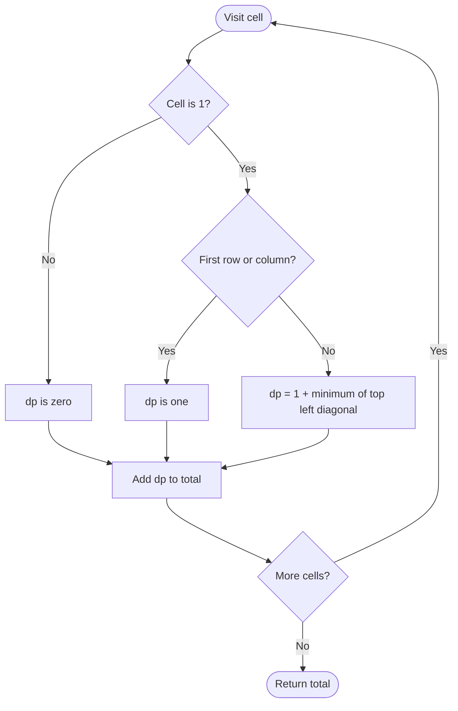

# 1277 — Count Square Submatrices with All Ones

## 1. Understanding

> **मराठी:** प्रश्नात काय दिले आहे आणि नेमके काय शोधायचे आहे, हे आधी स्पष्ट करा.
> Count every square submatrix containing only ones, across all possible sizes. A cell can represent several squares ending at that cell.

## 2. Worked examples and edge cases

> **मराठी:** प्रश्नात काय दिले आहे आणि नेमके काय शोधायचे आहे, हे आधी स्पष्ट करा.
> An all-one `2×2` matrix contains four `1×1` squares and one `2×2` square: answer `5`. A zero cell contributes no square; one-cell matrices return `0` or `1`.

## 3. Pattern identification + cheat sheet

> **मराठी:** या clues मुळे योग्य pattern ओळखता येतो; constraints आणि relations नीट तपासा.
> This is **2D dynamic programming** using the smallest neighboring square.
> | Cell | DP value |
> |---|---|
> | Matrix value is 0 | 0 |
> | First row/column and value 1 | 1 |
> | Other one cell | `1+min(top,left,diagonal)` |

## 4. Approaches

> **मराठी:** सोप्या उपायापासून सुरुवात करा आणि constraints नुसार योग्य optimization निवडा.

- Enumerate every top-left and size, check cells: correct but expensive (`O(mn·min(m,n)^2)` or worse).
- Source DP: `O(mn)` and counts all sizes at once.
- Rolling rows can reduce auxiliary DP space to `O(n)`, but source uses a full table.

## 5. Mermaid flowchart and explanation

> **मराठी:** Flowchart मधील decision, loop आणि termination condition क्रमाने समजून घ्या.
> The three neighbors certify that every smaller square needed to extend the current square exists.

## 6. Algorithm / intuition

> **मराठी:** मुख्य observation समजल्यावर algorithm चे steps लक्षात ठेवणे सोपे होते.
> `dp[i][j]` is the largest all-one square with bottom-right corner `(i,j)`. If the cell is one, its square size is limited by the smallest square ending above, left, and diagonally above-left, plus this cell.

## 7. Code explanation

> **मराठी:** Code मधील variable आणि condition यांचा algorithm मधील उद्देश समजून घ्या.
> `countSquares` traverses top-left to bottom-right, fills `dp`, and adds each `dp[i][j]` to `res`; a value `k` counts one square of each size `1..k`. Source assumes matrix is nonempty. Demo `main()` is not part of judge code.

## 8. Dry run

> **मराठी:** प्रत्येक महत्त्वाच्या step नंतर variable ची value trace करा.
> For `[[1,1],[1,1]]`:
> | Cell | Top | Left | Diagonal | `dp` |
> |---|---:|---:|---:|---:|
> | (0,0) | — | — | — | 1 |
> | (0,1) | — | 1 | — | 1 |
> | (1,0) | 1 | — | — | 1 |
> | (1,1) | 1 | 1 | 1 | 2 |
> Total `1+1+1+2=5`.

## 9. Complexity

> **मराठी:** Input size आणि प्रत्येक operation कितीदा चालतो यावरून complexity ठरवा.
> `O(mn)` time and `O(mn)` auxiliary space in this implementation.

## 10. Correctness

> **मराठी:** Invariant किंवा तर्क वापरून algorithm योग्य उत्तर देतो हे समजून घ्या.
> For each cell, all-one squares ending there must include that cell. At borders, only size one can be established. Else the largest possible extension is exactly one plus the minimum of the three prerequisite squares; summing these sizes counts each valid square once by its unique bottom-right corner and size.

## 11. Mistakes / interview traps

> **मराठी:** Boundary, duplicate आणि off-by-one cases स्वतंत्रपणे तपासा.

- The answer is the sum of DP sizes, not the number of cells equal to one.
- Use the minimum of all three neighbors.
- Do not access neighbors at the top/left boundary.
- Confirm nonempty dimensions before reading `matrix[0]` if constraints do not guarantee them.

## 12. Quick revision

Bottom-right DP: `1 + min(top,left,diag)`; add every DP value to answer. प्रत्येक cell अनेक squares मोजू शकतो.

## 13. Related problems / variations

> **मराठी:** प्रश्नात काय दिले आहे आणि नेमके काय शोधायचे आहे, हे आधी स्पष्ट करा.
> Maximal Square, Count Submatrices With All Ones, largest plus sign; variation: return only the largest square.

## 14. Self-assessment

> **मराठी:** उत्तर न पाहता प्रश्न सोडवा आणि तुमच्या निवडीचे कारण सांगा.

1. What does `dp[i][j]=3` count?
2. Why use the minimum neighbor?
3. Why does summing DP values count each square once?
4. What changes for maximum-square-only?
