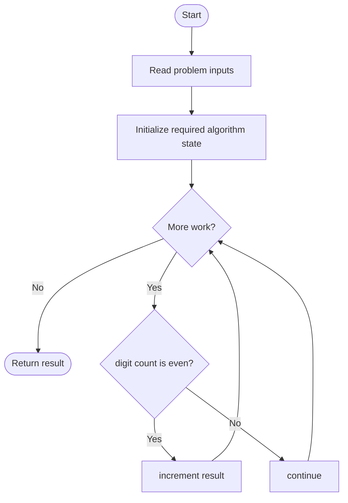
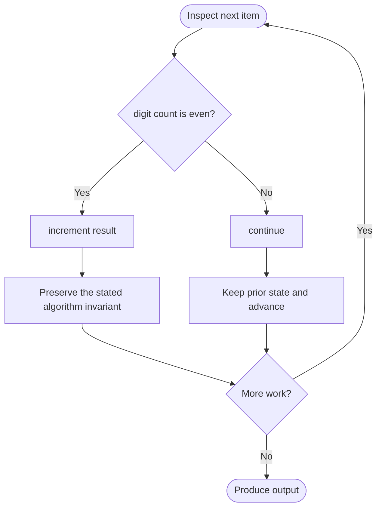

# Find Numbers with Even Number of Digits

**LeetCode ID:** 1295

**Source file(s):** `1295.cpp` (originally `findNumbers.cpp`)

**Identification evidence:** The original filename, declared signature, and distinctive behavior described below uniquely identify this problem; no number was inferred from a filename alone.

## Expected input/output or judge interface

SolutionDigitCount::findNumbers / SolutionStringCount::findNumbers. Inputs follow the problem constraints; the output is the documented scalar, sequence, or design-object behavior. The description below reflects the implementation actually present in the source.

## Main flow



## Important branch and loop flow



## Core logic and invariant

Counts elements with even decimal digit length using repeated division or string conversion.

The key branch/loop rule above is applied once per relevant item; the algorithm relies on that rule to preserve its state and produce the required result.

## Optimization / comparison

Each integer contributes exactly once iff its decimal representation has even length.

## Complexity

O(total digits) time; O(1) extra for division, O(d) temporary string for string version.

## Compile and run

The repository file includes a standalone demonstration `main()`; it is not a raw LeetCode submission unit. From the repository root, with a C++17 compiler:

```powershell
g++ -std=c++17 LeetCode\1295\1295.cpp -o solution.exe
.\solution.exe
```

For LeetCode's class-method judge, copy the relevant class/method or design-class API and omit the demo `main()` and local harness. Adapt free-function implementations to the requested `Solution` class signature where necessary. See the source caveat above for any compile blocker.
