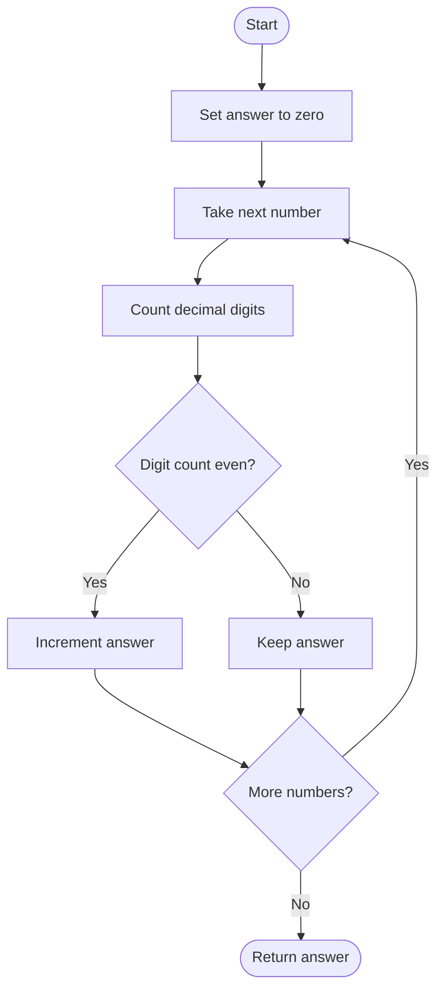

# 1295 — Find Numbers with Even Number of Digits

## 1. Understanding

या प्रश्नाचा गाभा म्हणजे सम अंकसंख्या असलेल्या संख्यांची मोजणी.

> **मराठी:** प्रश्नात काय दिले आहे आणि नेमके काय शोधायचे आहे, हे आधी स्पष्ट करा.
> Count array elements whose decimal representation has an even number of digits.

## 2. Worked examples and edge cases

उदाहरणे आणि सीमाप्रकरणांत सम अंकसंख्या असलेल्या संख्यांची मोजणी कशी लागू होते ते पाहा.

> **मराठी:** उदाहरणातील input पासून output पर्यंत प्रत्येक बदल समजून घ्या.
> `[12,345,2,6,7896]` gives `2` (`12`, `7896`). Single-digit values have odd length; powers of ten still have their ordinary decimal digit count.

## 3. Pattern identification + cheat sheet

येथे मुख्य pattern म्हणजे प्रत्येक संख्येचे अंक मोजून सम-विषम तपासणे; वरील तुलना लक्षात घ्या.

> **मराठी:** या clues मुळे योग्य pattern ओळखता येतो; constraints आणि relations नीट तपासा.
> This is a simple **per-element digit property** scan.
> | Method | When useful |
> |---|---|
> | Repeated division by 10 | Avoid temporary strings |
> | `to_string` length | Clearest for general decimal formatting |
> | Digit-length bounds | Fast if input ranges are fixed |

## 4. Approaches

पद्धतींची तुलना करताना प्रत्येक संख्येचे अंक मोजून सम-विषम तपासणे याचा वेळ आणि जागेवरील परिणाम पाहा.

> **मराठी:** सोप्या उपायापासून सुरुवात करा आणि constraints नुसार योग्य optimization निवडा.

- Convert each number to a string and inspect length: source implementation, `O(d)` per number.
- Repeatedly divide by ten and count digits: source implementation, `O(d)` per number.
- For bounded positive integers, compare against powers of ten, but less general and easy to off-by-one.

## 5. Mermaid flowchart and explanation

आकृतीमध्ये प्रत्येक संख्येचे अंक मोजून सम-विषम तपासणे ही प्रक्रिया क्रमाने दाखवली आहे.

> **मराठी:** Flowchart मध्ये प्रत्येक decision, loop आणि loop कधी थांबतो ते पाहा.
> Each number is independent; count it once if its digit count is even.

## 6. Algorithm / intuition

मूळ कल्पना: प्रत्येक संख्येचे अंक मोजून सम-विषम तपासणे.

> **मराठी:** मुख्य observation समजल्यावर algorithm चे steps लक्षात ठेवणे सोपे होते.
> For every positive input, determine its decimal digit count, test parity, and accumulate. Division removes one trailing digit each iteration; string length gives the same count directly.

## 7. Code explanation

Code मधील state आणि updates हे प्रत्येक संख्येचे अंक मोजून सम-विषम तपासणे या कल्पनेशी जोडून वाचा.

> **मराठी:** Code मधील variable आणि condition यांचा algorithm मधील उद्देश समजून घ्या.
> `SolutionDigitCount` repeatedly divides a local copy of each value by 10. `SolutionStringCount` uses `to_string(i).size()`. Both expose `findNumbers`; local tests compare them. LeetCode needs only one solution class/method.

## 8. Dry run

Dry run मध्ये प्रत्येक संख्येचे अंक मोजून सम-विषम तपासणे कसे घडते ते प्रत्येक टप्प्यावर तपासा.

> **मराठी:** प्रत्येक महत्त्वाच्या step नंतर variable ची value trace करा.
> Input `[12,345,2,7896]`:
> | Number | Digits | Even? | Count |
> |---:|---:|---|---:|
> | 12 | 2 | Yes | 1 |
> | 345 | 3 | No | 1 |
> | 2 | 1 | No | 1 |
> | 7896 | 4 | Yes | 2 |

## 9. Complexity

प्रत्येक संख्येचे अंक मोजून सम-विषम तपासणे यासाठी लागणारा वेळ आणि अतिरिक्त जागा वरील bounds मध्ये दिली आहेत.

> **मराठी:** Input size आणि प्रत्येक operation कितीदा चालतो यावरून complexity ठरवा.
> For `n` values with at most `d` digits: both are `O(nd)` time. String method allocates temporary strings; division method uses `O(1)` auxiliary space.

## 10. Correctness

योग्यतेचा युक्तिवाद प्रत्येक संख्येचे अंक मोजून सम-विषम तपासणे यावर आधारित आहे; वरील अटी तपासा.

> **मराठी:** Invariant किंवा तर्क वापरून algorithm योग्य उत्तर देतो हे समजून घ्या.
> Both methods count the exact number of base-10 digits for positive integers. Incrementing precisely when that count is even therefore counts exactly the requested elements.

## 11. Mistakes / interview traps

लक्षात ठेवा: अंकांची संख्या तपासा; संख्येची सम-विषमता नव्हे.

> **मराठी:** Boundary, duplicate आणि off-by-one cases स्वतंत्रपणे तपासा.

- The problem's inputs are positive; for zero, digit count must be treated as one.
- Do not test digit parity using the numeric value's parity.
- Mutating a local copy during division leaves the input vector unchanged.

## 12. Quick revision

थोडक्यात, प्रत्येक संख्येचे अंक मोजून सम-विषम तपासणे. अंकांची संख्या तपासा; संख्येची सम-विषमता नव्हे.

> **मराठी:** दोन मिनिटांच्या revision साठी pattern, मुख्य कल्पना आणि complexity आठवा.
> Count digits per value → even? increment. Division and string approaches give the same condition.

## 13. Related problems / variations

संबंधित प्रश्नांत सम अंकसंख्या असलेल्या संख्यांची मोजणी यासारखी अट बदलल्यास योग्य पद्धतही तपासा.

> **मराठी:** Related problem मध्ये constraints बदलल्यास approach कसा बदलेल ते विचारा.
> Find Numbers with Even Digit Sum, number of digits in an integer, count values by digit length; variation: count odd digit lengths or a chosen base.

## 14. Self-assessment

वरील प्रश्न स्वतः सोडवून सम अंकसंख्या असलेल्या संख्यांची मोजणी याची उजळणी करा.

> **मराठी:** उत्तर न पाहता प्रश्न सोडवा आणि तुमच्या निवडीचे कारण सांगा.

1. How many digits does `1000` have?
2. Why does dividing by ten count digits?
3. What should zero's digit count be?
4. Which source method uses extra temporary memory?
