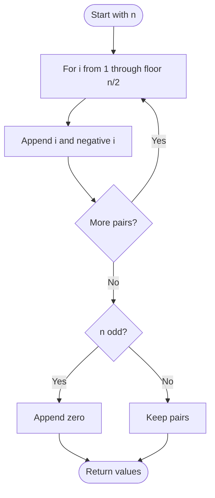

# 1304 — Find N Unique Integers Sum up to Zero

## 1. Understanding

या प्रश्नाचा गाभा म्हणजे शून्य बेरीज असलेल्या वेगवेगळ्या पूर्णांकांची रचना.

> **मराठी:** प्रश्नात काय दिले आहे आणि नेमके काय शोधायचे आहे, हे आधी स्पष्ट करा.
> Construct `n` distinct integers whose total is zero. Any valid construction is accepted.

## 2. Worked examples and edge cases

उदाहरणे आणि सीमाप्रकरणांत शून्य बेरीज असलेल्या वेगवेगळ्या पूर्णांकांची रचना कशी लागू होते ते पाहा.

> **मराठी:** उदाहरणातील input पासून output पर्यंत प्रत्येक बदल समजून घ्या.
> For `n=5`, source returns `1,-1,2,-2,0`; pairs cancel and the leftover zero keeps all five values unique. For `n=1`, answer is `[0]`.

## 3. Pattern identification + cheat sheet

येथे मुख्य pattern म्हणजे विरुद्ध चिन्हांच्या जोड्या तयार करणे; वरील तुलना लक्षात घ्या.

> **मराठी:** या clues मुळे योग्य pattern ओळखता येतो; constraints आणि relations नीट तपासा.
> Use **cancellation by symmetric pairs**.
> | `n` parity | Construction |
> |---|---|
> | Even | `±1, ±2, ...` |
> | Odd | Same pairs plus `0` |

## 4. Approaches

पद्धतींची तुलना करताना विरुद्ध चिन्हांच्या जोड्या तयार करणे याचा वेळ आणि जागेवरील परिणाम पाहा.

> **मराठी:** सोप्या उपायापासून सुरुवात करा आणि constraints नुसार योग्य optimization निवडा.

- Search/backtracking for values: unnecessary and inefficient.
- Source pairs each positive integer with its negative; for odd `n`, adds zero. `O(n)` time and output space.
- Any `n` distinct values summing to zero also works; pair symmetry is simple to prove.

## 5. Mermaid flowchart and explanation

आकृतीमध्ये विरुद्ध चिन्हांच्या जोड्या तयार करणे ही प्रक्रिया क्रमाने दाखवली आहे.

> **मराठी:** Flowchart मध्ये प्रत्येक decision, loop आणि loop कधी थांबतो ते पाहा.
> Every appended pair has sum zero; the optional center value is also zero.

## 6. Algorithm / intuition

मूळ कल्पना: विरुद्ध चिन्हांच्या जोड्या तयार करणे.

> **मराठी:** मुख्य observation समजल्यावर algorithm चे steps लक्षात ठेवणे सोपे होते.
> Generate distinct magnitudes and add each with its opposite. Their sums cancel pairwise; zero can be added once for odd cardinality.

## 7. Code explanation

Code मधील state आणि updates हे विरुद्ध चिन्हांच्या जोड्या तयार करणे या कल्पनेशी जोडून वाचा.

> **मराठी:** Code मधील variable आणि condition यांचा algorithm मधील उद्देश समजून घ्या.
> `sumZero` appends `i` and `-i` for `i=1..n/2`, then appends zero iff `n` is odd. The result order is irrelevant; demo prints and verifies it.

## 8. Dry run

Dry run मध्ये विरुद्ध चिन्हांच्या जोड्या तयार करणे कसे घडते ते प्रत्येक टप्प्यावर तपासा.

> **मराठी:** प्रत्येक महत्त्वाच्या step नंतर variable ची value trace करा.
> For `n=4`:
> | `i` | Appended values | Running sum |
> |---:|---|---:|
> | 1 | `1,-1` | 0 |
> | 2 | `2,-2` | 0 |

## 9. Complexity

विरुद्ध चिन्हांच्या जोड्या तयार करणे यासाठी लागणारा वेळ आणि अतिरिक्त जागा वरील bounds मध्ये दिली आहेत.

> **मराठी:** Input size आणि प्रत्येक operation कितीदा चालतो यावरून complexity ठरवा.
> `O(n)` time to build and `O(n)` space for the required output.

## 10. Correctness

योग्यतेचा युक्तिवाद विरुद्ध चिन्हांच्या जोड्या तयार करणे यावर आधारित आहे; वरील अटी तपासा.

> **मराठी:** Invariant किंवा तर्क वापरून algorithm योग्य उत्तर देतो हे समजून घ्या.
> Each loop iteration contributes two distinct values whose sum is zero. Different iterations use different positive magnitudes, so all generated nonzero values are unique. If `n` is odd, one unique zero is added; the output has exactly `n` values and sum zero.

## 11. Mistakes / interview traps

लक्षात ठेवा: विषम n साठी एकदाच शून्य घालायचे.

> **मराठी:** Boundary, duplicate आणि off-by-one cases स्वतंत्रपणे तपासा.

- Output values must be unique, not merely sum to zero.
- Add exactly one zero for odd `n`; don't add zero to an even-sized result.
- Avoid integer overflow if choosing very large pair values; source uses small values.

## 12. Quick revision

थोडक्यात, विरुद्ध चिन्हांच्या जोड्या तयार करणे. विषम n साठी एकदाच शून्य घालायचे.

> **मराठी:** दोन मिनिटांच्या revision साठी pattern, मुख्य कल्पना आणि complexity आठवा.
> Append `±i` for each pair; odd count gets one zero. Pair cancellation is the proof.

## 13. Related problems / variations

संबंधित प्रश्नांत शून्य बेरीज असलेल्या वेगवेगळ्या पूर्णांकांची रचना यासारखी अट बदलल्यास योग्य पद्धतही तपासा.

> **मराठी:** Related problem मध्ये constraints बदलल्यास approach कसा बदलेल ते विचारा.
> Two Sum, Construct an Array With K Differences; variation: construct distinct values summing to target `T` by shifting one value or adding a balancing value.

## 14. Self-assessment

वरील प्रश्न स्वतः सोडवून शून्य बेरीज असलेल्या वेगवेगळ्या पूर्णांकांची रचना याची उजळणी करा.

> **मराठी:** उत्तर न पाहता प्रश्न सोडवा आणि तुमच्या निवडीचे कारण सांगा.

1. Why are all generated values unique?
2. Why is zero needed only for odd `n`?
3. What is the time complexity?
4. Give another valid construction for `n=4`.
