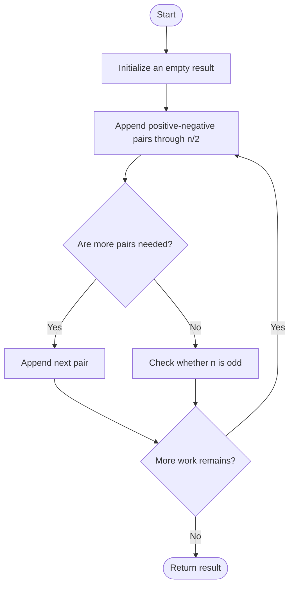
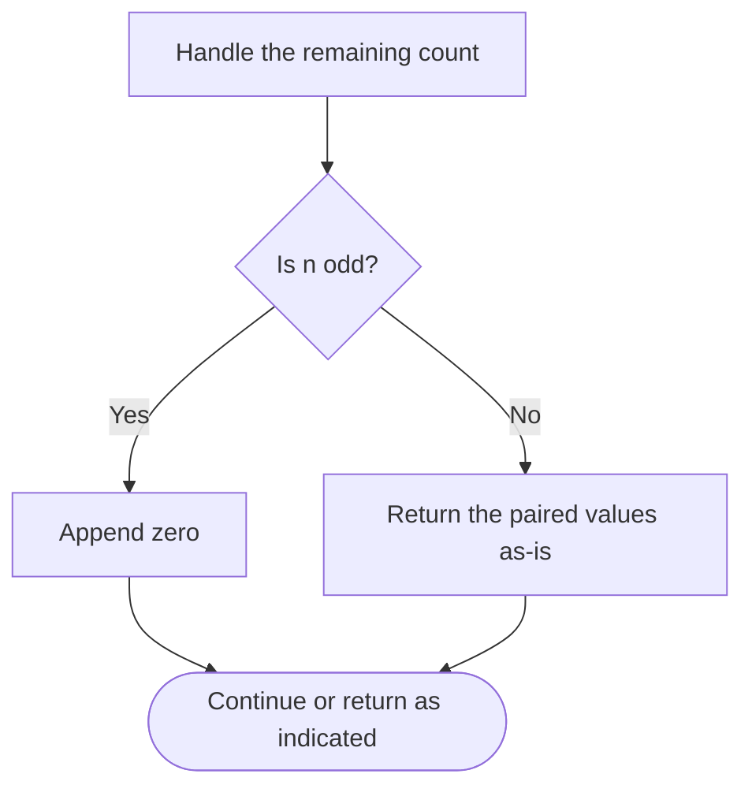

# Find N Unique Integers Sum up to Zero — LeetCode 1304

## Problem and judge interface

vector<int> sumZero(int n); return n distinct integers summing to zero.

## Identification evidence

The method emits positive/negative pairs and an optional zero, exactly problem 1304.

## Main flow



## Important branch / loop



## Core logic and invariants

Append i and -i for each i through floor(n/2). If n is odd append zero. Every pair cancels and all values are distinct.

## Complexity

O(n) time and O(n) output space.

## Comparison and optimization

The paired construction guarantees zero sum directly without a balancing pass.

## Compile and run

The `.cpp` is the original standalone source, including its local `main()` demonstration where present. Compile and run from the repository root with a C++17 compiler:

```text
g++ -std=c++17 LeetCode\1304\1304.cpp -o solution.exe
.\solution.exe
```

For LeetCode, adapt the implementation to the required class/method signature and omit the local `main()` and demonstration helpers; use the judge-provided node types. Notes above identify method-name or behavior differences. The moved source bytes have not been edited.
