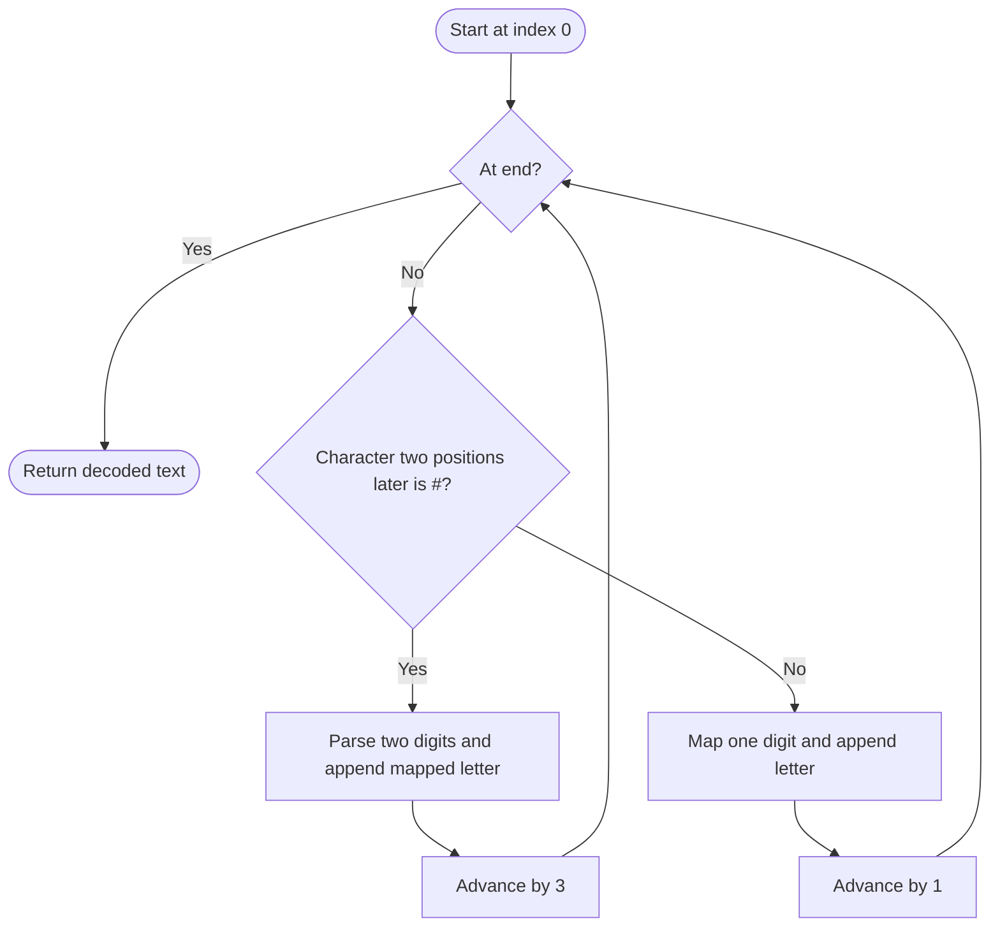

# 1309 — Decrypt String from Alphabet to Integer Mapping

## 1. Understanding

या प्रश्नाचा गाभा म्हणजे अंकांपासून अक्षरांमध्ये decoding.

> **मराठी:** प्रश्नात काय दिले आहे आणि नेमके काय शोधायचे आहे, हे आधी स्पष्ट करा.
> Decode digits `1`–`9` as `a`–`i`, and `10#`–`26#` as `j`–`z`.

## 2. Worked examples and edge cases

उदाहरणे आणि सीमाप्रकरणांत अंकांपासून अक्षरांमध्ये decoding कशी लागू होते ते पाहा.

> **मराठी:** उदाहरणातील input पासून output पर्यंत प्रत्येक बदल समजून घ्या.
> `"10#11#12"` becomes `"jkab"`. At each position, a `#` exactly two places ahead marks a two-digit code; otherwise decode one digit.

## 3. Pattern identification + cheat sheet

येथे मुख्य pattern म्हणजे # चिन्ह पाहून एक किंवा दोन अंक वाचणे; वरील तुलना लक्षात घ्या.

> **मराठी:** या clues मुळे योग्य pattern ओळखता येतो; constraints आणि relations नीट तपासा.
> This is a **left-to-right parser with lookahead**.
> | Input cue | Consume |
> |---|---|
> | `s[i+2]=='#'` | Two digits and `#` |
> | Otherwise | One digit |
> | Letter value `v` | `'a'+v-1` |

## 4. Approaches

पद्धतींची तुलना करताना # चिन्ह पाहून एक किंवा दोन अंक वाचणे याचा वेळ आणि जागेवरील परिणाम पाहा.

> **मराठी:** सोप्या उपायापासून सुरुवात करा आणि constraints नुसार योग्य optimization निवडा.

- Parse with a separate tokenization pass: correct but extra work/storage.
- Source uses direct lookahead and appends decoded characters in one pass: optimal `O(n)`.
- Greedy choice is safe because the encoding explicitly marks all two-digit tokens with `#`.

## 5. Mermaid flowchart and explanation

आकृतीमध्ये # चिन्ह पाहून एक किंवा दोन अंक वाचणे ही प्रक्रिया क्रमाने दाखवली आहे.

> **मराठी:** Flowchart मध्ये प्रत्येक decision, loop आणि loop कधी थांबतो ते पाहा.
> Lookahead detects a complete `xx#` token before falling back to one digit.

## 6. Algorithm / intuition

मूळ कल्पना: # चिन्ह पाहून एक किंवा दोन अंक वाचणे.

> **मराठी:** मुख्य observation समजल्यावर algorithm चे steps लक्षात ठेवणे सोपे होते.
> Scan once. If `i+2` is in bounds and contains `#`, parse the two-digit value and skip three characters; otherwise map the current digit and advance one. The marker removes ambiguity.

## 7. Code explanation

Code मधील state आणि updates हे # चिन्ह पाहून एक किंवा दोन अंक वाचणे या कल्पनेशी जोडून वाचा.

> **मराठी:** Code मधील variable आणि condition यांचा algorithm मधील उद्देश समजून घ्या.
> `freqAlphabets` checks both bounds and marker, uses `stoi(s.substr(i,2))` for marked codes, otherwise `s[i]-'0'`, and appends the corresponding character. Source `main()` is a local demo.

## 8. Dry run

Dry run मध्ये # चिन्ह पाहून एक किंवा दोन अंक वाचणे कसे घडते ते प्रत्येक टप्प्यावर तपासा.

> **मराठी:** प्रत्येक महत्त्वाच्या step नंतर variable ची value trace करा.
> Input `"10#11#12"`:
> | Index | Token | Value | Letter |
> |---:|---|---:|---|
> | 0 | `10#` | 10 | `j` |
> | 3 | `11#` | 11 | `k` |
> | 6 | `1` | 1 | `a` |
> | 7 | `2` | 2 | `b` |

## 9. Complexity

# चिन्ह पाहून एक किंवा दोन अंक वाचणे यासाठी लागणारा वेळ आणि अतिरिक्त जागा वरील bounds मध्ये दिली आहेत.

> **मराठी:** Input size आणि प्रत्येक operation कितीदा चालतो यावरून complexity ठरवा.
> `O(n)` scan plus output space `O(n)`. Substring/`stoi` work is bounded to two digits.

## 10. Correctness

योग्यतेचा युक्तिवाद # चिन्ह पाहून एक किंवा दोन अंक वाचणे यावर आधारित आहे; वरील अटी तपासा.

> **मराठी:** Invariant किंवा तर्क वापरून algorithm योग्य उत्तर देतो हे समजून घ्या.
> At each index, the encoding rule makes the token unambiguous: a `#` at offset two denotes the only possible two-digit code; otherwise the next character belongs to a one-digit code. The loop consumes exactly that token and maps its value to its specified letter, so all input is decoded in order.

## 11. Mistakes / interview traps

लक्षात ठेवा: दोन अंकी code वाचताना मर्यादा तपासायची.

> **मराठी:** Boundary, duplicate आणि off-by-one cases स्वतंत्रपणे तपासा.

- Check bounds before reading `s[i+2]`.
- Advance by three after a `#` token; otherwise the digits are decoded twice.
- Use `value-1` for zero-based alphabet offset.
- Inputs are valid by problem guarantee; malformed strings need validation separately.

## 12. Quick revision

थोडक्यात, # चिन्ह पाहून एक किंवा दोन अंक वाचणे. दोन अंकी code वाचताना मर्यादा तपासायची.

> **मराठी:** दोन मिनिटांच्या revision साठी pattern, मुख्य कल्पना आणि complexity आठवा.
> Two-place lookahead for `#` → consume 3, else consume 1. Map `v` to `'a'+v-1`.

## 13. Related problems / variations

संबंधित प्रश्नांत अंकांपासून अक्षरांमध्ये decoding यासारखी अट बदलल्यास योग्य पद्धतही तपासा.

> **मराठी:** Related problem मध्ये constraints बदलल्यास approach कसा बदलेल ते विचारा.
> Decode Ways, String to Integer (atoi), basic token parsers; variation: parse variable-width codes using separators or a trie.

## 14. Self-assessment

वरील प्रश्न स्वतः सोडवून अंकांपासून अक्षरांमध्ये decoding याची उजळणी करा.

> **मराठी:** उत्तर न पाहता प्रश्न सोडवा आणि तुमच्या निवडीचे कारण सांगा.

1. What does the `#` signal?
2. Why is lookahead safe here?
3. How many characters does a marked code consume?
4. What is the mapping formula for value 26?
