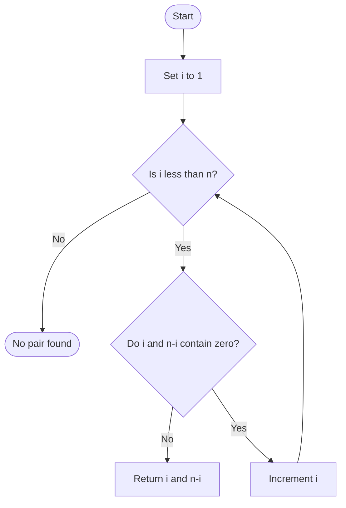

# 1317 — Convert Integer to the Sum of Two No-Zero Integers

## 1. Understanding

या प्रश्नाचा गाभा म्हणजे शून्य अंक नसलेल्या दोन संख्यांची बेरीज.

> **मराठी:** प्रश्नात काय दिले आहे आणि नेमके काय शोधायचे आहे, हे आधी स्पष्ट करा.
> Find positive `A` and `B` with `A+B=n`, where neither decimal representation contains digit zero.

## 2. Worked examples and edge cases

उदाहरणे आणि सीमाप्रकरणांत शून्य अंक नसलेल्या दोन संख्यांची बेरीज कशी लागू होते ते पाहा.

> **मराठी:** उदाहरणातील input पासून output पर्यंत प्रत्येक बदल समजून घ्या.
> For `n=11`, the first valid split is `2+9`; for `n=2`, it is `1+1`. The loop checks candidates in increasing order and returns the first valid pair.

## 3. Pattern identification + cheat sheet

येथे मुख्य pattern म्हणजे प्रत्येक उमेदवार आणि त्याचा पूरक तपासणे; वरील तुलना लक्षात घ्या.

> **मराठी:** या clues मुळे योग्य pattern ओळखता येतो; constraints आणि relations नीट तपासा.
> This is a **bounded search with a digit predicate**.
> | Task | Technique |
> |---|---|
> | Enumerate decompositions | Try `i` from 1 to `n-1` |
> | Check no zero digits | Decimal string search |
> | Need any valid answer | Stop at first valid split |

## 4. Approaches

पद्धतींची तुलना करताना प्रत्येक उमेदवार आणि त्याचा पूरक तपासणे याचा वेळ आणि जागेवरील परिणाम पाहा.

> **मराठी:** सोप्या उपायापासून सुरुवात करा आणि constraints नुसार योग्य optimization निवडा.

- Check all positive splits: source approach, `O(n·d)` with string conversion.
- Check digits arithmetically: same search without temporary strings.
- There is no need to test every ordered pair; `B=n-i` is determined.

## 5. Mermaid flowchart and explanation

आकृतीमध्ये प्रत्येक उमेदवार आणि त्याचा पूरक तपासणे ही प्रक्रिया क्रमाने दाखवली आहे.

> **मराठी:** Flowchart मध्ये प्रत्येक decision, loop आणि loop कधी थांबतो ते पाहा.
> The search stops as soon as both sides pass the no-zero test.

## 6. Algorithm / intuition

मूळ कल्पना: प्रत्येक उमेदवार आणि त्याचा पूरक तपासणे.

> **मराठी:** मुख्य observation समजल्यावर algorithm चे steps लक्षात ठेवणे सोपे होते.
> Every valid answer has some first addend `i` between `1` and `n-1`; its partner is forced to be `n-i`. Test both numbers for digit zero until a valid split appears.

## 7. Code explanation

Code मधील state आणि updates हे प्रत्येक उमेदवार आणि त्याचा पूरक तपासणे या कल्पनेशी जोडून वाचा.

> **मराठी:** Code मधील variable आणि condition यांचा algorithm मधील उद्देश समजून घ्या.
> `CheckZero` converts its argument to a string and searches for `'0'`. `getNoZeroIntegers` loops, appends the two values and breaks on a match. The source returns an empty vector only if no split is found; constraints guarantee one.

## 8. Dry run

Dry run मध्ये प्रत्येक उमेदवार आणि त्याचा पूरक तपासणे कसे घडते ते प्रत्येक टप्प्यावर तपासा.

> **मराठी:** प्रत्येक महत्त्वाच्या step नंतर variable ची value trace करा.
> For `n=11`:
> | `i` | `n-i` | Contains zero? | Result |
> |---:|---:|---|---|
> | 1 | 10 | Yes | Continue |
> | 2 | 9 | No | Return `[2,9]` |

## 9. Complexity

प्रत्येक उमेदवार आणि त्याचा पूरक तपासणे यासाठी लागणारा वेळ आणि अतिरिक्त जागा वरील bounds मध्ये दिली आहेत.

> **मराठी:** Input size आणि प्रत्येक operation कितीदा चालतो यावरून complexity ठरवा.
> At most `n-1` candidates and `O(log n)` digit checks per candidate: `O(n log n)` time, `O(log n)` temporary string space.

## 10. Correctness

योग्यतेचा युक्तिवाद प्रत्येक उमेदवार आणि त्याचा पूरक तपासणे यावर आधारित आहे; वरील अटी तपासा.

> **मराठी:** Invariant किंवा तर्क वापरून algorithm योग्य उत्तर देतो हे समजून घ्या.
> The loop visits every possible positive first addend in ascending order, and computes the only partner that sums to `n`. It returns only after both numbers have no zero digit, so the returned pair satisfies all requirements; the problem guarantees the search succeeds.

## 11. Mistakes / interview traps

लक्षात ठेवा: दोन्ही संख्यांमधील प्रत्येक अंक तपासायचा.

> **मराठी:** Boundary, duplicate आणि off-by-one cases स्वतंत्रपणे तपासा.

- Exclude zero addends: start at `1`, stop before `n`.
- Check both numbers; one valid number is not enough.
- Use `n-i`, not another independent guess.
- Return exactly two values.

## 12. Quick revision

थोडक्यात, प्रत्येक उमेदवार आणि त्याचा पूरक तपासणे. दोन्ही संख्यांमधील प्रत्येक अंक तपासायचा.

> **मराठी:** दोन मिनिटांच्या revision साठी pattern, मुख्य कल्पना आणि complexity आठवा.
> Try `i=1..n-1`; validate `i` and `n-i`; first valid split wins. Check string for `'0'`.

## 13. Related problems / variations

संबंधित प्रश्नांत शून्य अंक नसलेल्या दोन संख्यांची बेरीज यासारखी अट बदलल्यास योग्य पद्धतही तपासा.

> **मराठी:** Related problem मध्ये constraints बदलल्यास approach कसा बदलेल ते विचारा.
> Two Sum, split integer under digit constraints, digit DP; variation: count all valid splits instead of returning the first.

## 14. Self-assessment

वरील प्रश्न स्वतः सोडवून शून्य अंक नसलेल्या दोन संख्यांची बेरीज याची उजळणी करा.

> **मराठी:** उत्तर न पाहता प्रश्न सोडवा आणि तुमच्या निवडीचे कारण सांगा.

1. Why is the partner determined once `i` is chosen?
2. Why must `i` start at one?
3. What does `CheckZero` test?
4. What is the worst-case number of candidate checks?
