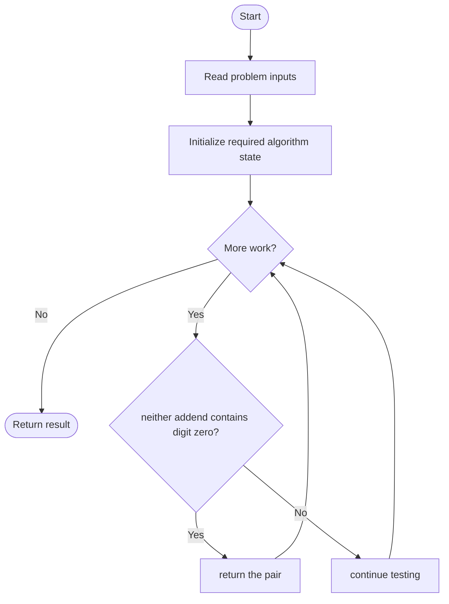
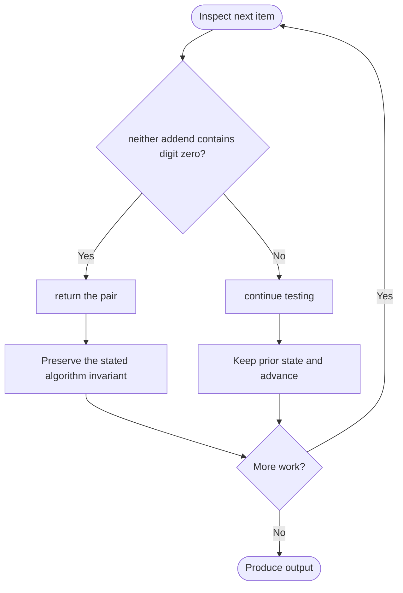

# Convert Integer to the Sum of Two No-Zero Integers

**LeetCode ID:** 1317
**Source file(s):** `1317.cpp` (originally `getNoZeroIntegers.cpp`)
**Identification evidence:** The original filename, declared signature, and distinctive behavior described below uniquely identify this problem; no number was inferred from a filename alone.

## Expected input/output or judge interface

vector<int> getNoZeroIntegers(int n). Inputs follow the problem constraints; the output is the documented scalar, sequence, or design-object behavior. The description below reflects the implementation actually present in the source.

## Main flow



## Important branch and loop flow



## Core logic and invariant

Tests candidate splits i and n-i in increasing order and returns the first pair whose decimal strings contain no zero.
The key branch/loop rule above is applied once per relevant item; the algorithm relies on that rule to preserve its state and produce the required result.

## Optimization / comparison

The positive addends sum to n and are independently checked for zero digits.

## Complexity

O(n\*d) time and O(d) temporary string space.

## Compile and run

The repository file includes a standalone demonstration `main()`; it is not a raw LeetCode submission unit. From the repository root, with a C++17 compiler:

```powershell
g++ -std=c++17 LeetCode\1317\1317.cpp -o solution.exe
.\solution.exe
```

For LeetCode's class-method judge, copy the relevant class/method or design-class API and omit the demo `main()` and local harness. Adapt free-function implementations to the requested `Solution` class signature where necessary. See the source caveat above for any compile blocker.
