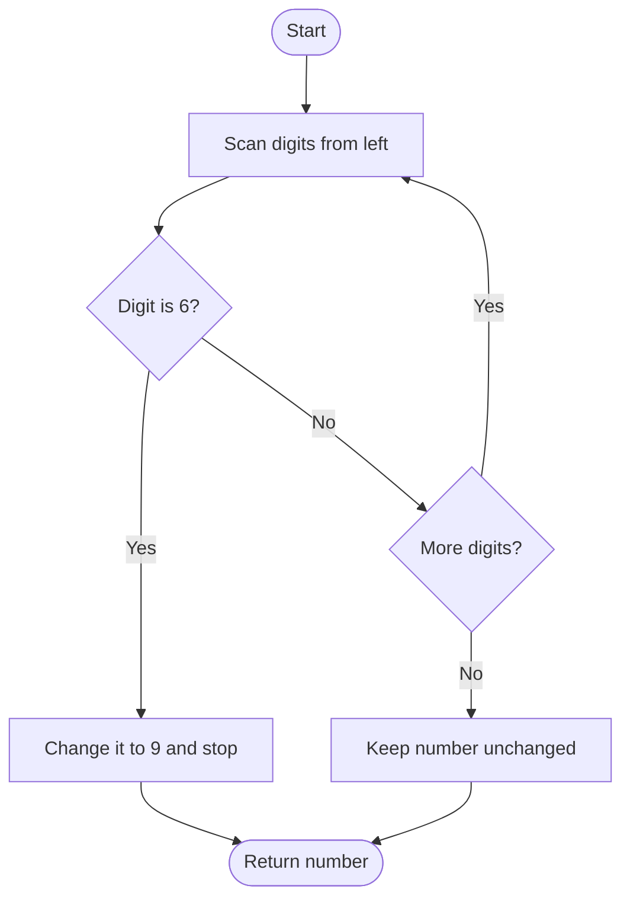

# 1323 — Maximum 69 Number

## 1. Understanding

या प्रश्नाचा गाभा म्हणजे एका बदलाने मिळणारी कमाल संख्या.

> **मराठी:** प्रश्नात काय दिले आहे आणि नेमके काय शोधायचे आहे, हे आधी स्पष्ट करा.
> Change at most one digit `6` to `9` to maximize the number. If there is no six, leave it unchanged.

## 2. Worked examples and edge cases

उदाहरणे आणि सीमाप्रकरणांत एका बदलाने मिळणारी कमाल संख्या कशी लागू होते ते पाहा.

> **मराठी:** उदाहरणातील input पासून output पर्यंत प्रत्येक बदल समजून घ्या.
> `9669` becomes `9969`: changing the leftmost six gives the largest positional gain. `9999` stays unchanged; `6969` becomes `9969`.

## 3. Pattern identification + cheat sheet

येथे मुख्य pattern म्हणजे सर्वात डावीकडील 6 चे 9 करणे; वरील तुलना लक्षात घ्या.

> **मराठी:** या clues मुळे योग्य pattern ओळखता येतो; constraints आणि relations नीट तपासा.
> Use **greedy positional value**: modify the most significant eligible digit.
> | Objective | Choice |
> |---|---|
> | Maximize number | First/leftmost `6` |
> | At most one change | Stop after first match |
> | No match | Return original |

## 4. Approaches

पद्धतींची तुलना करताना सर्वात डावीकडील 6 चे 9 करणे याचा वेळ आणि जागेवरील परिणाम पाहा.

> **मराठी:** सोप्या उपायापासून सुरुवात करा आणि constraints नुसार योग्य optimization निवडा.

- Try changing each six and take the maximum: correct but unnecessary.
- Source string scan: `O(d)`.
- Source recursive digit traversal also changes the first six from the left.

## 5. Mermaid flowchart and explanation

आकृतीमध्ये सर्वात डावीकडील 6 चे 9 करणे ही प्रक्रिया क्रमाने दाखवली आहे.

> **मराठी:** Flowchart मध्ये प्रत्येक decision, loop आणि loop कधी थांबतो ते पाहा.
> Earlier digits have greater place value; the first six is the best one to change.

## 6. Algorithm / intuition

मूळ कल्पना: सर्वात डावीकडील 6 चे 9 करणे.

> **मराठी:** मुख्य observation समजल्यावर algorithm चे steps लक्षात ठेवणे सोपे होते.
> The gain from changing digit `6` to `9` is `3 × place value`; the leftmost six has the largest place value. Make that one change and stop.

## 7. Code explanation

Code मधील state आणि updates हे सर्वात डावीकडील 6 चे 9 करणे या कल्पनेशी जोडून वाचा.

> **मराठी:** Code मधील variable आणि condition यांचा algorithm मधील उद्देश समजून घ्या.
> `maximum69NumberIterative` scans `to_string(num)`, changes the first `'6'`, and converts back. Recursive version processes digits from most significant order using `fromStart` and a `changed` flag. Demo `main()` compares both.

## 8. Dry run

Dry run मध्ये सर्वात डावीकडील 6 चे 9 करणे कसे घडते ते प्रत्येक टप्प्यावर तपासा.

> **मराठी:** प्रत्येक महत्त्वाच्या step नंतर variable ची value trace करा.
> For `9669`:
> | Scan digit | Action | Current result |
> |---|---|---|
> | 9 | Keep | 9 |
> | 6 | Change to 9; stop changing | 99 |
> | 6, 9 | Keep | 9969 |

## 9. Complexity

सर्वात डावीकडील 6 चे 9 करणे यासाठी लागणारा वेळ आणि अतिरिक्त जागा वरील bounds मध्ये दिली आहेत.

> **मराठी:** Input size आणि प्रत्येक operation कितीदा चालतो यावरून complexity ठरवा.
> `O(d)` time and `O(d)` storage for the string approach; recursion uses `O(d)` call stack.

## 10. Correctness

योग्यतेचा युक्तिवाद सर्वात डावीकडील 6 चे 9 करणे यावर आधारित आहे; वरील अटी तपासा.

> **मराठी:** Invariant किंवा तर्क वापरून algorithm योग्य उत्तर देतो हे समजून घ्या.
> Changing any six increases the number by three times its place value. The leftmost six has strictly greater place value than every later digit, so changing it yields the greatest possible increase; changing no digit is worse whenever a six exists.

## 11. Mistakes / interview traps

लक्षात ठेवा: 6 नसल्यास संख्या तशीच ठेवायची.

> **मराठी:** Boundary, duplicate आणि off-by-one cases स्वतंत्रपणे तपासा.

- Scan left to right, not right to left.
- Change only one digit.
- Do not change any `9`.
- Recursive helper must preserve digit order.

## 12. Quick revision

थोडक्यात, सर्वात डावीकडील 6 चे 9 करणे. 6 नसल्यास संख्या तशीच ठेवायची.

> **मराठी:** दोन मिनिटांच्या revision साठी pattern, मुख्य कल्पना आणि complexity आठवा.
> Leftmost `6` → `9`, then stop. Highest place value means greatest gain.

## 13. Related problems / variations

संबंधित प्रश्नांत एका बदलाने मिळणारी कमाल संख्या यासारखी अट बदलल्यास योग्य पद्धतही तपासा.

> **मराठी:** Related problem मध्ये constraints बदलल्यास approach कसा बदलेल ते विचारा.
> Maximum Difference You Can Get From Changing an Integer, maximum swap, greedy digit replacement; variation: one allowed replacement under different digit constraints.

## 14. Self-assessment

वरील प्रश्न स्वतः सोडवून एका बदलाने मिळणारी कमाल संख्या याची उजळणी करा.

> **मराठी:** उत्तर न पाहता प्रश्न सोडवा आणि तुमच्या निवडीचे कारण सांगा.

1. Why is the leftmost six optimal?
2. What should happen if no six exists?
3. How much does changing place value `p` increase the number?
4. Why stop after one replacement?
