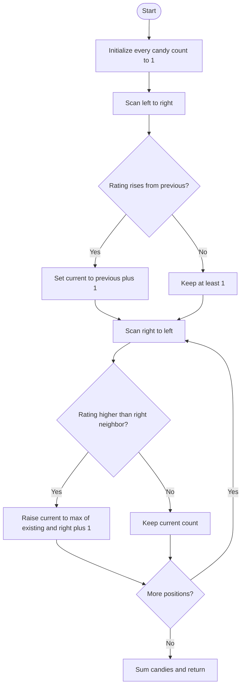

# Candy — LeetCode 135

## 1. Understanding

Ratings असलेल्या line मधील प्रत्येक childला किमान एक candy द्या; जास्त rating असलेल्या adjacent childला शेजाऱ्यापेक्षा अधिक candy द्यावी. Minimum total candies परत करा.

## 2. Worked examples and edges

- `[1,0,2]` → `[2,1,2]`, total 5.
- `[1,2,2]` → `[1,2,1]`, total 4; equal neighborsवर condition नाही.
- Increasing `[1,2,3]` → 1,2,3; decreasing `[3,2,1]` → 3,2,1.
- Empty ratings sourceनुसार total 0.

## 3. Pattern identification + cheat sheet

| Clue                                         | Pattern             | कारण                                     |
| -------------------------------------------- | ------------------- | ---------------------------------------- |
| Adjacent pair constraints both directions    | Two-pass greedy     | Left आणि right dependency वेगळे          |
| Minimize total while satisfying lower bounds | Greedy assignment   | प्रत्येकाला initial 1                    |
| One-way scan insufficient                    | Bidirectional sweep | Descending slopesही दुरुस्त करावे लागतात |

## 4. Approaches

- Brute force repeatedly increase violated neighbor until stable: potentially very slow; termination/optimality harder.
- Source two-pass greedy: O(n) time/O(n) candy array, clear optimal solution.
- Single left-to-right pass alone चुकीचा; आधीच्या childला पुढे higher rating आल्यावर वाढवावे लागू शकते.
- Constant-space slope greedy हे variation आहे; source मध्ये नाही.

## 5. Flowchart

पहिला pass rising slopes, दुसरा descending slopes सांभाळतो; `max` पहिल्या passची गरज जपतो.

## 6. Algorithm / intuition

सर्वांना 1 द्या. Left-to-rightमध्ये `ratings[i]>ratings[i-1]` असल्यास `candy[i]=candy[i-1]+1`. Reverse passमध्ये `ratings[i]>ratings[i+1]` असल्यास right neighborपेक्षा किमान एक जास्त द्या.

## 7. Code explanation

`candy` vector length `n`, सर्व values 1. दोन loops नंतर `accumulate` total काढतो. Source `candy` नावे वापरतो आणि input ratings mutate करत नाही.

## 8. Dry run

> **मराठी:** प्रत्येक महत्त्वाच्या step नंतर variable ची value trace करा.
> Ratings `[1,0,2]`:
> | Pass | candies after pass |
> |---|---|
> | Initialize | `[1,1,1]` |
> | Left→right | `[1,1,2]` |
> | Right→left | `[2,1,2]` |
> | Sum | `5` |

## 9. Complexity

> **मराठी:** Input size आणि प्रत्येक operation कितीदा चालतो यावरून complexity ठरवा.
> O(n) time, O(n) auxiliary space for candy vector.

## 10. Correctness

Left pass प्रत्येक increasing adjacent pair साठी currentला leftपेक्षा अधिक करतो. Right pass प्रत्येक decreasing adjacent pairची अट पूर्ण करतो; `max` आधीचे constraints कमी होऊ देत नाही. सर्वांना 1 हे minimum lower bound, आणि प्रत्येक violated relationला आवश्यक तेवढेच वाढवल्याने total minimum आहे.

## 11. Mistakes and interview traps

- दोन passesची directions उलटी/गहाळ करू नका.
- Reverse updateमध्ये `max(existing, right+1)` आवश्यक.
- Equal ratingsमध्ये candy relation लागू नाही.
- Valleyच्या दोन्ही बाजूंच्या constraints लक्षात ठेवा.

## 12. Quick revision

> **मराठी:** दोन मिनिटांच्या revision साठी pattern, मुख्य कल्पना आणि complexity आठवा.
> All 1 → left pass for rises → right pass for falls using max → sum.

## 13. Related problems / variations

> **मराठी:** प्रश्नात काय दिले आहे आणि नेमके काय शोधायचे आहे, हे आधी स्पष्ट करा.
> Longest increasing/decreasing sequence, mountain array constraints, minimum increments for adjacent inequalities.

## 14. Self-assessment

1. `[1,0,2]` चे candy assignment?
2. Reverse passमध्ये `max` का?
3. Equal ratingsसाठी अट काय?
4. एका दिशेचा pass अपुरा का?
