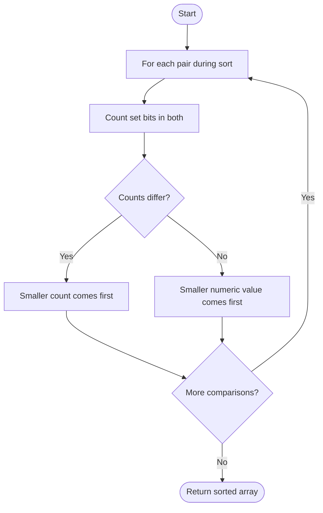

# 1356 — Sort Integers by The Number of 1 Bits

## 1. Understanding

या प्रश्नाचा गाभा म्हणजे set bits नुसार आणि नंतर मूल्याने क्रमवारी.

> **मराठी:** प्रश्नात काय दिले आहे आणि नेमके काय शोधायचे आहे, हे आधी स्पष्ट करा.
> Sort integers by the number of set bits in binary; if counts tie, sort by numeric value.

## 2. Worked examples and edge cases

उदाहरणे आणि सीमाप्रकरणांत set bits नुसार आणि नंतर मूल्याने क्रमवारी कशी लागू होते ते पाहा.

> **मराठी:** उदाहरणातील input पासून output पर्यंत प्रत्येक बदल समजून घ्या.
> `[0,1,2,3,4]` has bit counts `0,1,1,2,1`; result is `[0,1,2,4,3]`. Equal bit counts require the numeric tie-breaker.

## 3. Pattern identification + cheat sheet

येथे मुख्य pattern म्हणजे popcount आणि मूल्य या जोडीने तुलना करणे; वरील तुलना लक्षात घ्या.

> **मराठी:** या clues मुळे योग्य pattern ओळखता येतो; constraints आणि relations नीट तपासा.
> This is **custom comparator sorting** with a derived key `(popcount, value)`.
> | Key component | Purpose |
> |---|---|
> | Popcount | Primary order |
> | Integer value | Tie-break |
> | Cache popcount | Avoid recomputing in comparator |

## 4. Approaches

पद्धतींची तुलना करताना popcount आणि मूल्य या जोडीने तुलना करणे याचा वेळ आणि जागेवरील परिणाम पाहा.

> **मराठी:** सोप्या उपायापासून सुरुवात करा आणि constraints नुसार योग्य optimization निवडा.

- Comparator calls builtin `__builtin_popcount`: source approach.
- Comparator counts bits manually: source alternative.
- Precompute counts in a map: source third alternative, avoids repeated count work but adds map overhead.

## 5. Mermaid flowchart and explanation

आकृतीमध्ये popcount आणि मूल्य या जोडीने तुलना करणे ही प्रक्रिया क्रमाने दाखवली आहे.

> **मराठी:** Flowchart मध्ये प्रत्येक decision, loop आणि loop कधी थांबतो ते पाहा.
> The comparator creates a total ordering by comparing bit count first, then value.

## 6. Algorithm / intuition

मूळ कल्पना: popcount आणि मूल्य या जोडीने तुलना करणे.

> **मराठी:** मुख्य observation समजल्यावर algorithm चे steps लक्षात ठेवणे सोपे होते.
> Sorting needs a consistent comparator. Compare `(popcount(a),a)` against `(popcount(b),b)` lexicographically; the source expresses the same rule with two branches.

## 7. Code explanation

Code मधील state आणि updates हे popcount आणि मूल्य या जोडीने तुलना करणे या कल्पनेशी जोडून वाचा.

> **मराठी:** Code मधील variable आणि condition यांचा algorithm मधील उद्देश समजून घ्या.
> `sortByBits_Builtin`, `sortByBits_Manual`, and `sortByBits_Precompute` all return sorted copies because arguments are by value. `countBits` repeatedly shifts; precompute uses `unordered_map`. `__builtin_popcount` is GCC/Clang-specific.

## 8. Dry run

Dry run मध्ये popcount आणि मूल्य या जोडीने तुलना करणे कसे घडते ते प्रत्येक टप्प्यावर तपासा.

> **मराठी:** प्रत्येक महत्त्वाच्या step नंतर variable ची value trace करा.
> For `[3,4,1]`:
> | Value | Binary | Set bits |
> |---:|---|---:|
> | 1 | `001` | 1 |
> | 4 | `100` | 1 |
> | 3 | `011` | 2 |
> Sorted result: `[1,4,3]`.

## 9. Complexity

popcount आणि मूल्य या जोडीने तुलना करणे यासाठी लागणारा वेळ आणि अतिरिक्त जागा वरील bounds मध्ये दिली आहेत.

> **मराठी:** Input size आणि प्रत्येक operation कितीदा चालतो यावरून complexity ठरवा.
> Sorting takes `O(n log n)` comparisons. Builtin/manual versions may count up to `W` bits per comparison (`O(Wn log n)`); precomputation costs `O(nW)` then sort `O(n log n)`, with `O(u)` map space.

## 10. Correctness

योग्यतेचा युक्तिवाद popcount आणि मूल्य या जोडीने तुलना करणे यावर आधारित आहे; वरील अटी तपासा.

> **मराठी:** Invariant किंवा तर्क वापरून algorithm योग्य उत्तर देतो हे समजून घ्या.
> The comparator orders values first by the required primary key (number of one bits), and for equal keys by numeric value. A comparison sort using this ordering therefore returns exactly the requested order.

## 11. Mistakes / interview traps

लक्षात ठेवा: समान bit count असल्यास संख्यात्मक क्रम वापरायचा.

> **मराठी:** Boundary, duplicate आणि off-by-one cases स्वतंत्रपणे तपासा.

- Include the numeric tie-break; sort is not stable by default.
- Comparator must be strict (`a<b`-style), not `<=`.
- `__builtin_popcount` handles `unsigned int`; LeetCode inputs are nonnegative.
- Do not recompute counts unnecessarily if optimizing.

## 12. Quick revision

थोडक्यात, popcount आणि मूल्य या जोडीने तुलना करणे. समान bit count असल्यास संख्यात्मक क्रम वापरायचा.

> **मराठी:** दोन मिनिटांच्या revision साठी pattern, मुख्य कल्पना आणि complexity आठवा.
> Sort by `(popcount(x), x)`. Ties on bit count are resolved numerically.

## 13. Related problems / variations

संबंधित प्रश्नांत set bits नुसार आणि नंतर मूल्याने क्रमवारी यासारखी अट बदलल्यास योग्य पद्धतही तपासा.

> **मराठी:** Related problem मध्ये constraints बदलल्यास approach कसा बदलेल ते विचारा.
> Sort by frequency, Relative Sort Array, Hamming weight; variation: descending bit count or stable original order for ties.

## 14. Self-assessment

वरील प्रश्न स्वतः सोडवून set bits नुसार आणि नंतर मूल्याने क्रमवारी याची उजळणी करा.

> **मराठी:** उत्तर न पाहता प्रश्न सोडवा आणि तुमच्या निवडीचे कारण सांगा.

1. Why is numeric tie-break required?
2. What does `__builtin_popcount` return?
3. Why must the comparator be strict?
4. What is the cost of counting bits during comparisons?
