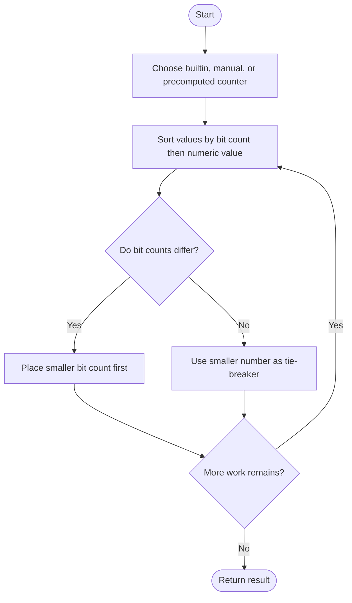
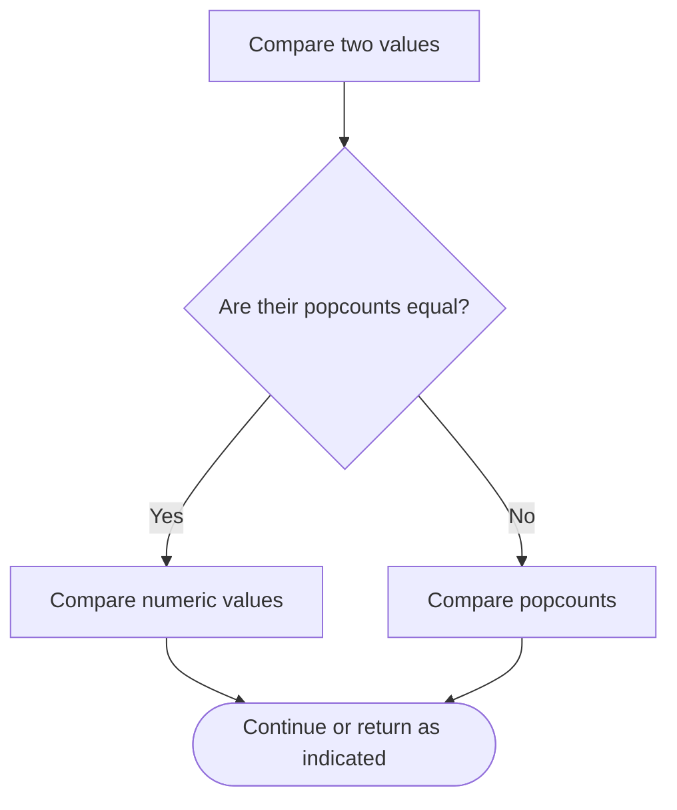

# Sort Integers by The Number of 1 Bits — LeetCode 1356

## Problem and judge interface

vector<int> sortByBits(vector<int> arr); sort by ascending set-bit count, then ascending value.

## Identification evidence

All comparators use population count first and numeric value for ties, exactly problem 1356.

## Main flow



## Important branch / loop



## Core logic and invariants

Three variants use builtin popcount, manual bit counting, or precomputed builtin counts. Each sorts by the same ordered key: bit count then value.

## Complexity

O(n log n times w) sorting work for word width w; precomputed counts cost O(nw) and O(n) storage.

## Comparison and optimization

The source methods are named `sortByBits_Builtin`, `sortByBits_Manual`, and `sortByBits_Precompute`; expose the selected variant under the judge name. Precomputation prevents repeated bit counts during comparator calls at the cost of a lookup table.

## Compile and run

The `.cpp` is the original standalone source, including its local `main()` demonstration where present. Compile and run from the repository root with a C++17 compiler:

```text
g++ -std=c++17 LeetCode\1356\1356.cpp -o solution.exe
.\solution.exe
```

For LeetCode, adapt the implementation to the required class/method signature and omit the local `main()` and demonstration helpers; use the judge-provided node types. Notes above identify method-name or behavior differences. The moved source bytes have not been edited.

