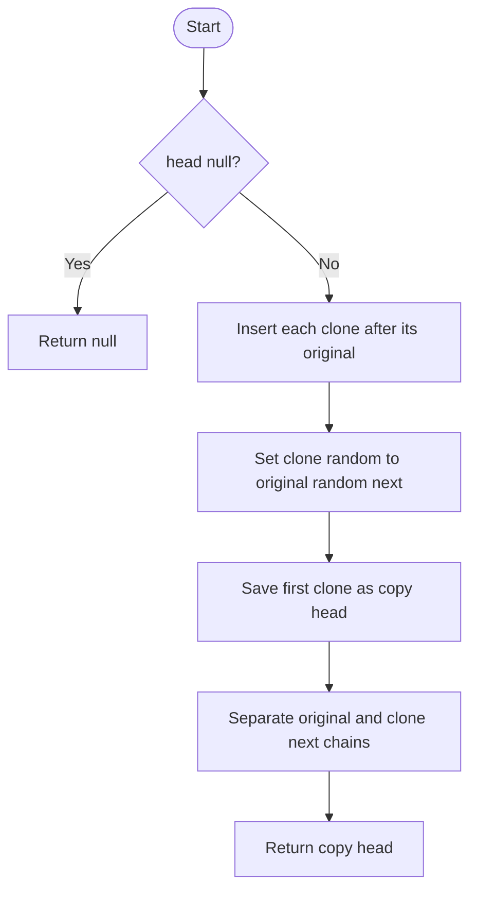

# Copy List with Random Pointer — LeetCode 138

## 1. Understanding

प्रत्येक nodeला `next` आणि arbitrary `random` pointer असलेल्या listची deep copy करा. Copy pointersनी copied nodesकडेच point केले पाहिजे.

## 2. Worked examples and edges

- `7→13→11`, random links indices `[-1,0,2]` → values आणि random structure independent copy.
- Empty list → null; one node with null random → one independent node.
- Random pointer self किंवा listमधील कोणत्याही nodeकडे असू शकतो; duplicate values असल्या तरी identity महत्त्वाची.

## 3. Pattern identification + cheat sheet

| Clue                          | Pattern           | कारण                                      |
| ----------------------------- | ----------------- | ----------------------------------------- |
| Graph-like arbitrary pointers | Node mapping      | Original address → clone address          |
| O(1) auxiliary-space target   | Interleaving      | Clone originalच्या मध्ये तात्पुरता ठेवा   |
| Deep copy                     | Pointer remapping | Cloneने original nodes reference करू नयेत |

## 4. Approaches

- Hash map: दोन passes; O(n) time/O(n) map space, straightforward.
- Source `copyRandomListOptimal`: interleave, random assign, separate — O(n) time/O(1) auxiliary space.
- फक्त `next` chain copy केली तर random pointers missing; random target `mp[target]` mappingनेच cloneमध्ये जावा.
- O(1) variant तात्पुरते original list mutate करतो; concurrent observers असतील तर योग्य नाही.

## 5. Flowchart

Interleavingमुळे original random targetचा clone लगेच `target->next` म्हणून सापडतो.

## 6. Algorithm / intuition

पहिला pass: `A→B` चे `A→A'→B→B'`. दुसरा: `A'.random=A.random.next`. तिसरा: दोन्ही `next` chains वेगळ्या करून original restore करा.

## 7. Code explanation

`copyRandomListHashMap` clones nodes and `mp` मध्ये address mapping ठेवतो; दुसऱ्या passमध्ये random जोडतो. `copyRandomListOptimal` तीन interleaving passes. Utility `buildList` random indices वापरून list तयार करतो.

## 8. Dry run

> **मराठी:** प्रत्येक महत्त्वाच्या step नंतर variable ची value trace करा.
> Original `A→B`, `A.random=B`, `B.random=null`:
> | Phase | Links |
> |---|---|
> | Interleave | `A→A'→B→B'` |
> | Random set | `A'.random=B'`, `B'.random=null` |
> | Separate | original `A→B`; copy `A'→B'` |

## 9. Complexity

> **मराठी:** Input size आणि प्रत्येक operation कितीदा चालतो यावरून complexity ठरवा.
> Both approaches O(n) time. Hash map O(n) auxiliary space. Interleaving O(1) auxiliary space, plus O(n) memory for returned copy itself.

## 10. Correctness

Hash map पद्धतीत प्रत्येक original nodeसाठी एक unique clone map केल्याने `next` आणि `random` targets योग्य cloneकडे जातात. Interleavingमध्ये प्रत्येक originalच्या लगेच नंतर त्याचा clone असल्याने `original.random->next` त्याचा clone; separation योग्य दोन chains बनवते.

## 11. Mistakes and interview traps

- Null random pointerला null ठेवा.
- Valuesवर mapping करू नका; duplicate values शक्य.
- Separation करताना original `next` restore करा आणि copy `next` cloneकडे ठेवा.
- LeetCode node definition judge देऊ शकतो; source standalone `Node` typeтэй.

## 12. Quick revision

> **मराठी:** दोन मिनिटांच्या revision साठी pattern, मुख्य कल्पना आणि complexity आठवा.
> Map solution simple; O(1) variant: weave → random links → unweave.

## 13. Related problems / variations

> **मराठी:** प्रश्नात काय दिले आहे आणि नेमके काय शोधायचे आहे, हे आधी स्पष्ट करा.
> Clone Graph, deep-copy arbitrary graph, flatten multilevel doubly linked list.

## 14. Self-assessment

1. `original.random->next` clone का असतो?
2. Hash map काय map करतो?
3. Duplicate valuesमुळे value-key mapping का चुकीचे?
4. O(1) variant कोणती side effect करतो?
