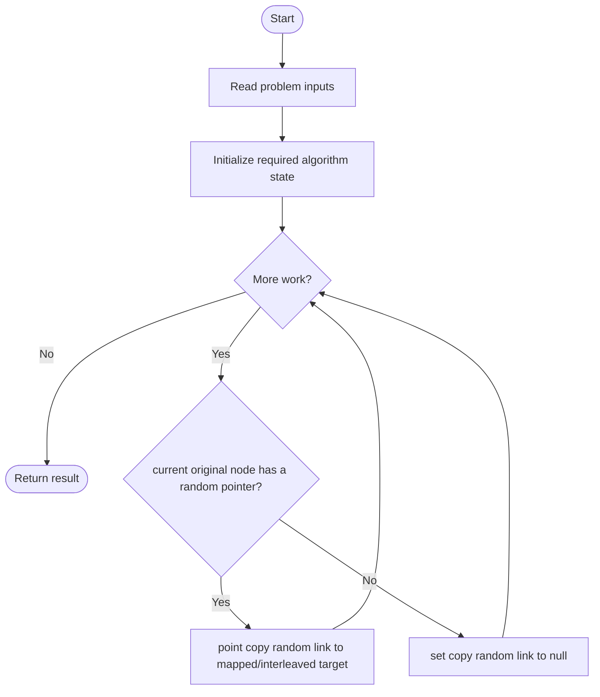
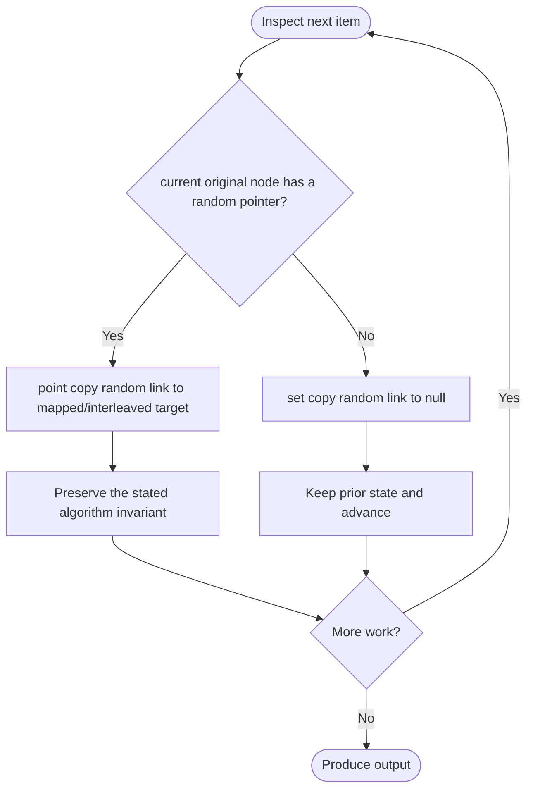

# Copy List with Random Pointer

**LeetCode ID:** 138
**Source file(s):** `138.cpp` (originally `copyRandomList.cpp`)
**Identification evidence:** The original filename, declared signature, and distinctive behavior described below uniquely identify this problem; no number was inferred from a filename alone.

## Expected input/output or judge interface

Node* copyRandomListHashMap(Node*); Node* copyRandomListOptimal(Node*). Inputs follow the problem constraints; the output is the documented scalar, sequence, or design-object behavior. The description below reflects the implementation actually present in the source.

## Main flow



## Important branch and loop flow



## Core logic and invariant

Deep-copies next/random linked-list links using an old-to-copy map or by interleaving copies, wiring random links, then separating lists.
The key branch/loop rule above is applied once per relevant item; the algorithm relies on that rule to preserve its state and produce the required result.

## Optimization / comparison

During interleaving each original is followed by its copy; this removes the map but temporarily mutates the original list.

## Complexity

Both O(n) time; map O(n) auxiliary space, interleaving O(1) auxiliary space.

## Compile and run

The repository file includes a standalone demonstration `main()`; it is not a raw LeetCode submission unit. From the repository root, with a C++17 compiler:

```powershell
g++ -std=c++17 LeetCode\138\138.cpp -o solution.exe
.\solution.exe
```

For LeetCode's class-method judge, copy the relevant class/method or design-class API and omit the demo `main()` and local harness. Adapt free-function implementations to the requested `Solution` class signature where necessary. See the source caveat above for any compile blocker.
