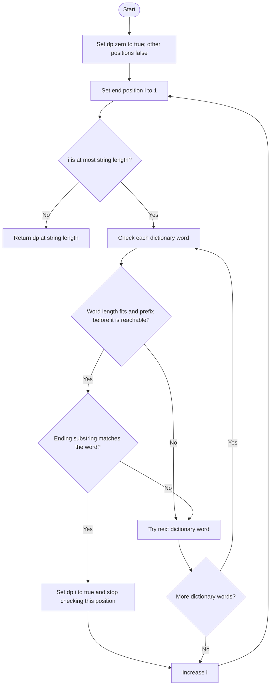

# 139. Word Break

## 1. Problem Understanding

एक string `s` आणि dictionary `wordDict` दिले आहेत. `s` ला dictionary मधील एक किंवा अधिक words मध्ये सलग भागांत विभागता येते का ते ठरवा. प्रत्येक भाग dictionary मध्ये असला पाहिजे. उत्तर boolean (`true`/`false`) आहे.
Dictionary word पुन्हा वापरता येतो. String मधील characters बदलता किंवा skip करता येत नाहीत; सर्व characters पूर्णपणे cover झाले पाहिजेत.
**Constraints:** `s` ची length जास्तीत जास्त `300`, dictionary मध्ये जास्तीत जास्त `1000` lowercase words, प्रत्येक word ची length जास्तीत जास्त `20`. या मर्यादेत `O(nDL)` DP/memoization चालते.

## 2. Example Understanding

### Example 1

```text
s = "leetcode", wordDict = ["leet","code"]
Output: true
```

`"leetcode" = "leet" + "code"`; दोन्ही भाग dictionary मध्ये आहेत.

### Example 2

```text
s = "applepenapple", wordDict = ["apple","pen"]
Output: true
```

`"apple" + "pen" + "apple"` valid segmentation आहे. `"apple"` पुन्हा वापरले आहे; reuse allowed.

### Example 3

```text
s = "catsandog", wordDict = ["cats","dog","sand","and","cat"]
Output: false
```

`"cats" + "and" + "og"` मध्ये `"og"` dictionary मध्ये नाही. `"cat" + "sand" + "og"` हाही मार्ग पूर्ण होत नाही; म्हणून `false`.

### Edge cases

- रिकामी string: code च्या base case नुसार `true` (शून्य शब्दांनी पूर्ण segmentation).
- एक character dictionary मध्ये नसेल तर तो position पार करता येत नाही.
- अनेक possible prefixes असू शकतात; पहिला पर्याय fail झाला तरी दुसरा पर्याय यशस्वी असू शकतो.

## 3. Problem Identification

“String dictionary words मध्ये segment करता येतो का?” हे **prefix/suffix DP** चे clue आहे. प्रत्येक index हा state: इथून पुढे उरलेला suffix segment होऊ शकतो का?
स्वतःला विचारा:

1. Valid word कुठून सुरू होऊ शकतो? Current index पासून.
2. Word match झाल्यावर पुढचा subproblem कोणता? त्या word नंतरचा index.
3. अनेक segmentation पर्याय असतील तर कोणता हवा? एक जरी पूर्ण झाला तरी `true`.
4. Same index अनेक prefix paths मधून येतो का? हो; memoization/visited उपयोगी.

### Pattern Recognition Cheat Sheet

| Clue in Question                             | Possible Pattern          | Why?                                    |
| -------------------------------------------- | ------------------------- | --------------------------------------- |
| String ला dictionary words मध्ये तोडणे       | Word Break DP             | Prefix/suffix feasibility तपासतो        |
| पूर्ण string cover झाली पाहिजे               | Reachability / boolean DP | अंतिम index reachable आहे का हे विचारतो |
| एका position पासून अनेक valid next positions | DFS or BFS on indices     | प्रत्येक matched word पुढचा index बनवतो |
| एकाच index कडे अनेक मार्ग                    | Memoization / visited     | Suffix answer पुन्हा compute करू नये    |
| “Can it be segmented?”                       | Boolean recurrence        | एक successful split पुरेसा              |

हे graph problem म्हणूनही पाहता येते: indices `0..n` nodes; dictionary word match झाला तर `i → i+len` edge. मग `n` reachable आहे का ते शोधायचे.

## 4. Different Approaches

### A. Plain recursive search — brute force

प्रत्येक index पासून dictionary मधील प्रत्येक matching word वापरून पुढच्या index वर recurse करा. कुठलाही route end पर्यंत पोहोचला तर `true`.

- Correct, पण memoization शिवाय अनेकदा तेच suffix पुन्हा तपासतो.
- Worst-case exponential segmentation branches.
- Space: recursion depth जास्तीत जास्त `O(n)`.
- Code मध्ये plain brute-force version नाही; `wordBreakDFS` memoization वापरतो.
- उपयोग: recursive state समजायला; large inputs वर memoization शिवाय नाही.

### B. DFS + memoization — top-down

`dp[idx]` मध्ये `s[idx..]` segment होऊ शकतो का ते cache करा. Matching word सापडल्यास त्यानंतरचा suffix solve करा; success मिळताच `true`.

- Time: worst-case `O(n * D * L)`; `D` dictionary size, `L` maximum word length, substring creation/comparison cost include.
- Space: `O(n)` memo + `O(n)` recursion stack.
- Pros: code मधील recursive branching शी natural fit.
- Cons: recursion depth; dictionary words scan/copy and `substr` work.

### C. BFS over string indices

Queue मध्ये reachable indices ठेवा. प्रत्येक index पासून dictionary word शी match होणारा next index enqueue करा. `visited` मुळे index पुन्हा process होत नाही. End index मिळाला तर `true`.

- Time: worst-case `O(n * D * L)`, space: `O(n)` (strings slice/check work included in time).
- Pros: segmentation ला reachability levels म्हणून पाहता येते; recursive call stack लागत नाही.
- Cons: queue/visited, dictionary scan.

### D. Bottom-up DP

`dp[i] = s[0..i)` prefix segment होऊ शकतो का. `dp[0]=true`; `i` येथे संपणाऱ्या प्रत्येक dictionary word साठी आधीचा prefix `dp[i-len]` reachable आहे का आणि शेवटचा substring त्या word शी समान आहे का ते तपासा. `dp[n]` हे answer.

- Time: worst-case `O(n * D * L)` with current `substr` checks.
- Space: `O(n)`.
- Pros: iterative आहे, recursion लागत नाही; standard interview solution.
- Code: `wordBreakDP`; recommended default.
  | Approach | Time | Space | Pros | Cons |
  |---|---:|---:|---|---|
  | Plain recursion | Exponential worst case | `O(n)` stack | Simple decisions | Repeated suffix work |
  | DFS + memo | `O(nDL)` | `O(n)` + stack | Top-down and clear | Recursion and dictionary scans |
  | BFS | `O(nDL)` | `O(n)` | Reachability view, iterative | Queue and visited management |
  | Tabulation | `O(nDL)` | `O(n)` | Predictable iterative DP | `substr` and repeated dictionary checks |
  Blindly choosing the longest dictionary word (greedy) is not safe: one locally valid word can lead to a suffix that cannot be segmented, while a shorter prefix can work.

## 5. Flowchart



`dp[i]` true म्हणजे सुरुवातीपासून `i` पर्यंत segmentation शक्य. Dictionary word शेवटी जोडता येण्यासाठी त्याच्या आधीचा prefix आधीच reachable असावा.

## 6. Algorithm / Intuition

**Key observation:** valid segmentation मधील शेवटचा word dictionary मध्ये असतो आणि त्याच्या आधीचा prefix independently segment होऊ शकतो.

1. `dp` size `n+1` करा; सगळे `false`.
2. `dp[0]=true`: empty prefix तयार करण्यासाठी शब्द लागत नाही.
3. प्रत्येक end position `i=1..n` साठी dictionary words तपासा.
4. Word length `len <= i`, `dp[i-len]` true, आणि `s[i-len..i)` त्या word शी समान असल्यास `dp[i]=true`.
5. `dp[n]` return करा.

## 7. Code Explanation

`dfs` मध्ये `idx==s.size()` success base case. `dp[idx]` suffix feasibility cache करतो (`-1` unknown). प्रत्येक dictionary word current index पासून match होतो का तपासून पुढील index वर recursion होते.
`wordBreakBFS` indices queue करतो; `visited[idx]` एकाच suffix position चे repeated expansion रोखते. `wordBreakDP` prefix-based state वापरते. DFS memo suffix-based आहे, tabulation prefix-based—दोन्ही वेगवेगळ्या दिशांनी तेच segmentation feasibility solve करतात.
Code मध्ये `for (string word : wordDict)` प्रत्येक dictionary word ची copy बनवतो; खूप मोठ्या dictionary साठी `const string&`, Trie किंवा hash set सारखे optimization उपयोगी ठरू शकते. हा performance refinement आहे, logical bug नाही.
**Submission note:** LeetCode method name `wordBreak` असावे. या file मध्ये local comparison `main` आणि वेगवेगळ्या approach method names आहेत; judge signature शी जुळवावे. दिलेल्या algorithms मध्ये correctness bug दिसत नाही.

## 8. Dry Run

Input: `s="leetcode"`, dictionary `["leet","code"]`. Prefix DP:
| Step | Variables | Condition | Action | Result |
|---:|---|---|---|---|
| 1 | `dp[0]` | Empty prefix | Base case true | `dp[0]=true` |
| 2 | `i=4`, word `leet` | `dp[0]` true and `s[0..4)="leet"` | Mark end 4 reachable | `dp[4]=true` |
| 3 | `i=8`, word `code` | `dp[4]` true and `s[4..8)="code"` | Mark end 8 reachable | `dp[8]=true` |
| 4 | `i=8` | Other words do not improve boolean result | Finish | Return `true` |
Other intermediate positions stay false unless a dictionary word ends there and its preceding prefix is reachable.

## 9. Complexity Analysis

`n = s.length`, `D = wordDict.size`, `L = maximum dictionary word length`. At up to `n` positions, code tries up to `D` words. Creating/comparing a substring costs up to `O(L)`, so worst-case **`O(nDL)` time**. DP/memo/visited uses `O(n)` values; DFS adds `O(n)` stack, so **`O(n)` auxiliary space** (excluding input and temporary substring allocations).
Given LeetCode constraints, memoization or tabulation avoids exponential repeated search. Large dictionaries can benefit from a Trie or hash-set lookup; complexity should then be analyzed for that structure.

## 10. Why This Solution Works

For prefix DP, invariant: `dp[i]` is true exactly when prefix `s[0..i)` can be segmented. Base `dp[0]` is true. Any valid segmentation of prefix ending at `i` has a final dictionary word of some length `len`; the prefix before it must be segmentable and the suffix must equal that word. The transition checks every dictionary possibility, so it finds every valid final word. Thus `dp[n]` is true exactly when the full string can be segmented. Indices only move forward and the loops are finite, so the algorithm terminates.

## 11. Common Mistakes & Interview Traps

- Greedy longest/shortest matching word without checking whether the remaining suffix works.
- Forgetting `dp[0]=true`; then no first word can be attached.
- Checking only that a substring is in the dictionary but not that its preceding prefix is reachable.
- Not requiring full coverage; `dp[n]` must be checked.
- Confusing inclusive indices with substring half-open range `[start,end)`.
- Reusing words is allowed; do not remove a dictionary word after using it.
- Follow-up: return all segmentations? Store predecessor choices for each reachable index, then backtrack; output may be exponential.
- Follow-up: very large dictionary? A Trie can avoid trying every word at every index.

## 12. Revision Notes (Quick Recall)

- **Pattern:** Boolean prefix DP / index reachability.
- **Clues:** dictionary segmentation, every character must be covered, word reuse allowed.
- **Intuition:** reachable prefix + dictionary word ending here ⇒ new reachable prefix.
- **Algorithm:** `dp[0]=true`; for each end, test dictionary words against reachable prior prefixes; return `dp[n]`.
- **Complexity:** current substring-based code `O(nDL)` time, `O(n)` space.
- **Mistakes:** greedy, missing base, partial coverage.
- **Takeaway:** segmentation choices branch; memoize positions or build reachability DP instead of committing greedily.

## 13. Similar Problem Recognition

Word Break II returns every valid segmentation, requiring predecessor lists/backtracking. Minimum word break count changes boolean OR into a minimum-cost recurrence. If dictionary is huge, Trie-based matching reduces repeated dictionary scans. If word reuse were forbidden, state would need to track which words were already used; the current index-only state relies on unlimited reuse and word validity depending only on the remaining suffix.

## 14. Final Self-Assessment

1. Why is `dp[0]` true even though the empty prefix contains no word?
2. What does `dp[i]` mean in the tabulation method?
3. Why can a longest-prefix greedy choice fail?
4. In the index graph view, what does an edge `i → j` represent?
5. What extra information is needed to return all segmentations, not just `true/false`?
