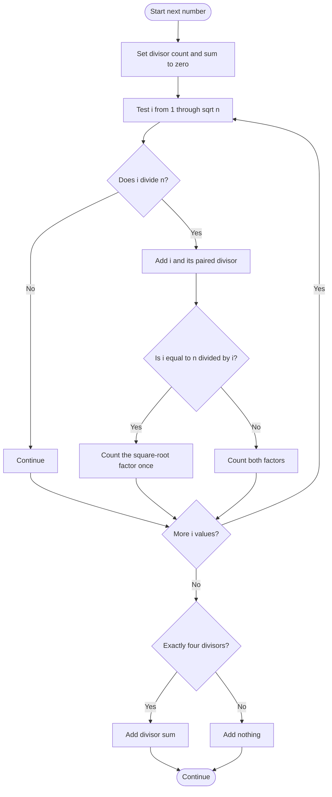

# 1390 — Four Divisors

## 1. Understanding

या प्रश्नाचा गाभा म्हणजे नेमके चार विभाजक असलेल्या संख्यांची बेरीज.

> **मराठी:** प्रश्नात काय दिले आहे आणि नेमके काय शोधायचे आहे, हे आधी स्पष्ट करा.
> For each value, add the sum of its divisors only when it has exactly four positive divisors.

## 2. Worked examples and edge cases

उदाहरणे आणि सीमाप्रकरणांत नेमके चार विभाजक असलेल्या संख्यांची बेरीज कशी लागू होते ते पाहा.

> **मराठी:** उदाहरणातील input पासून output पर्यंत प्रत्येक बदल समजून घ्या.
> `21` has divisors `1,3,7,21`, sum `32`; `8` has four divisors `1,2,4,8`, sum `15`; `16` has five, so contributes zero. Repeated inputs contribute repeatedly.

## 3. Pattern identification + cheat sheet

येथे मुख्य pattern म्हणजे वर्गमूळापर्यंत विभाजकांच्या जोड्या तपासणे; वरील तुलना लक्षात घ्या.

> **मराठी:** या clues मुळे योग्य pattern ओळखता येतो; constraints आणि relations नीट तपासा.
> This is **divisor enumeration with paired factors**, plus an optional number-theory classification.
> | Divisor found | Pair |
> |---|---|
> | `i` divides `n` | `n/i` |
> | `i*i==n` | Count only once |
> | Exactly four divisors | Add their sum |

## 4. Approaches

पद्धतींची तुलना करताना वर्गमूळापर्यंत विभाजकांच्या जोड्या तपासणे याचा वेळ आणि जागेवरील परिणाम पाहा.

> **मराठी:** सोप्या उपायापासून सुरुवात करा आणि constraints नुसार योग्य optimization निवडा.

- Source brute force checks `i` through `sqrt(n)`, counts/sums factor pairs: reliable `O(sqrt n)` per item.
- Source memoization saves repeated values; useful when duplicates dominate.
- Mathematical approach classifies four-divisor numbers as `p³` or `p*q` for distinct primes, but its square-root factor scan and primality tests are not uniformly faster.

## 5. Mermaid flowchart and explanation

आकृतीमध्ये वर्गमूळापर्यंत विभाजकांच्या जोड्या तपासणे ही प्रक्रिया क्रमाने दाखवली आहे.

> **मराठी:** Flowchart मध्ये प्रत्येक decision, loop आणि loop कधी थांबतो ते पाहा.
> Count each factor and its paired factor, avoiding double-counting a square root.

## 6. Algorithm / intuition

मूळ कल्पना: वर्गमूळापर्यंत विभाजकांच्या जोड्या तपासणे.

> **मराठी:** मुख्य observation समजल्यावर algorithm चे steps लक्षात ठेवणे सोपे होते.
> Factors arrive in pairs around `sqrt(n)`. For each divisor, add both members unless they are the same square root. After scanning, include the sum only when count equals four.

## 7. Code explanation

Code मधील state आणि updates हे वर्गमूळापर्यंत विभाजकांच्या जोड्या तपासणे या कल्पनेशी जोडून वाचा.

> **मराठी:** Code मधील variable आणि condition यांचा algorithm मधील उद्देश समजून घ्या.
> `sumFourDivisors_bruteforce` implements paired enumeration. `_memo` caches each number's sum or `-1`. `_math` checks prime cubes and distinct prime factors. The demo invokes all three; the direct divisor counter is easiest to trust.

## 8. Dry run

Dry run मध्ये वर्गमूळापर्यंत विभाजकांच्या जोड्या तपासणे कसे घडते ते प्रत्येक टप्प्यावर तपासा.

> **मराठी:** प्रत्येक महत्त्वाच्या step नंतर variable ची value trace करा.
> For `n=21`, factor pairs are:
> | `i` | Paired factor | Count | Sum |
> |---:|---:|---:|---:|
> | 1 | 21 | 2 | 22 |
> | 3 | 7 | 4 | 32 |
> Exactly four, so add `32`.

## 9. Complexity

वर्गमूळापर्यंत विभाजकांच्या जोड्या तपासणे यासाठी लागणारा वेळ आणि अतिरिक्त जागा वरील bounds मध्ये दिली आहेत.

> **मराठी:** Input size आणि प्रत्येक operation कितीदा चालतो यावरून complexity ठरवा.
> Brute force `O(Σ√x)` time and `O(1)` auxiliary space. Memoized version adds `O(u)` space and avoids repeated scans. Mathematical method has repeated primality tests; do not assume it is `O(n)` overall.

## 10. Correctness

योग्यतेचा युक्तिवाद वर्गमूळापर्यंत विभाजकांच्या जोड्या तपासणे यावर आधारित आहे; वरील अटी तपासा.

> **मराठी:** Invariant किंवा तर्क वापरून algorithm योग्य उत्तर देतो हे समजून घ्या.
> Every divisor `d≤sqrt(n)` is visited, and its complementary divisor `n/d` is added; every divisor is therefore counted once, including a square root only once. The count test selects exactly the required numbers, and their accumulated factor sum is correct.

## 11. Mistakes / interview traps

लक्षात ठेवा: पूर्ण वर्गाचा समान विभाजक दोनदा मोजू नये.

> **मराठी:** Boundary, duplicate आणि off-by-one cases स्वतंत्रपणे तपासा.

- Use `i <= num/i` or safe multiplication to avoid overflow in `i*i`.
- Count a perfect-square root once.
- Don't add divisor sums for numbers with a different divisor count.
- A number has exactly four divisors iff it is `p³` or `p*q` for distinct primes.

## 12. Quick revision

थोडक्यात, वर्गमूळापर्यंत विभाजकांच्या जोड्या तपासणे. पूर्ण वर्गाचा समान विभाजक दोनदा मोजू नये.

> **मराठी:** दोन मिनिटांच्या revision साठी pattern, मुख्य कल्पना आणि complexity आठवा.
> Scan to square root → factor pair → count and sum → add only if count is four.

## 13. Related problems / variations

संबंधित प्रश्नांत नेमके चार विभाजक असलेल्या संख्यांची बेरीज यासारखी अट बदलल्यास योग्य पद्धतही तपासा.

> **मराठी:** Related problem मध्ये constraints बदलल्यास approach कसा बदलेल ते विचारा.
> Count Primes, Sum of All Divisors, Perfect Number; variation: count exactly `k` divisors or use a sieve for many bounded queries.

## 14. Self-assessment

वरील प्रश्न स्वतः सोडवून नेमके चार विभाजक असलेल्या संख्यांची बेरीज याची उजळणी करा.

> **मराठी:** उत्तर न पाहता प्रश्न सोडवा आणि तुमच्या निवडीचे कारण सांगा.

1. Why stop at `sqrt(n)`?
2. How is a perfect-square factor handled?
3. Why does `p³` have four divisors?
4. What does memoization improve?
