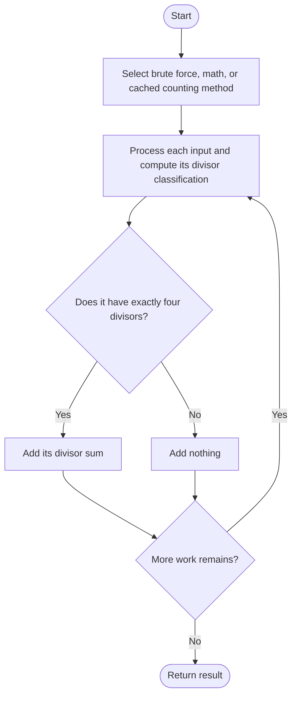

# Four Divisors — LeetCode 1390

## Problem and judge interface

`int sumFourDivisors(vector<int>& nums)`; return the sum of divisors for values having exactly four positive divisors.

## Identification evidence

Three implementations count or characterize numbers with exactly four divisors and add their divisor sum, identifying problem 1390.

## Main flow



## Important branch / loop

```mermaid
flowchart TD
 A[Test candidate divisor i up to sqrt(x)] --> B{Does i divide x?}
 B -- Yes --> C[Add i and paired divisor once if square]
 B -- No --> D[Continue to next candidate]
 C --> E([Continue or return as indicated])
 D --> E
```

## Core logic and invariants

Brute force enumerates divisor pairs up to sqrt(x); math recognizes p^3 or distinct prime p*q; memoized brute force caches divisor sum or a nonqualifying sentinel for repeated inputs.

## Complexity

Brute force O(sum sqrt(x)); math uses trial division and primality tests; memoized O(sum sqrt(u)) for u unique values plus O(u) cache.

## Comparison and optimization

The source methods are named `sumFourDivisors_bruteforce`, `sumFourDivisors_math`, and `sumFourDivisors_memo`; adapt the selected variant to the judge method name. Math uses the four-divisor prime-factor characterization; memoization helps repeated values; direct counting is simplest.

## Compile and run

The `.cpp` is the original standalone source, including its local `main()` demonstration where present. Compile and run from the repository root with a C++17 compiler:

```text
g++ -std=c++17 LeetCode\1390\1390.cpp -o solution.exe
.\solution.exe
```

For LeetCode, adapt the implementation to the required class/method signature and omit the local `main()` and demonstration helpers; use the judge-provided node types. Notes above identify method-name or behavior differences. The moved source bytes have not been edited.


