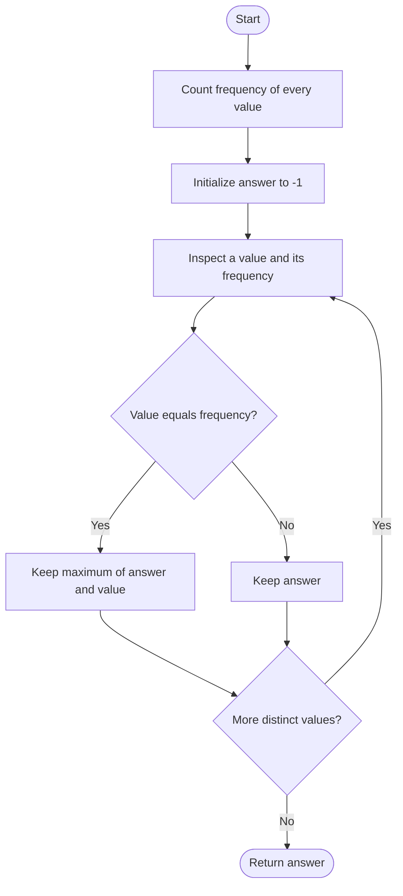

# 1394 — Find Lucky Integer in an Array

## 1. Understanding

या प्रश्नाचा गाभा म्हणजे वारंवारता आणि मूल्य समान असलेली सर्वात मोठी संख्या.

> **मराठी:** प्रश्नात काय दिले आहे आणि नेमके काय शोधायचे आहे, हे आधी स्पष्ट करा.
> An integer is lucky when its frequency equals its value; return the largest lucky integer, or `-1` if none exists.

## 2. Worked examples and edge cases

उदाहरणे आणि सीमाप्रकरणांत वारंवारता आणि मूल्य समान असलेली सर्वात मोठी संख्या कशी लागू होते ते पाहा.

> **मराठी:** उदाहरणातील input पासून output पर्यंत प्रत्येक बदल समजून घ्या.
> In `[1,2,2,3,3,3]`, `2` occurs twice and `3` occurs three times, so return `3`. If no value matches its frequency, return `-1`.

## 3. Pattern identification + cheat sheet

येथे मुख्य pattern म्हणजे frequency table वापरून पात्र मूल्य निवडणे; वरील तुलना लक्षात घ्या.

> **मराठी:** या clues मुळे योग्य pattern ओळखता येतो; constraints आणि relations नीट तपासा.
> This is **frequency counting + filtered maximum**.
> | Step | Operation |
> |---|---|
> | Count values | Hash map or bounded array |
> | Lucky predicate | `value == frequency` |
> | Select answer | Maximum qualifying value |

## 4. Approaches

पद्धतींची तुलना करताना frequency table वापरून पात्र मूल्य निवडणे याचा वेळ आणि जागेवरील परिणाम पाहा.

> **मराठी:** सोप्या उपायापासून सुरुवात करा आणि constraints नुसार योग्य optimization निवडा.

- For every distinct value, recount the whole array: correct but `O(nu)`.
- Source uses `unordered_map` in one pass, then checks each distinct value: expected `O(n)`.
- If values have a small known range, an array counter can be simpler and faster.

## 5. Mermaid flowchart and explanation

आकृतीमध्ये frequency table वापरून पात्र मूल्य निवडणे ही प्रक्रिया क्रमाने दाखवली आहे.

> **मराठी:** Flowchart मध्ये प्रत्येक decision, loop आणि loop कधी थांबतो ते पाहा.
> Frequency collection and candidate checking are separate passes.

## 6. Algorithm / intuition

मूळ कल्पना: frequency table वापरून पात्र मूल्य निवडणे.

> **मराठी:** मुख्य observation समजल्यावर algorithm चे steps लक्षात ठेवणे सोपे होते.
> Build a frequency table, then scan its entries. A matching key/count is a candidate; keep the largest one.

## 7. Code explanation

Code मधील state आणि updates हे frequency table वापरून पात्र मूल्य निवडणे या कल्पनेशी जोडून वाचा.

> **मराठी:** Code मधील variable आणि condition यांचा algorithm मधील उद्देश समजून घ्या.
> `findLucky` increments `ump[i]`, starts `Result=-1`, and checks each `(i,j)` for `i==j`, updating with `max`. Unordered iteration is safe because the maximum is explicit.

## 8. Dry run

Dry run मध्ये frequency table वापरून पात्र मूल्य निवडणे कसे घडते ते प्रत्येक टप्प्यावर तपासा.

> **मराठी:** प्रत्येक महत्त्वाच्या step नंतर variable ची value trace करा.
> For `[2,2,3,3,3]`:
> | Value | Frequency | Lucky? | Answer |
> |---:|---:|---|---:|
> | 2 | 2 | Yes | 2 |
> | 3 | 3 | Yes | 3 |

## 9. Complexity

frequency table वापरून पात्र मूल्य निवडणे यासाठी लागणारा वेळ आणि अतिरिक्त जागा वरील bounds मध्ये दिली आहेत.

> **मराठी:** Input size आणि प्रत्येक operation कितीदा चालतो यावरून complexity ठरवा.
> Expected `O(n+u)` time and `O(u)` space, where `u` is number of distinct values. Hash worst-case can be slower.

## 10. Correctness

योग्यतेचा युक्तिवाद frequency table वापरून पात्र मूल्य निवडणे यावर आधारित आहे; वरील अटी तपासा.

> **मराठी:** Invariant किंवा तर्क वापरून algorithm योग्य उत्तर देतो हे समजून घ्या.
> The map records exact frequencies. The second pass tests the problem's defining equality for every distinct value and retains the greatest match. Starting at `-1` correctly represents no candidate.

## 11. Mistakes / interview traps

लक्षात ठेवा: पात्र संख्या नसेल तर -1 परत करायचे.

> **मराठी:** Boundary, duplicate आणि off-by-one cases स्वतंत्रपणे तपासा.

- Return the largest qualifying value, not the first map entry.
- `-1` is the required no-match result.
- A value need not be unique in the input.
- Do not compare a value to array index or total length.

## 12. Quick revision

थोडक्यात, frequency table वापरून पात्र मूल्य निवडणे. पात्र संख्या नसेल तर -1 परत करायचे.

> **मराठी:** दोन मिनिटांच्या revision साठी pattern, मुख्य कल्पना आणि complexity आठवा.
> Hash frequency → test `key==count` → max, default `-1`.

## 13. Related problems / variations

संबंधित प्रश्नांत वारंवारता आणि मूल्य समान असलेली सर्वात मोठी संख्या यासारखी अट बदलल्यास योग्य पद्धतही तपासा.

> **मराठी:** Related problem मध्ये constraints बदलल्यास approach कसा बदलेल ते विचारा.
> Majority Element, Top K Frequent Elements, degree of an array; variation: return all lucky values or smallest lucky value.

## 14. Self-assessment

वरील प्रश्न स्वतः सोडवून वारंवारता आणि मूल्य समान असलेली सर्वात मोठी संख्या याची उजळणी करा.

> **मराठी:** उत्तर न पाहता प्रश्न सोडवा आणि तुमच्या निवडीचे कारण सांगा.

1. Why is unordered-map iteration order irrelevant?
2. Why initialize the answer to `-1`?
3. What is the lucky condition?
4. How could a bounded array replace the map?
