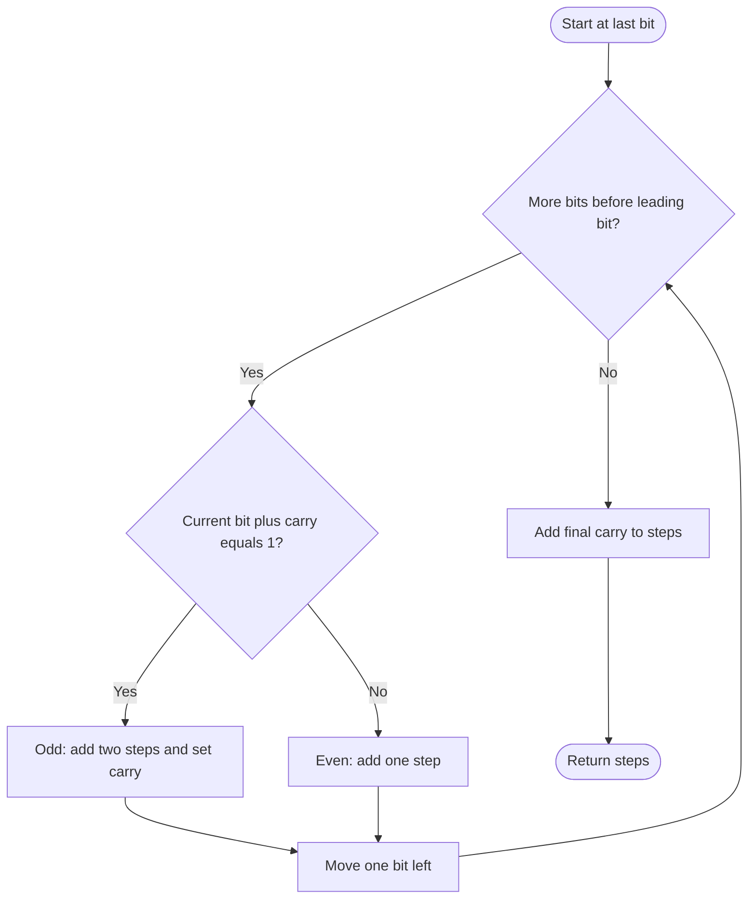

# 1404 — Number of Steps to Reduce a Number in Binary Representation to One

## 1. Understanding

या प्रश्नाचा गाभा म्हणजे binary संख्येला एक करण्यासाठी लागणाऱ्या पायऱ्या.

> **मराठी:** प्रश्नात काय दिले आहे आणि नेमके काय शोधायचे आहे, हे आधी स्पष्ट करा.
> For a positive binary string, repeatedly divide an even value by two or add one to an odd value; count steps until one.

## 2. Worked examples and edge cases

उदाहरणे आणि सीमाप्रकरणांत binary संख्येला एक करण्यासाठी लागणाऱ्या पायऱ्या कशी लागू होते ते पाहा.

> **मराठी:** उदाहरणातील input पासून output पर्यंत प्रत्येक बदल समजून घ्या.
> `"1101"` (`13`) takes 6 steps. `"1"` takes 0. The input may be too long for a built-in integer, so process the string directly.

## 3. Pattern identification + cheat sheet

येथे मुख्य pattern म्हणजे उजवीकडून bits आणि carry तपासणे; वरील तुलना लक्षात घ्या.

> **मराठी:** या clues मुळे योग्य pattern ओळखता येतो; constraints आणि relations नीट तपासा.
> This is **binary arithmetic by scanning bits with carry**.
> | Effective low bit | Operation | Steps |
> |---|---|---:|
> | 0 | Divide by 2 | 1 |
> | 1 | Add 1, then divide | 2 |

## 4. Approaches

पद्धतींची तुलना करताना उजवीकडून bits आणि carry तपासणे याचा वेळ आणि जागेवरील परिणाम पाहा.

> **मराठी:** सोप्या उपायापासून सुरुवात करा आणि constraints नुसार योग्य optimization निवडा.

- Source direct string simulation: correct but worst-case `O(n²)` due to edits/carry propagation.
- Source `numSteps_bigint`: manual simulation, also `O(n²)` worst case.
- Source optimized carry scan: `O(n)` time, `O(1)` extra space; use for long inputs.

## 5. Mermaid flowchart and explanation

आकृतीमध्ये उजवीकडून bits आणि carry तपासणे ही प्रक्रिया क्रमाने दाखवली आहे.

> **मराठी:** Flowchart मध्ये प्रत्येक decision, loop आणि loop कधी थांबतो ते पाहा.
> Scan from least significant bit toward the leading one; carry records the effect of prior increments.

## 6. Algorithm / intuition

मूळ कल्पना: उजवीकडून bits आणि carry तपासणे.

> **मराठी:** मुख्य observation समजल्यावर algorithm चे steps लक्षात ठेवणे सोपे होते.
> At a bit position, `bit+carry` determines whether the current value is odd. Odd requires `+1` then `/2` (two operations) and leaves carry one; even needs only `/2`. The leading bit is already the final one except possibly for its carry.

## 7. Code explanation

Code मधील state आणि updates हे उजवीकडून bits आणि carry तपासणे या कल्पनेशी जोडून वाचा.

> **मराठी:** Code मधील variable आणि condition यांचा algorithm मधील उद्देश समजून घ्या.
> `numSteps_optimized` loops from `s.size()-1` down to index `1`; it adds two and sets carry for effective one, otherwise adds one. The result is `steps+carry`. Simulation methods mutate a string. `main()` compares all approaches.

## 8. Dry run

Dry run मध्ये उजवीकडून bits आणि carry तपासणे कसे घडते ते प्रत्येक टप्प्यावर तपासा.

> **मराठी:** प्रत्येक महत्त्वाच्या step नंतर variable ची value trace करा.
> For `"10"`:
> | Bit processed | Carry in | Effective bit | Steps added | Carry out |
> |---|---:|---:|---:|---:|
> | index 1 (`0`) | 0 | 0 | 1 | 0 |
> | leading bit | — | — | final 0 | — |
> Answer `1` (`10` → `1`).

## 9. Complexity

उजवीकडून bits आणि carry तपासणे यासाठी लागणारा वेळ आणि अतिरिक्त जागा वरील bounds मध्ये दिली आहेत.

> **मराठी:** Input size आणि प्रत्येक operation कितीदा चालतो यावरून complexity ठरवा.
> Optimized scan `O(n)` time, `O(1)` extra space. The source's string simulations can take `O(n²)` time due to shifting or repeated character edits.

## 10. Correctness

योग्यतेचा युक्तिवाद उजवीकडून bits आणि carry तपासणे यावर आधारित आहे; वरील अटी तपासा.

> **मराठी:** Invariant किंवा तर्क वापरून algorithm योग्य उत्तर देतो हे समजून घ्या.
> For every non-leading bit, the effective bit after carry completely determines parity. If odd, incrementing then dividing costs two steps and propagates a carry; if even, division costs one and no carry. Processing from right to left accounts for every operation, and the final carry handles the leading overflow case.

## 11. Mistakes / interview traps

लक्षात ठेवा: शेवटी उरलेला carry विसरू नये.

> **मराठी:** Boundary, duplicate आणि off-by-one cases स्वतंत्रपणे तपासा.

- Stop before processing the leading bit as an ordinary position.
- Remember an odd state costs two operations, not one.
- `"1"` must return zero.
- Do not parse a potentially huge binary string into an integer.

## 12. Quick revision

थोडक्यात, उजवीकडून bits आणि carry तपासणे. शेवटी उरलेला carry विसरू नये.

> **मराठी:** दोन मिनिटांच्या revision साठी pattern, मुख्य कल्पना आणि complexity आठवा.
> Right-to-left carry: effective 1 → `+2 steps, carry=1`; effective 0 → `+1`; final answer `steps+carry`.

## 13. Related problems / variations

संबंधित प्रश्नांत binary संख्येला एक करण्यासाठी लागणाऱ्या पायऱ्या यासारखी अट बदलल्यास योग्य पद्धतही तपासा.

> **मराठी:** Related problem मध्ये constraints बदलल्यास approach कसा बदलेल ते विचारा.
> Add Binary, Number of Steps to Reduce a Number to Zero, binary increment; variation: explain each operation on arbitrary-precision binary input.

## 14. Self-assessment

वरील प्रश्न स्वतः सोडवून binary संख्येला एक करण्यासाठी लागणाऱ्या पायऱ्या याची उजळणी करा.

> **मराठी:** उत्तर न पाहता प्रश्न सोडवा आणि तुमच्या निवडीचे कारण सांगा.

1. Why does an odd value cost two steps?
2. What does carry represent?
3. Why is the leading bit not processed in the loop?
4. Why can direct simulation be quadratic?
