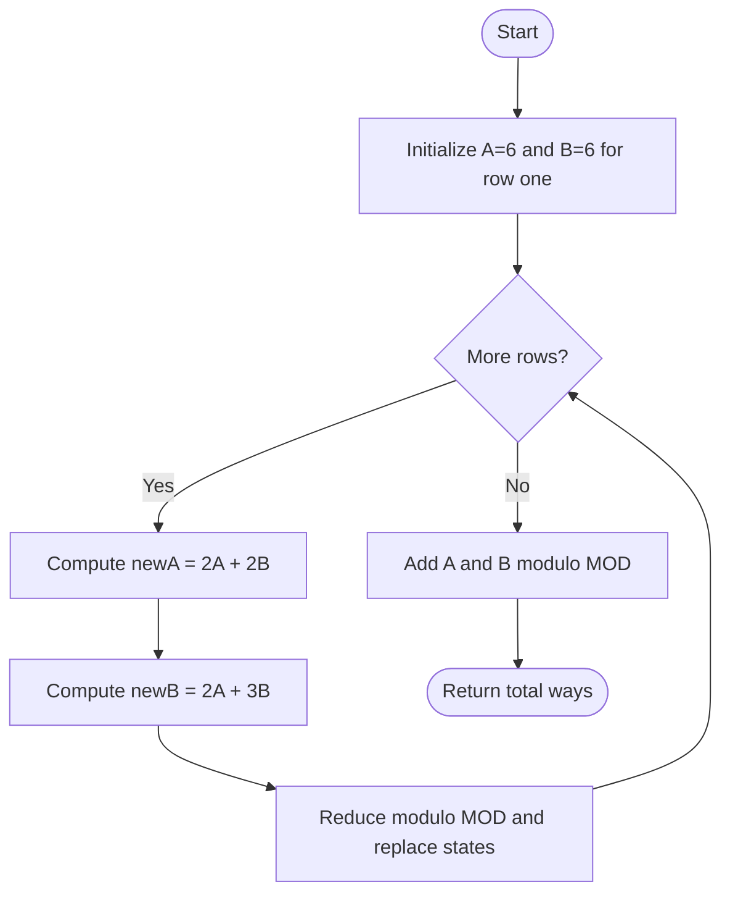

# 1411 — Number of Ways to Paint N × 3 Grid

## 1. Understanding

या प्रश्नाचा गाभा म्हणजे तीन स्तंभांच्या grid ला रंगवण्याच्या पद्धती.

> **मराठी:** प्रश्नात काय दिले आहे आणि नेमके काय शोधायचे आहे, हे आधी स्पष्ट करा.
> Color an `n×3` grid with three colors so adjacent cells in each row and column differ; count ways modulo `1,000,000,007`.

## 2. Worked examples and edge cases

उदाहरणे आणि सीमाप्रकरणांत तीन स्तंभांच्या grid ला रंगवण्याच्या पद्धती कशी लागू होते ते पाहा.

> **मराठी:** उदाहरणातील input पासून output पर्यंत प्रत्येक बदल समजून घ्या.
> For one row there are 12 patterns: 6 of type `ABA` (first and third same) and 6 of type `ABC` (all different). Source names these types `B` and `A` respectively.

## 3. Pattern identification + cheat sheet

येथे मुख्य pattern म्हणजे मागील रांगेच्या pattern वर्गांवर DP करणे; वरील तुलना लक्षात घ्या.

> **मराठी:** या clues मुळे योग्य pattern ओळखता येतो; constraints आणि relations नीट तपासा.
> This is **finite-state dynamic programming**: group row patterns by transition behavior.
> | Type | Row shape | Next-row count |
> |---|---|---|
> | A | all three different | `2A+2B` |
> | B | first and third same | `2A+3B` |

## 4. Approaches

पद्धतींची तुलना करताना मागील रांगेच्या pattern वर्गांवर DP करणे याचा वेळ आणि जागेवरील परिणाम पाहा.

> **मराठी:** सोप्या उपायापासून सुरुवात करा आणि constraints नुसार योग्य optimization निवडा.

- Enumerate all row colorings and transitions: possible but unnecessarily complex.
- Source full-array DP: `O(n)` time, `O(n)` space.
- Source rolling two-state DP: `O(n)` time, `O(1)` space; recommended for normal constraints.
- Source matrix exponentiation: `O(log n)` for very large `n`.

## 5. Mermaid flowchart and explanation

आकृतीमध्ये मागील रांगेच्या pattern वर्गांवर DP करणे ही प्रक्रिया क्रमाने दाखवली आहे.

> **मराठी:** Flowchart मध्ये प्रत्येक decision, loop आणि loop कधी थांबतो ते पाहा.
> The two pattern counts transition together row by row.

## 6. Algorithm / intuition

मूळ कल्पना: मागील रांगेच्या pattern वर्गांवर DP करणे.

> **मराठी:** मुख्य observation समजल्यावर algorithm चे steps लक्षात ठेवणे सोपे होते.
> Adjacent constraints depend on the previous row's pattern class, not its exact colors. Track counts for each class and apply the two transitions. Keep intermediates in `long long` before modulo.

## 7. Code explanation

Code मधील state आणि updates हे मागील रांगेच्या pattern वर्गांवर DP करणे या कल्पनेशी जोडून वाचा.

> **मराठी:** Code मधील variable आणि condition यांचा algorithm मधील उद्देश समजून घ्या.
> `numOfWays_OptimizedDP` rolls `A,B`; `FullDP` stores every row; `MatrixExpo` raises transition matrix `[[2,2],[2,3]]` to `n-1`. All return `(A+B)%MOD`; source assumes `n>=1`.

## 8. Dry run

Dry run मध्ये मागील रांगेच्या pattern वर्गांवर DP करणे कसे घडते ते प्रत्येक टप्प्यावर तपासा.

> **मराठी:** प्रत्येक महत्त्वाच्या step नंतर variable ची value trace करा.
> For row two, starting `A=B=6`:
> | State | Calculation | Count |
> |---|---|---:|
> | `newA` | `2·6+2·6` | 24 |
> | `newB` | `2·6+3·6` | 30 |
> | Total | `24+30` | 54 |

## 9. Complexity

मागील रांगेच्या pattern वर्गांवर DP करणे यासाठी लागणारा वेळ आणि अतिरिक्त जागा वरील bounds मध्ये दिली आहेत.

> **मराठी:** Input size आणि प्रत्येक operation कितीदा चालतो यावरून complexity ठरवा.
> Rolling DP `O(n)` time, `O(1)` space; full DP `O(n)` space; matrix exponentiation `O(log n)` time and `O(1)` matrix space.

## 10. Correctness

योग्यतेचा युक्तिवाद मागील रांगेच्या pattern वर्गांवर DP करणे यावर आधारित आहे; वरील अटी तपासा.

> **मराठी:** Invariant किंवा तर्क वापरून algorithm योग्य उत्तर देतो हे समजून घ्या.
> Every valid row belongs to exactly one of the two patterns. The transition coefficients count exactly the next-row patterns compatible with each prior class. Starting counts enumerate every valid first row, so induction gives exact class counts at every row; their sum is the answer.

## 11. Mistakes / interview traps

लक्षात ठेवा: गणनेत modulo आणि मोठा integer type वापरायचा.

> **मराठी:** Boundary, duplicate आणि off-by-one cases स्वतंत्रपणे तपासा.

- Define the two pattern classes consistently; source calls all-different `A`.
- Enforce both horizontal and vertical adjacency.
- Apply modulo and use wide arithmetic.
- Matrix exponent is `n-1`, since initial counts describe row one.

## 12. Quick revision

थोडक्यात, मागील रांगेच्या pattern वर्गांवर DP करणे. गणनेत modulo आणि मोठा integer type वापरायचा.

> **मराठी:** दोन मिनिटांच्या revision साठी pattern, मुख्य कल्पना आणि complexity आठवा.
> Start `(A,B)=(6,6)`; transition `(2A+2B,2A+3B)`; answer `A+B mod MOD`.

## 13. Related problems / variations

संबंधित प्रश्नांत तीन स्तंभांच्या grid ला रंगवण्याच्या पद्धती यासारखी अट बदलल्यास योग्य पद्धतही तपासा.

> **मराठी:** Related problem मध्ये constraints बदलल्यास approach कसा बदलेल ते विचारा.
> Domino and Tromino Tiling, Paint House, coloring grids; variation: more columns/colors with a larger state set.

## 14. Self-assessment

वरील प्रश्न स्वतः सोडवून तीन स्तंभांच्या grid ला रंगवण्याच्या पद्धती याची उजळणी करा.

> **मराठी:** उत्तर न पाहता प्रश्न सोडवा आणि तुमच्या निवडीचे कारण सांगा.

1. What distinguishes pattern types A and B?
2. Why are there six starting patterns of each type?
3. Why use old values to compute both next states?
4. When is matrix exponentiation preferable?
