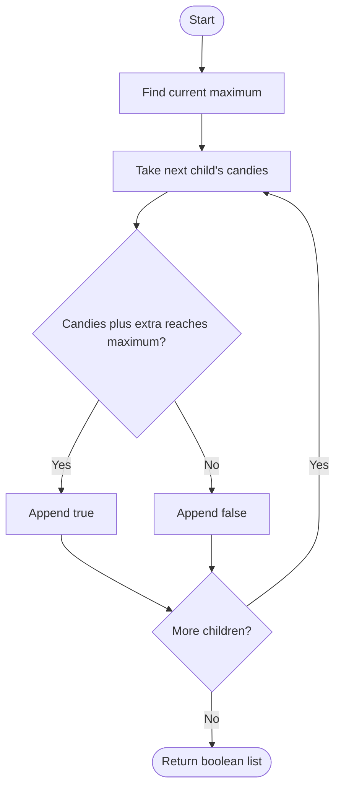

# 1431 — Kids With the Greatest Number of Candies

## 1. Understanding

या प्रश्नाचा गाभा म्हणजे extra candies दिल्यावर सर्वाधिक होऊ शकणाऱ्या मुलांची ओळख.

> **मराठी:** प्रश्नात काय दिले आहे आणि नेमके काय शोधायचे आहे, हे आधी स्पष्ट करा.
> For each child, decide whether adding all `extraCandies` would make their count at least the current maximum.

## 2. Worked examples and edge cases

उदाहरणे आणि सीमाप्रकरणांत extra candies दिल्यावर सर्वाधिक होऊ शकणाऱ्या मुलांची ओळख कशी लागू होते ते पाहा.

> **मराठी:** उदाहरणातील input पासून output पर्यंत प्रत्येक बदल समजून घ्या.
> For `[2,3,5,1,3]` with `3` extra, compare each `candies[i]+3` to `5`; result `[true,true,true,false,true]`. A child already at the maximum remains true.

## 3. Pattern identification + cheat sheet

येथे मुख्य pattern म्हणजे सध्याच्या कमाल संख्येशी प्रत्येक मुलाची तुलना करणे; वरील तुलना लक्षात घ्या.

> **मराठी:** या clues मुळे योग्य pattern ओळखता येतो; constraints आणि relations नीट तपासा.
> This is a **global extremum followed by independent comparisons**.
> | Step | Operation |
> |---|---|
> | Find threshold | Maximum current candies |
> | Evaluate child | `count + extra >= threshold` |
> | Preserve order | Append one boolean per child |

## 4. Approaches

पद्धतींची तुलना करताना सध्याच्या कमाल संख्येशी प्रत्येक मुलाची तुलना करणे याचा वेळ आणि जागेवरील परिणाम पाहा.

> **मराठी:** सोप्या उपायापासून सुरुवात करा आणि constraints नुसार योग्य optimization निवडा.

- Recompute maximum for every child: correct but `O(n²)`.
- Source finds maximum once then scans: optimal `O(n)`.
- Sorting is unnecessary and would complicate preserving original order.

## 5. Mermaid flowchart and explanation

आकृतीमध्ये सध्याच्या कमाल संख्येशी प्रत्येक मुलाची तुलना करणे ही प्रक्रिया क्रमाने दाखवली आहे.

> **मराठी:** Flowchart मध्ये प्रत्येक decision, loop आणि loop कधी थांबतो ते पाहा.
> The threshold stays fixed; each child is tested independently.

## 6. Algorithm / intuition

मूळ कल्पना: सध्याच्या कमाल संख्येशी प्रत्येक मुलाची तुलना करणे.

> **मराठी:** मुख्य observation समजल्यावर algorithm चे steps लक्षात ठेवणे सोपे होते.
> Only the existing maximum matters: after giving extra candies, a child can be greatest iff their updated count is at least this threshold. Compute the maximum once, then compare.

## 7. Code explanation

Code मधील state आणि updates हे सध्याच्या कमाल संख्येशी प्रत्येक मुलाची तुलना करणे या कल्पनेशी जोडून वाचा.

> **मराठी:** Code मधील variable आणि condition यांचा algorithm मधील उद्देश समजून घ्या.
> `kidsWithCandies` calls `max_element`, reserves result space, and appends the predicate for every count. The method assumes a nonempty vector as guaranteed by constraints.

## 8. Dry run

Dry run मध्ये सध्याच्या कमाल संख्येशी प्रत्येक मुलाची तुलना करणे कसे घडते ते प्रत्येक टप्प्यावर तपासा.

> **मराठी:** प्रत्येक महत्त्वाच्या step नंतर variable ची value trace करा.
> `candies=[2,3,5,1]`, extra `3`, maximum `5`:
> | Child count | Updated | `>=5` |
> |---:|---:|---|
> | 2 | 5 | true |
> | 3 | 6 | true |
> | 5 | 8 | true |
> | 1 | 4 | false |

## 9. Complexity

सध्याच्या कमाल संख्येशी प्रत्येक मुलाची तुलना करणे यासाठी लागणारा वेळ आणि अतिरिक्त जागा वरील bounds मध्ये दिली आहेत.

> **मराठी:** Input size आणि प्रत्येक operation कितीदा चालतो यावरून complexity ठरवा.
> `O(n)` time: one maximum scan plus one comparison scan. Output is `O(n)`; extra working space excluding output is `O(1)`.

## 10. Correctness

योग्यतेचा युक्तिवाद सध्याच्या कमाल संख्येशी प्रत्येक मुलाची तुलना करणे यावर आधारित आहे; वरील अटी तपासा.

> **मराठी:** Invariant किंवा तर्क वापरून algorithm योग्य उत्तर देतो हे समजून घ्या.
> The maximum is exactly the threshold a child must reach or exceed to tie/become greatest among the original counts. The method tests this condition for every child and appends results in input order, so each boolean is correct.

## 11. Mistakes / interview traps

लक्षात ठेवा: समान कमाल असल्यास उत्तर true आहे.

> **मराठी:** Boundary, duplicate आणि off-by-one cases स्वतंत्रपणे तपासा.

- Compare with the original maximum, not a changing maximum.
- Use `>=`, since tying for greatest qualifies.
- Return booleans in original order.
- Avoid sorting when only a maximum is needed.

## 12. Quick revision

थोडक्यात, सध्याच्या कमाल संख्येशी प्रत्येक मुलाची तुलना करणे. समान कमाल असल्यास उत्तर true आहे.

> **मराठी:** दोन मिनिटांच्या revision साठी pattern, मुख्य कल्पना आणि complexity आठवा.
> Find max once → test `x+extra >= max` for each `x`.

## 13. Related problems / variations

संबंधित प्रश्नांत extra candies दिल्यावर सर्वाधिक होऊ शकणाऱ्या मुलांची ओळख यासारखी अट बदलल्यास योग्य पद्धतही तपासा.

> **मराठी:** Related problem मध्ये constraints बदलल्यास approach कसा बदलेल ते विचारा.
> Running maximum, array threshold queries, maximum candies allocation; variation: ask whether each child can exceed a target or maximum after a bounded allocation.

## 14. Self-assessment

वरील प्रश्न स्वतः सोडवून extra candies दिल्यावर सर्वाधिक होऊ शकणाऱ्या मुलांची ओळख याची उजळणी करा.

> **मराठी:** उत्तर न पाहता प्रश्न सोडवा आणि तुमच्या निवडीचे कारण सांगा.

1. Why is the maximum computed before updates?
2. Does tying for maximum qualify?
3. Why is sorting unnecessary?
4. How many passes does the implementation make?
