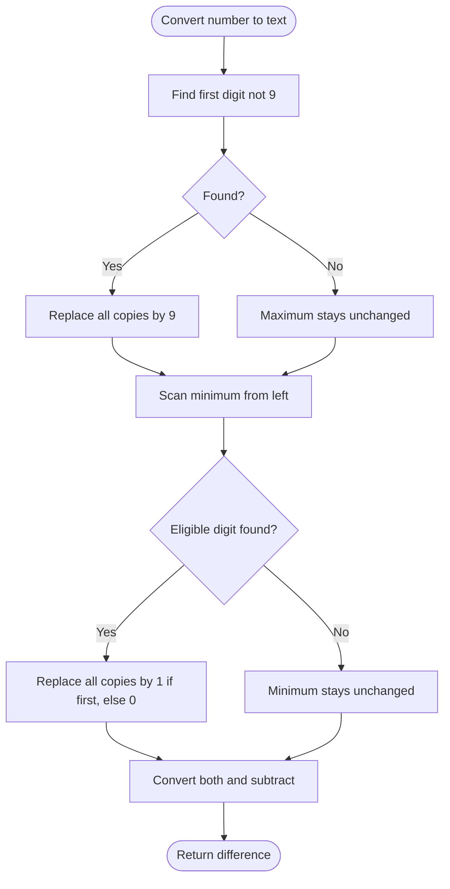

# 1432 — Max Difference You Can Get From Changing an Integer

## 1. Understanding

या प्रश्नाचा गाभा म्हणजे अंक बदलून मिळणाऱ्या कमाल आणि किमान संख्यांतील फरक.

> **मराठी:** प्रश्नात काय दिले आहे आणि नेमके काय शोधायचे आहे, हे आधी स्पष्ट करा.
> Choose one digit and replace every occurrence of it to create a maximum number, and independently do the same to create a minimum number. Neither result may have a leading zero; maximize their difference.

## 2. Worked examples and edge cases

उदाहरणे आणि सीमाप्रकरणांत अंक बदलून मिळणाऱ्या कमाल आणि किमान संख्यांतील फरक कशी लागू होते ते पाहा.

> **मराठी:** उदाहरणातील input पासून output पर्यंत प्रत्येक बदल समजून घ्या.
> For `num=123456`, maximum replaces first non-9 digit `1→9`; minimum replaces the first digit `1` with `1` (no change), then next eligible digit `2→0`. For all nines, maximum is unchanged.

## 3. Pattern identification + cheat sheet

येथे मुख्य pattern म्हणजे स्थानमूल्य पाहून निवडलेल्या अंकाच्या सर्व occurrences बदलणे; वरील तुलना लक्षात घ्या.

> **मराठी:** या clues मुळे योग्य pattern ओळखता येतो; constraints आणि relations नीट तपासा.
> This is **greedy digit replacement by place value**, with a leading-digit constraint.
> | Goal | First eligible digit | Replacement |
> |---|---|---|
> | Maximize | First digit not 9 | Replace all its copies with 9 |
> | Minimize, first digit | First digit not 1 or 0 | Replace all copies with 1 |
> | Minimize, later digit | First digit not 0 or 1 | Replace all copies with 0 |

## 4. Approaches

पद्धतींची तुलना करताना स्थानमूल्य पाहून निवडलेल्या अंकाच्या सर्व occurrences बदलणे याचा वेळ आणि जागेवरील परिणाम पाहा.

> **मराठी:** सोप्या उपायापासून सुरुवात करा आणि constraints नुसार योग्य optimization निवडा.

- Try every digit/replacement and keep valid extrema: correct but unnecessary.
- Source greedily constructs max/min strings in `O(d)`.
- Replacing all occurrences preserves the rule that one digit is selected globally.

## 5. Mermaid flowchart and explanation

आकृतीमध्ये स्थानमूल्य पाहून निवडलेल्या अंकाच्या सर्व occurrences बदलणे ही प्रक्रिया क्रमाने दाखवली आहे.

> **मराठी:** Flowchart मध्ये प्रत्येक decision, loop आणि loop कधी थांबतो ते पाहा.
> Maximize and minimize separately; the first eligible position gives the largest place-value change.

## 6. Algorithm / intuition

मूळ कल्पना: स्थानमूल्य पाहून निवडलेल्या अंकाच्या सर्व occurrences बदलणे.

> **मराठी:** मुख्य observation समजल्यावर algorithm चे steps लक्षात ठेवणे सोपे होते.
> For maximum, changing an earlier non-9 digit to 9 yields the largest gain without restrictions. For minimum, never create a leading zero; change the earliest digit that can be lowered legally, and replace every occurrence of that chosen digit.

## 7. Code explanation

Code मधील state आणि updates हे स्थानमूल्य पाहून निवडलेल्या अंकाच्या सर्व occurrences बदलणे या कल्पनेशी जोडून वाचा.

> **मराठी:** Code मधील variable आणि condition यांचा algorithm मधील उद्देश समजून घ्या.
> `maxDiff` uses `find_first_not_of('9')` for maximum. The minimum scan picks the first digit other than `1` or `0`, replacing it with `1` at index zero or `0` elsewhere. It converts both strings and subtracts.

## 8. Dry run

Dry run मध्ये स्थानमूल्य पाहून निवडलेल्या अंकाच्या सर्व occurrences बदलणे कसे घडते ते प्रत्येक टप्प्यावर तपासा.

> **मराठी:** प्रत्येक महत्त्वाच्या step नंतर variable ची value trace करा.
> For `num=555`:
> | Construction | Replacement | Result |
> |---|---|---:|
> | Maximum | `5→9` | 999 |
> | Minimum | leading `5→1` | 111 |
> | Difference | `999-111` | 888 |

## 9. Complexity

स्थानमूल्य पाहून निवडलेल्या अंकाच्या सर्व occurrences बदलणे यासाठी लागणारा वेळ आणि अतिरिक्त जागा वरील bounds मध्ये दिली आहेत.

> **मराठी:** Input size आणि प्रत्येक operation कितीदा चालतो यावरून complexity ठरवा.
> `O(d)` time and `O(d)` string space for `d` digits.

## 10. Correctness

योग्यतेचा युक्तिवाद स्थानमूल्य पाहून निवडलेल्या अंकाच्या सर्व occurrences बदलणे यावर आधारित आहे; वरील अटी तपासा.

> **मराठी:** Invariant किंवा तर्क वापरून algorithm योग्य उत्तर देतो हे समजून घ्या.
> An earlier digit has greater positional weight than all later positions combined, so the earliest legal replacement optimizes each extremum. Replacing all copies of the chosen digit follows the operation rule. The minimum's first-position rule prevents leading zero; subtracting the independently optimal values maximizes the difference.

## 11. Mistakes / interview traps

लक्षात ठेवा: किमान संख्येत अग्रस्थानी शून्य येऊ देऊ नये.

> **मराठी:** Boundary, duplicate आणि off-by-one cases स्वतंत्रपणे तपासा.

- Replace every occurrence of the chosen digit, not only one position.
- Avoid leading zero in the minimum.
- For minimum, a later replacement may be zero; a first-digit replacement must be one.
- Maximum replacement may have no eligible digit.

## 12. Quick revision

थोडक्यात, स्थानमूल्य पाहून निवडलेल्या अंकाच्या सर्व occurrences बदलणे. किमान संख्येत अग्रस्थानी शून्य येऊ देऊ नये.

> **मराठी:** दोन मिनिटांच्या revision साठी pattern, मुख्य कल्पना आणि complexity आठवा.
> Max: first non-9 → 9 globally. Min: first eligible digit → 1 if leading, otherwise 0, globally.

## 13. Related problems / variations

संबंधित प्रश्नांत अंक बदलून मिळणाऱ्या कमाल आणि किमान संख्यांतील फरक यासारखी अट बदलल्यास योग्य पद्धतही तपासा.

> **मराठी:** Related problem मध्ये constraints बदलल्यास approach कसा बदलेल ते विचारा.
> Maximum 69 Number, Maximum Swap, digit DP; variation: maximize/minimize under exactly one global digit substitution.

## 14. Self-assessment

वरील प्रश्न स्वतः सोडवून अंक बदलून मिळणाऱ्या कमाल आणि किमान संख्यांतील फरक याची उजळणी करा.

> **मराठी:** उत्तर न पाहता प्रश्न सोडवा आणि तुमच्या निवडीचे कारण सांगा.

1. Why replace all copies of a digit?
2. Why can the minimum not start with zero?
3. What happens when every digit is nine?
4. Why does the earliest legal position matter most?
