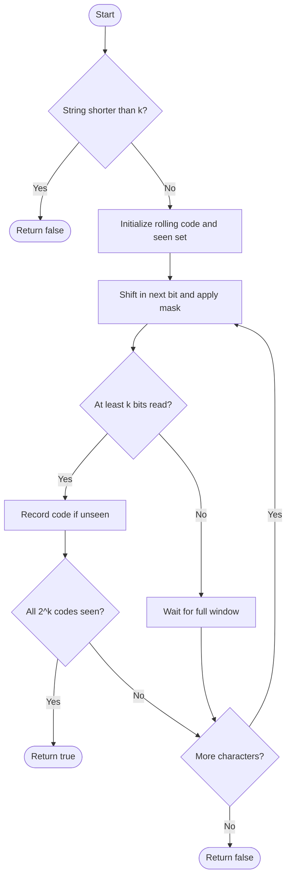

# 1461 — Check If a String Contains All Binary Codes of Size K

## 1. Understanding

या प्रश्नाचा गाभा म्हणजे लांबी k चे सर्व binary codes उपस्थित आहेत का याची तपासणी.

> **मराठी:** प्रश्नात काय दिले आहे आणि नेमके काय शोधायचे आहे, हे आधी स्पष्ट करा.
> Check whether every possible binary substring of length `k` occurs in `s`. There are `2^k` distinct codes to find.

## 2. Worked examples and edge cases

उदाहरणे आणि सीमाप्रकरणांत लांबी k चे सर्व binary codes उपस्थित आहेत का याची तपासणी कशी लागू होते ते पाहा.

> **मराठी:** उदाहरणातील input पासून output पर्यंत प्रत्येक बदल समजून घ्या.
> For `s="00110110", k=2`, codes `00,01,10,11` all occur, so return true. If `|s|<k`, return false.

## 3. Pattern identification + cheat sheet

येथे मुख्य pattern म्हणजे rolling bit mask वापरून वेगवेगळ्या windows नोंदवणे; वरील तुलना लक्षात घ्या.

> **मराठी:** या clues मुळे योग्य pattern ओळखता येतो; constraints आणि relations नीट तपासा.
> This is a **fixed-width sliding window encoded as an integer bitmask**.
> | Need | Technique |
> |---|---|
> | Window of `k` bits | Rolling binary value |
> | Keep only last `k` bits | Mask `(1<<k)-1` |
> | All possible codes | Need `2^k` distinct windows |

## 4. Approaches

पद्धतींची तुलना करताना rolling bit mask वापरून वेगवेगळ्या windows नोंदवणे याचा वेळ आणि जागेवरील परिणाम पाहा.

> **मराठी:** सोप्या उपायापासून सुरुवात करा आणि constraints नुसार योग्य optimization निवडा.

- Source nested-loop encoding plus `set`: correct, `O(nk)` time (building each code and set insertion are both `O(k)` here).
- Source rolling hash with `unordered_set`: `O(n)` expected, but hash overhead.
- Source boolean vector: `O(n+2^k)` time and `O(2^k)` space; deterministic and compact.
- Immediate impossibility test: if windows available `<2^k`, return false.

## 5. Mermaid flowchart and explanation

आकृतीमध्ये rolling bit mask वापरून वेगवेगळ्या windows नोंदवणे ही प्रक्रिया क्रमाने दाखवली आहे.

> **मराठी:** Flowchart मध्ये प्रत्येक decision, loop आणि loop कधी थांबतो ते पाहा.
> Each new bit shifts the current code, masks old bits, and records a full-size window.

## 6. Algorithm / intuition

मूळ कल्पना: rolling bit mask वापरून वेगवेगळ्या windows नोंदवणे.

> **मराठी:** मुख्य observation समजल्यावर algorithm चे steps लक्षात ठेवणे सोपे होते.
> The rolling integer represents the last at most `k` bits. Left shift and OR append the new bit; the mask removes older bits. Once `k` bits have been read, the integer uniquely identifies that window.

## 7. Code explanation

Code मधील state आणि updates हे rolling bit mask वापरून वेगवेगळ्या windows नोंदवणे या कल्पनेशी जोडून वाचा.

> **मराठी:** Code मधील variable आणि condition यांचा algorithm मधील उद्देश समजून घ्या.
> Source provides set, rolling-set, and boolean-vector methods. The rolling methods use `mask=(1<<k)-1`; vector method tracks number of newly seen codes. Problem constraints keep shifts within integer range.

## 8. Dry run

Dry run मध्ये rolling bit mask वापरून वेगवेगळ्या windows नोंदवणे कसे घडते ते प्रत्येक टप्प्यावर तपासा.

> **मराठी:** प्रत्येक महत्त्वाच्या step नंतर variable ची value trace करा.
> For `"0011", k=2`, windows:
> | New bit | Rolling value | Window | New code? |
> |---|---:|---|---|
> | 0 | 0 | — | — |
> | 0 | 0 | 00 | Yes |
> | 1 | 1 | 01 | Yes |
> | 1 | 3 | 11 | Yes |
> Code `10` is missing, so false.

## 9. Complexity

rolling bit mask वापरून वेगवेगळ्या windows नोंदवणे यासाठी लागणारा वेळ आणि अतिरिक्त जागा वरील bounds मध्ये दिली आहेत.

> **मराठी:** Input size आणि प्रत्येक operation कितीदा चालतो यावरून complexity ठरवा.
> Rolling set expected `O(n)` time, `O(min(n,2^k))` stored codes. Boolean vector `O(n+2^k)` time and `O(2^k)` space. The set-based substring conversion performs `O(k)` work per window.

## 10. Correctness

योग्यतेचा युक्तिवाद rolling bit mask वापरून वेगवेगळ्या windows नोंदवणे यावर आधारित आहे; वरील अटी तपासा.

> **मराठी:** Invariant किंवा तर्क वापरून algorithm योग्य उत्तर देतो हे समजून घ्या.
> After each character, masking retains exactly the last `k` bits. Every full window is therefore recorded as its unique integer code, and every possible code corresponds to one such window. Returning true exactly when the number of distinct recorded codes is `2^k` is equivalent to having all codes.

## 11. Mistakes / interview traps

लक्षात ठेवा: पूर्ण k bits मिळाल्यावरच window मोजायची.

> **मराठी:** Boundary, duplicate आणि off-by-one cases स्वतंत्रपणे तपासा.

- Start recording only after `k` bits arrive.
- Apply the mask so older bits do not remain.
- Count distinct codes, not total windows.
- Check `n<k`; for large `k`, guard shifts/allocations if constraints differ.

## 12. Quick revision

थोडक्यात, rolling bit mask वापरून वेगवेगळ्या windows नोंदवणे. पूर्ण k bits मिळाल्यावरच window मोजायची.

> **मराठी:** दोन मिनिटांच्या revision साठी pattern, मुख्य कल्पना आणि complexity आठवा.
> Rolling `k`-bit value → mark each full window → need `2^k` distinct codes.

## 13. Related problems / variations

संबंधित प्रश्नांत लांबी k चे सर्व binary codes उपस्थित आहेत का याची तपासणी यासारखी अट बदलल्यास योग्य पद्धतही तपासा.

> **मराठी:** Related problem मध्ये constraints बदलल्यास approach कसा बदलेल ते विचारा.
> Repeated DNA Sequences, sliding-window hashing, binary substring coverage; variation: count missing codes or find shortest window covering all codes.

## 14. Self-assessment

वरील प्रश्न स्वतः सोडवून लांबी k चे सर्व binary codes उपस्थित आहेत का याची तपासणी याची उजळणी करा.

> **मराठी:** उत्तर न पाहता प्रश्न सोडवा आणि तुमच्या निवडीचे कारण सांगा.

1. Why does the rolling value identify a window?
2. What does the mask remove?
3. Why compare distinct count with `2^k`?
4. When can we return false before scanning?
