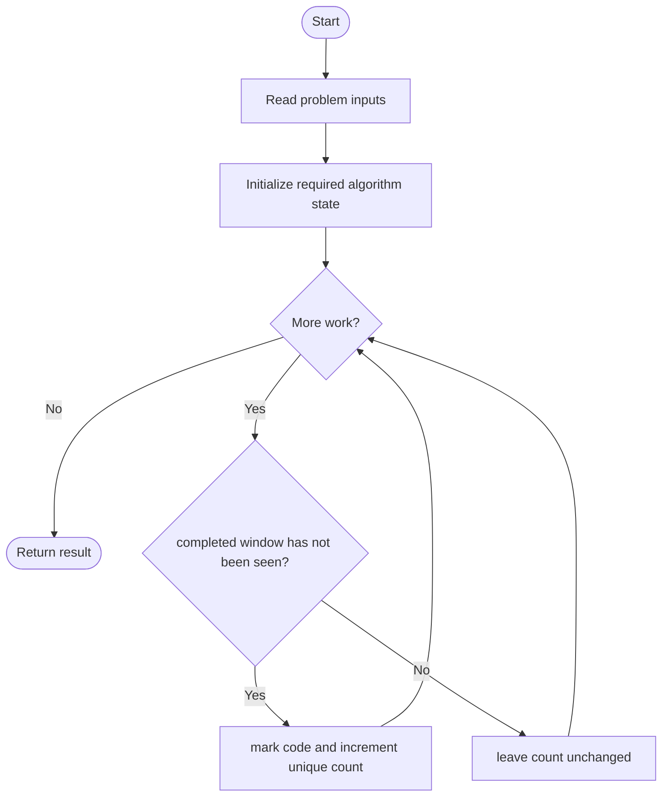
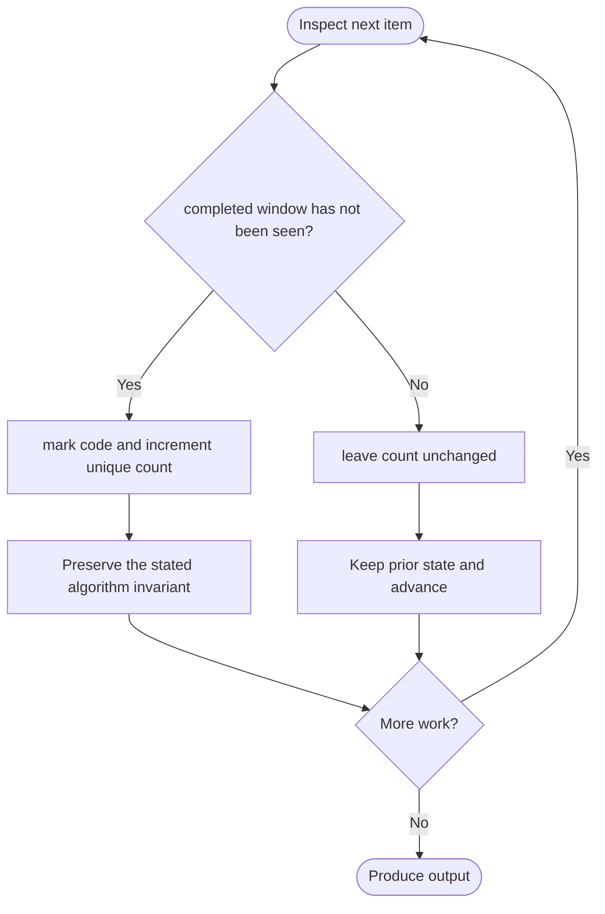

# Check If a String Contains All Binary Codes of Size K

**LeetCode ID:** 1461

**Source file(s):** `1461.cpp` (originally `hasAllCodes.cpp`)

**Identification evidence:** The original filename, declared signature, and distinctive behavior described below uniquely identify this problem; no number was inferred from a filename alone.

## Expected input/output or judge interface

hasAllCodes_Set/Rolling/Vector(string s,int k). Inputs follow the problem constraints; the output is the documented scalar, sequence, or design-object behavior. The description below reflects the implementation actually present in the source.

## Main flow



## Important branch and loop flow



## Core logic and invariant

Encodes each length-k bit window and counts distinct values using a set, rolling bitmask hash set, or boolean vector.

The key branch/loop rule above is applied once per relevant item; the algorithm relies on that rule to preserve its state and produce the required result.

## Optimization / comparison

Rolling mask retains exactly k bits; success requires all 2^k codes. Boolean vector avoids set overhead.

## Complexity

Rolling/vector O(n) time and O(2^k) space; set variant O(nk log(2^k)).

## Compile and run

The repository file includes a standalone demonstration `main()`; it is not a raw LeetCode submission unit. From the repository root, with a C++17 compiler:

```powershell
g++ -std=c++17 LeetCode\1461\1461.cpp -o solution.exe
.\solution.exe
```

For LeetCode's class-method judge, copy the relevant class/method or design-class API and omit the demo `main()` and local harness. Adapt free-function implementations to the requested `Solution` class signature where necessary. See the source caveat above for any compile blocker.
