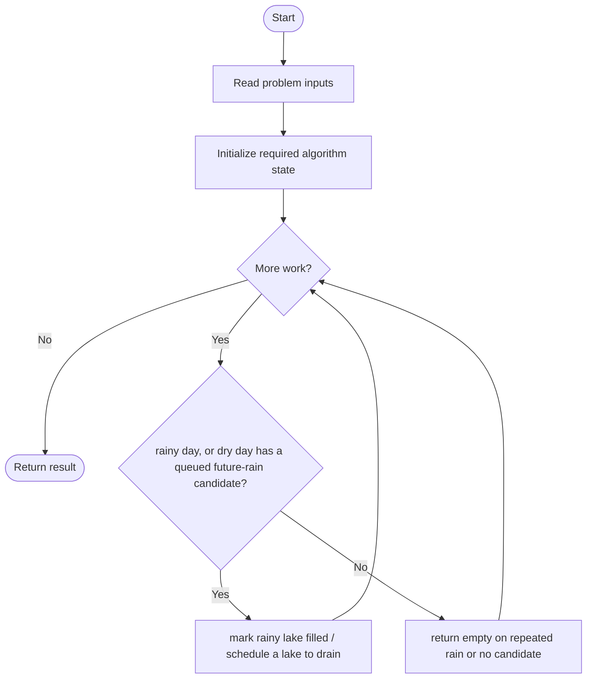
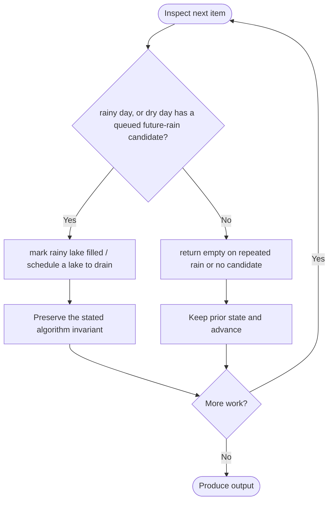

# Avoid Flood in The City

**LeetCode ID:** 1488

**Source file(s):** `1488.cpp` (originally `avoidFlood.cpp`)

**Identification evidence:** The original filename, declared signature, and distinctive behavior described below uniquely identify this problem; no number was inferred from a filename alone.

> **Implementation caveat:** `filledLakes` is never cleared after a scheduled drain, and the dry-day choice is based on map order rather than the next urgent rain. This implementation can reject feasible schedules or choose an invalid drain.

## Expected input/output or judge interface

vector<int> avoidFlood(vector<int>& rains). Inputs follow the problem constraints; the output is the documented scalar, sequence, or design-object behavior. The description below reflects the implementation actually present in the source.

## Main flow



## Important branch and loop flow



## Core logic and invariant

Queues future rainy days by lake, scans days, and chooses the first map-ordered lake with a queued future rain on dry days. A filled-lake set detects repeated rain.

The key branch/loop rule above is applied once per relevant item; the algorithm relies on that rule to preserve its state and produce the required result.

## Optimization / comparison

The source never removes drained lakes from filledLakes and chooses by map order, not urgent next-rain order; it can reject feasible schedules or make an invalid choice.

## Complexity

Preprocessing O(n log L); dry-day scans O(nL) worst case; O(n+L) storage.

## Compile and run

The repository file includes a standalone demonstration `main()`; it is not a raw LeetCode submission unit. From the repository root, with a C++17 compiler:

```powershell
g++ -std=c++17 LeetCode\1488\1488.cpp -o solution.exe
.\solution.exe
```

For LeetCode's class-method judge, copy the relevant class/method or design-class API and omit the demo `main()` and local harness. Adapt free-function implementations to the requested `Solution` class signature where necessary. See the source caveat above for any compile blocker.
