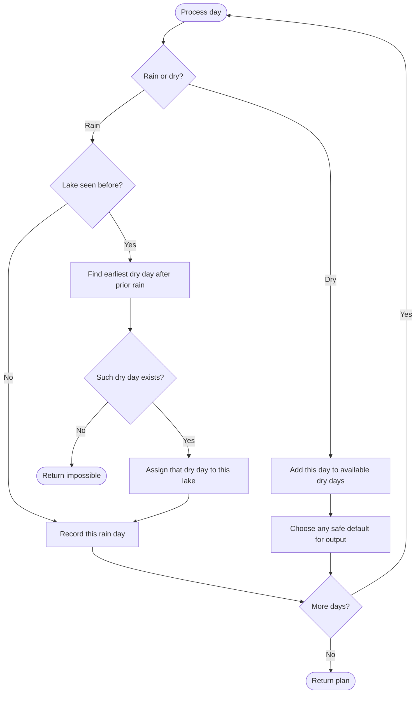

# 1488 — Avoid Flood in The City

## 1. Understanding

या प्रश्नाचा गाभा म्हणजे तलावांचा पूर टाळण्याची योजना.

> **मराठी:** प्रश्नात काय दिले आहे आणि नेमके काय शोधायचे आहे, हे आधी स्पष्ट करा.
> Rain fills a lake; a lake that rains while still full floods. On a dry day, choose one lake to drain. Return a valid plan or an empty array if impossible.

## 2. Worked examples and edge cases

उदाहरणे आणि सीमाप्रकरणांत तलावांचा पूर टाळण्याची योजना कशी लागू होते ते पाहा.

> **मराठी:** उदाहरणातील input पासून output पर्यंत प्रत्येक बदल समजून घ्या.
> For `[1,2,0,1,2]`, dry day must drain lake `1` or `2` before its next rain. All-dry input is feasible (choose any positive lake each dry day); repeated rain with no intervening dry day is impossible.

## 3. Pattern identification + cheat sheet

येथे मुख्य pattern म्हणजे मागील पावसानंतर उपलब्ध पहिला dry day निवडणे; वरील तुलना लक्षात घ्या.

> **मराठी:** या clues मुळे योग्य pattern ओळखता येतो; constraints आणि relations नीट तपासा.
> This is **greedy scheduling with ordered future deadlines**.
> | Event | Required action |
> |---|---|
> | Rain on full lake | Impossible |
> | Dry day before next rain | Drain that lake by its deadline |
> | Multiple choices | Drain the lake whose next rain is earliest |

## 4. Approaches

पद्धतींची तुलना करताना मागील पावसानंतर उपलब्ध पहिला dry day निवडणे याचा वेळ आणि जागेवरील परिणाम पाहा.

> **मराठी:** सोप्या उपायापासून सुरुवात करा आणि constraints नुसार योग्य optimization निवडा.

- Brute-force dry-day assignments: exponential.
- Correct greedy: track last rain per lake and use an ordered set of available dry days; for a repeated rain, assign the earliest dry day after its previous rain.
- **Source implementation is not correct:** it scans map order, not urgent next-rain order, can select a lake not currently full, and never clears `filledLakes` after draining. It can reject feasible plans or report impossible incorrectly.

## 5. Mermaid flowchart and explanation

आकृतीमध्ये मागील पावसानंतर उपलब्ध पहिला dry day निवडणे ही प्रक्रिया क्रमाने दाखवली आहे.

> **मराठी:** Flowchart मध्ये प्रत्येक decision, loop आणि loop कधी थांबतो ते पाहा.
> This diagram describes the correct scheduling invariant, not the flawed dry-day selection in the source.

## 6. Algorithm / intuition

मूळ कल्पना: मागील पावसानंतर उपलब्ध पहिला dry day निवडणे.

> **मराठी:** मुख्य observation समजल्यावर algorithm चे steps लक्षात ठेवणे सोपे होते.
> Every second rain on lake `L` creates a deadline: drain `L` after its previous rain and before today. The earliest unused dry day satisfying that interval is safe. In a correct implementation, ordered dry days support `lower_bound(lastRain[L]+1)`.

## 7. Code explanation

Code मधील state आणि updates हे मागील पावसानंतर उपलब्ध पहिला dry day निवडणे या कल्पनेशी जोडून वाचा.

> **मराठी:** Code मधील variable आणि condition यांचा algorithm मधील उद्देश समजून घ्या.
> Source initializes result to `-1`, queues future rainy indices by lake, and tracks `filledLakes`. On a dry day it picks the first map-ordered lake with a future rain; however this does not ensure the lake is full or the next rain is earliest. It also never erases a lake from `filledLakes` after draining. Its `map` dry-day scan is `O(nL)` worst case (plus map costs), and local examples do not prove correctness.

## 8. Dry run

Dry run मध्ये मागील पावसानंतर उपलब्ध पहिला dry day निवडणे कसे घडते ते प्रत्येक टप्प्यावर तपासा.

> **मराठी:** प्रत्येक महत्त्वाच्या step नंतर variable ची value trace करा.
> Correct plan for `[1,2,0,1,2]`:
> | Day | Event | Action/state |
> |---:|---|---|
> | 0 | Rain lake 1 | Lake 1 full |
> | 1 | Rain lake 2 | Lakes 1,2 full |
> | 2 | Dry | Drain lake 1 |
> | 3 | Rain lake 1 | Safe |
> | 4 | Rain lake 2 | Flood unless another dry day existed |
> Thus this exact input is **impossible**; a dry day cannot drain both lakes. (Any returned plan must be checked against this.)

## 9. Complexity

मागील पावसानंतर उपलब्ध पहिला dry day निवडणे यासाठी लागणारा वेळ आणि अतिरिक्त जागा वरील bounds मध्ये दिली आहेत.

> **मराठी:** Input size आणि प्रत्येक operation कितीदा चालतो यावरून complexity ठरवा.
> Source: `O(n log L + nL)` worst-case time, `O(n+L)` storage. Standard ordered-set greedy: `O(n log n)` time, `O(n)` space.

## 10. Correctness

योग्यतेचा युक्तिवाद मागील पावसानंतर उपलब्ध पहिला dry day निवडणे यावर आधारित आहे; वरील अटी तपासा.

> **मराठी:** Invariant किंवा तर्क वापरून algorithm योग्य उत्तर देतो हे समजून घ्या.
> For the standard greedy, each repeated rain's required drain lies after its previous rain and before its current day. Choosing the earliest available day in that interval preserves later days for later deadlines; if no such day exists, no valid schedule can satisfy that deadline. The source does not implement these conditions, so no correctness claim applies to it.

## 11. Mistakes / interview traps

लक्षात ठेवा: योग्य dry day नसल्यास योजना अशक्य आहे.

> **मराठी:** Boundary, duplicate आणि off-by-one cases स्वतंत्रपणे तपासा.

- Check feasibility for every repeat rain, not just whether a future rain exists.
- A dry day must drain a currently full lake to help.
- Track when a drained lake becomes empty.
- Choose by next deadline, not alphabetic/map order.
- `[1,2,0,1,2]` is impossible: one dry day cannot serve two deadlines.

## 12. Quick revision

थोडक्यात, मागील पावसानंतर उपलब्ध पहिला dry day निवडणे. योग्य dry day नसल्यास योजना अशक्य आहे.

> **मराठी:** दोन मिनिटांच्या revision साठी pattern, मुख्य कल्पना आणि complexity आठवा.
> Remember lake's last rain; on repeat assign earliest unused dry day after it. Source has known correctness bugs—do not mistake its greedy for the standard solution.

## 13. Related problems / variations

संबंधित प्रश्नांत तलावांचा पूर टाळण्याची योजना यासारखी अट बदलल्यास योग्य पद्धतही तपासा.

> **मराठी:** Related problem मध्ये constraints बदलल्यास approach कसा बदलेल ते विचारा.
> Course Schedule III, Task Scheduler, Meeting Rooms; variation: resource allocation with ordered deadlines and reusable capacity.

## 14. Self-assessment

वरील प्रश्न स्वतः सोडवून तलावांचा पूर टाळण्याची योजना याची उजळणी करा.

> **मराठी:** उत्तर न पाहता प्रश्न सोडवा आणि तुमच्या निवडीचे कारण सांगा.

1. Why is `[1,2,0,1,2]` impossible?
2. Which dry day is chosen for a repeated lake?
3. Why is map order not a valid greedy rule?
4. What state must change after draining?
