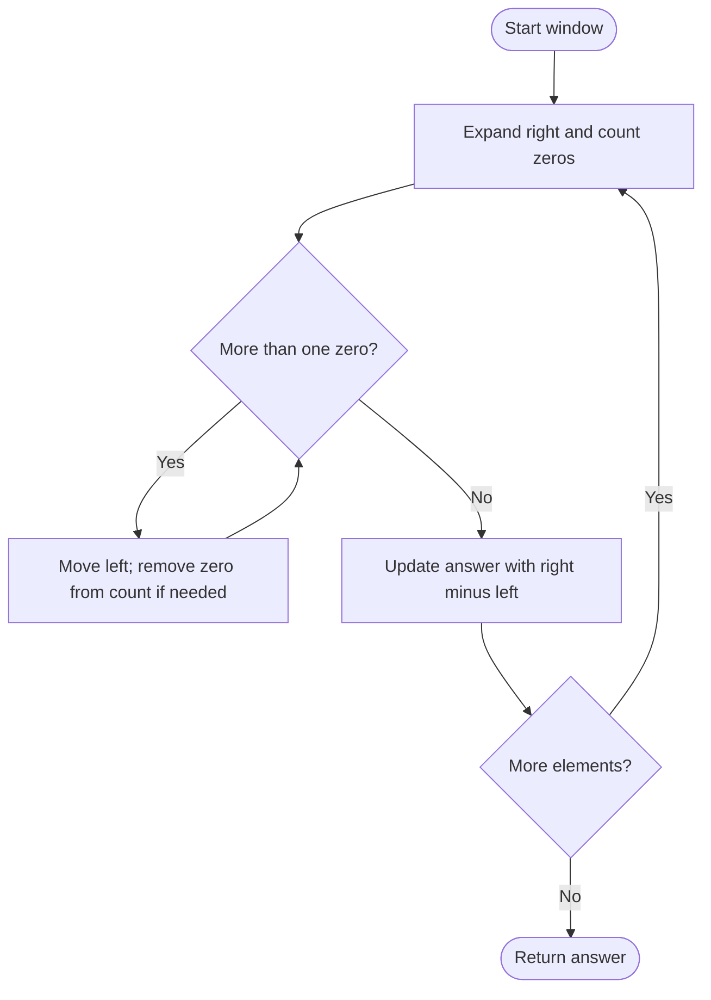

# 1493 — Longest Subarray of 1s After Deleting One Element

## 1. Understanding

या प्रश्नाचा गाभा म्हणजे एक घटक काढल्यावर सलग ones ची कमाल लांबी.

> **मराठी:** प्रश्नात काय दिले आहे आणि नेमके काय शोधायचे आहे, हे आधी स्पष्ट करा.
> Delete exactly one element, then return the longest remaining contiguous run of ones. Even an all-ones input must lose one element.

## 2. Worked examples and edge cases

उदाहरणे आणि सीमाप्रकरणांत एक घटक काढल्यावर सलग ones ची कमाल लांबी कशी लागू होते ते पाहा.

> **मराठी:** उदाहरणातील input पासून output पर्यंत प्रत्येक बदल समजून घ्या.
> `[1,1,0,1]` gives `3`; `[1,1,1]` gives `2` because one `1` must be deleted. `[0,0,0]` gives `0`.

## 3. Pattern identification + cheat sheet

येथे मुख्य pattern म्हणजे जास्तीत जास्त एक zero असलेली sliding window ठेवणे; वरील तुलना लक्षात घ्या.

> **मराठी:** या clues मुळे योग्य pattern ओळखता येतो; constraints आणि relations नीट तपासा.
> This is a **sliding window with at most one zero**; window length minus one accounts for the required deletion.
> | Window property | Interpretation |
> |---|---|
> | At most one zero | Deleting it leaves only ones |
> | `right-left+1` | Window length |
> | `right-left` | Kept length after one deletion |

## 4. Approaches

पद्धतींची तुलना करताना जास्तीत जास्त एक zero असलेली sliding window ठेवणे याचा वेळ आणि जागेवरील परिणाम पाहा.

> **मराठी:** सोप्या उपायापासून सुरुवात करा आणि constraints नुसार योग्य optimization निवडा.

- Source brute-force enumerates starts and extends while tracking zero count: `O(n²)` and harder to reason about.
- Source sliding window: `O(n)` time, `O(1)` space.
- A two-pointer window with at most one zero is the recommended pattern.

## 5. Mermaid flowchart and explanation

आकृतीमध्ये जास्तीत जास्त एक zero असलेली sliding window ठेवणे ही प्रक्रिया क्रमाने दाखवली आहे.

> **मराठी:** Flowchart मध्ये प्रत्येक decision, loop आणि loop कधी थांबतो ते पाहा.
> Shrink until at most one zero remains, then measure the length after mandatory deletion.

## 6. Algorithm / intuition

मूळ कल्पना: जास्तीत जास्त एक zero असलेली sliding window ठेवणे.

> **मराठी:** मुख्य observation समजल्यावर algorithm चे steps लक्षात ठेवणे सोपे होते.
> Any valid kept run corresponds to a window containing at most one zero; delete that zero if present. Since exactly one deletion is mandatory, the best post-deletion length is window length minus one, whether the window has zero or all ones.

## 7. Code explanation

Code मधील state आणि updates हे जास्तीत जास्त एक zero असलेली sliding window ठेवणे या कल्पनेशी जोडून वाचा.

> **मराठी:** Code मधील variable आणि condition यांचा algorithm मधील उद्देश समजून घ्या.
> `longestSubarrayOptimized` increments `zeroCount`, advances `left` while count exceeds one, and updates `maxLen` with `right-left`. Source also includes a brute-force variant; use the optimized method for the judge.

## 8. Dry run

Dry run मध्ये जास्तीत जास्त एक zero असलेली sliding window ठेवणे कसे घडते ते प्रत्येक टप्प्यावर तपासा.

> **मराठी:** प्रत्येक महत्त्वाच्या step नंतर variable ची value trace करा.
> For `[1,1,0,1]`:
> | Right index | Window after shrink | Zeros | `right-left` |
> |---:|---|---:|---:|
> | 0 | `[1]` | 0 | 0 |
> | 1 | `[1,1]` | 0 | 1 |
> | 2 | `[1,1,0]` | 1 | 2 |
> | 3 | `[1,1,0,1]` | 1 | 3 |

## 9. Complexity

जास्तीत जास्त एक zero असलेली sliding window ठेवणे यासाठी लागणारा वेळ आणि अतिरिक्त जागा वरील bounds मध्ये दिली आहेत.

> **मराठी:** Input size आणि प्रत्येक operation कितीदा चालतो यावरून complexity ठरवा.
> Sliding window `O(n)` time because each pointer moves at most `n` times; `O(1)` extra space. Brute force `O(n²)` time.

## 10. Correctness

योग्यतेचा युक्तिवाद जास्तीत जास्त एक zero असलेली sliding window ठेवणे यावर आधारित आहे; वरील अटी तपासा.

> **मराठी:** Invariant किंवा तर्क वापरून algorithm योग्य उत्तर देतो हे समजून घ्या.
> The window invariant guarantees at most one zero, so deleting that zero (or any one element when there is none) leaves only ones and length `windowLength-1`. Every valid subarray after one deletion is represented by such a window, so maximizing this quantity finds the optimum.

## 11. Mistakes / interview traps

लक्षात ठेवा: नेमका एक घटक काढणे बंधनकारक आहे.

> **मराठी:** Boundary, duplicate आणि off-by-one cases स्वतंत्रपणे तपासा.

- Subtract one even when the window has no zero: deletion is exact, not optional.
- Shrink while `zeroCount>1`, not `>=1`.
- Update with `right-left`, not full window size.
- Empty result is valid (e.g. all zeros).

## 12. Quick revision

थोडक्यात, जास्तीत जास्त एक zero असलेली sliding window ठेवणे. नेमका एक घटक काढणे बंधनकारक आहे.

> **मराठी:** दोन मिनिटांच्या revision साठी pattern, मुख्य कल्पना आणि complexity आठवा.
> Keep ≤1 zero; answer `max(right-left)`. Exact deletion is why subtract one always.

## 13. Related problems / variations

संबंधित प्रश्नांत एक घटक काढल्यावर सलग ones ची कमाल लांबी यासारखी अट बदलल्यास योग्य पद्धतही तपासा.

> **मराठी:** Related problem मध्ये constraints बदलल्यास approach कसा बदलेल ते विचारा.
> Max Consecutive Ones III, longest substring with at most K zeros, Fruit Into Baskets; variation: allow deleting up to `k` entries.

## 14. Self-assessment

वरील प्रश्न स्वतः सोडवून एक घटक काढल्यावर सलग ones ची कमाल लांबी याची उजळणी करा.

> **मराठी:** उत्तर न पाहता प्रश्न सोडवा आणि तुमच्या निवडीचे कारण सांगा.

1. Why subtract one for an all-ones window?
2. What is the window invariant?
3. What should `[1]` return?
4. Why is the two-pointer runtime linear?
