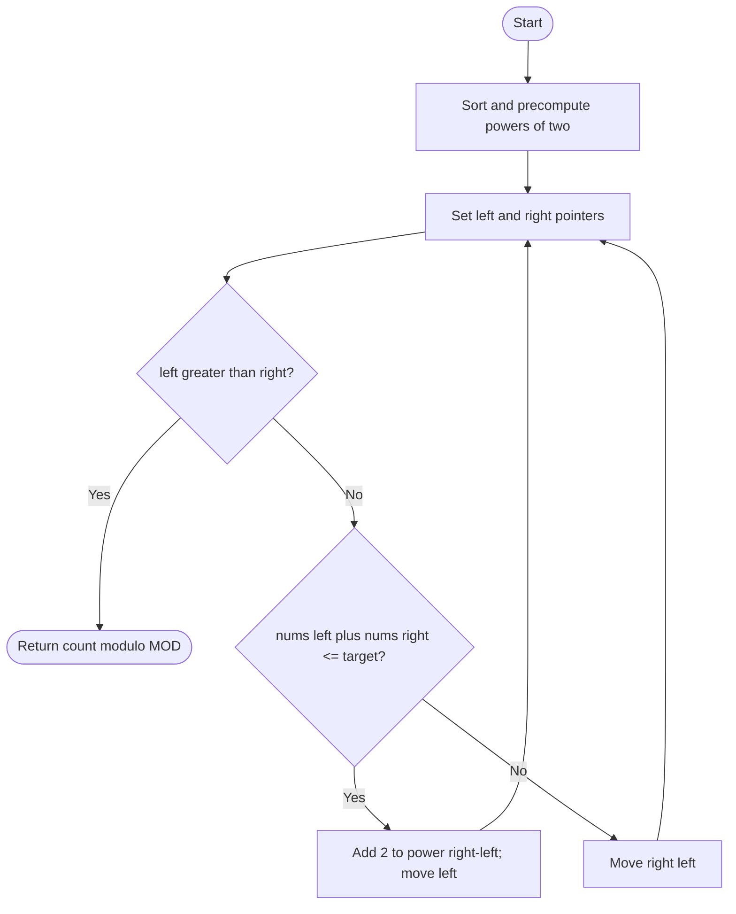

# 1498 — Number of Subsequences That Satisfy the Given Sum Condition

## 1. Understanding

या प्रश्नाचा गाभा म्हणजे मर्यादेत min आणि max बेरीज असलेल्या subsequences ची मोजणी.

> **मराठी:** प्रश्नात काय दिले आहे आणि नेमके काय शोधायचे आहे, हे आधी स्पष्ट करा.
> Count nonempty subsequences where `minimum + maximum <= target`; preserve element identity, but order within a subsequence does not matter. Return modulo `1e9+7`.

## 2. Worked examples and edge cases

उदाहरणे आणि सीमाप्रकरणांत मर्यादेत min आणि max बेरीज असलेल्या subsequences ची मोजणी कशी लागू होते ते पाहा.

> **मराठी:** उदाहरणातील input पासून output पर्यंत प्रत्येक बदल समजून घ्या.
> Sort `[3,5,6,7]`, target `9`: with minimum `3`, maximum may be any of `3,5,6`, giving `2^2=4` subsequences. Duplicates are separate choices.

## 3. Pattern identification + cheat sheet

येथे मुख्य pattern म्हणजे क्रमवारीनंतर two pointers आणि दोनच्या घाती वापरणे; वरील तुलना लक्षात घ्या.

> **मराठी:** या clues मुळे योग्य pattern ओळखता येतो; constraints आणि relations नीट तपासा.
> This is **sort + two pointers + combinatorial counting**.
> | Condition | Count |
> |---|---|
> | `nums[l]+nums[r] <= target` | `2^(r-l)` |
> | Otherwise | Decrease `r` |
> | Modulo powers | Precompute powers of two |

## 4. Approaches

पद्धतींची तुलना करताना क्रमवारीनंतर two pointers आणि दोनच्या घाती वापरणे याचा वेळ आणि जागेवरील परिणाम पाहा.

> **मराठी:** सोप्या उपायापासून सुरुवात करा आणि constraints नुसार योग्य optimization निवडा.

- Enumerate all subsequences: correct but `O(2^n)`.
- Source sorted two-pointer method: `O(n log n)` plus linear scan.
- Binary search per left endpoint also works, typically `O(n log n)` after sorting.

## 5. Mermaid flowchart and explanation

आकृतीमध्ये क्रमवारीनंतर two pointers आणि दोनच्या घाती वापरणे ही प्रक्रिया क्रमाने दाखवली आहे.

> **मराठी:** Flowchart मध्ये प्रत्येक decision, loop आणि loop कधी थांबतो ते पाहा.
> When the smallest and largest selected values fit, every subset of the middle elements is valid.

## 6. Algorithm / intuition

मूळ कल्पना: क्रमवारीनंतर two pointers आणि दोनच्या घाती वापरणे.

> **मराठी:** मुख्य observation समजल्यावर algorithm चे steps लक्षात ठेवणे सोपे होते.
> After sorting, if `nums[l]+nums[r]` meets the condition, `nums[l]` can be the minimum and every subset of indices `(l,r]` may be chosen or omitted. This yields `2^(r-l)` subsequences. Otherwise the current maximum is too large, so reduce `r`.

## 7. Code explanation

Code मधील state आणि updates हे क्रमवारीनंतर two pointers आणि दोनच्या घाती वापरणे या कल्पनेशी जोडून वाचा.

> **मराठी:** Code मधील variable आणि condition यांचा algorithm मधील उद्देश समजून घ्या.
> `numSubseq` sorts in place, precomputes `pow2`, and runs two pointers. It adds `pow2[right-left]` when valid; otherwise decrements `right`. `nums` is modified by sorting.

## 8. Dry run

Dry run मध्ये क्रमवारीनंतर two pointers आणि दोनच्या घाती वापरणे कसे घडते ते प्रत्येक टप्प्यावर तपासा.

> **मराठी:** प्रत्येक महत्त्वाच्या step नंतर variable ची value trace करा.
> For sorted `[3,5,6,7]`, target `9`:
> | `l,r` | Min+max | Add | New count |
> |---|---:|---:|---:|
> | 0,3 | 10 | —, decrement `r` | 0 |
> | 0,2 | 9 | `2²=4` | 4 |
> | 1,2 | 11 | —, decrement `r` | 4 |
> | 1,1 | 10 | —, decrement `r`; loop ends | 4 |

## 9. Complexity

क्रमवारीनंतर two pointers आणि दोनच्या घाती वापरणे यासाठी लागणारा वेळ आणि अतिरिक्त जागा वरील bounds मध्ये दिली आहेत.

> **मराठी:** Input size आणि प्रत्येक operation कितीदा चालतो यावरून complexity ठरवा.
> Sorting `O(n log n)`, pointer scan `O(n)`, powers `O(n)`; total `O(n log n)` time and `O(n)` extra space.

## 10. Correctness

योग्यतेचा युक्तिवाद क्रमवारीनंतर two pointers आणि दोनच्या घाती वापरणे यावर आधारित आहे; वरील अटी तपासा.

> **मराठी:** Invariant किंवा तर्क वापरून algorithm योग्य उत्तर देतो हे समजून घ्या.
> When endpoints satisfy the bound, every subset of the interior values preserves the same minimum and has maximum at most `nums[r]`; there are exactly `2^(r-l)` choices. If endpoints fail, no subsequence using `nums[r]` and this minimum can qualify, so moving `r` left is safe. The scan counts each valid subsequence at its minimum endpoint.

## 11. Mistakes / interview traps

लक्षात ठेवा: रिकामा subsequence मोजू नये.

> **मराठी:** Boundary, duplicate आणि off-by-one cases स्वतंत्रपणे तपासा.

- This is subsequence counting, not contiguous subarray counting.
- Include the left endpoint in every counted subset; hence exponent `r-l`.
- Equal values at different indices are distinct choices.
- Reduce modulo and use wide enough arithmetic.

## 12. Quick revision

थोडक्यात, क्रमवारीनंतर two pointers आणि दोनच्या घाती वापरणे. रिकामा subsequence मोजू नये.

> **मराठी:** दोन मिनिटांच्या revision साठी pattern, मुख्य कल्पना आणि complexity आठवा.
> Sort; if `min+max<=target`, add `2^(r-l)` and move left; else move right.

## 13. Related problems / variations

संबंधित प्रश्नांत मर्यादेत min आणि max बेरीज असलेल्या subsequences ची मोजणी यासारखी अट बदलल्यास योग्य पद्धतही तपासा.

> **मराठी:** Related problem मध्ये constraints बदलल्यास approach कसा बदलेल ते विचारा.
> Two Sum, 3Sum, count subsequences with bounded maximum; variation: count subsets whose min/max difference is bounded.

## 14. Self-assessment

वरील प्रश्न स्वतः सोडवून मर्यादेत min आणि max बेरीज असलेल्या subsequences ची मोजणी याची उजळणी करा.

> **मराठी:** उत्तर न पाहता प्रश्न सोडवा आणि तुमच्या निवडीचे कारण सांगा.

1. Why are there `2^(r-l)` choices?
2. Why move left when the endpoints are valid?
3. Why move right when they are invalid?
4. Do duplicate values represent distinct choices?
