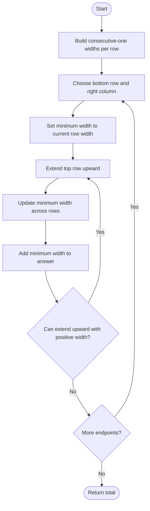

# 1504 — Count Submatrices With All Ones

## 1. Understanding

या प्रश्नाचा गाभा म्हणजे फक्त ones असलेल्या आयताकृती submatrices ची मोजणी.

> **मराठी:** प्रश्नात काय दिले आहे आणि नेमके काय शोधायचे आहे, हे आधी स्पष्ट करा.
> Count every nonempty rectangular submatrix whose cells are all one.

## 2. Worked examples and edge cases

उदाहरणे आणि सीमाप्रकरणांत फक्त ones असलेल्या आयताकृती submatrices ची मोजणी कशी लागू होते ते पाहा.

> **मराठी:** उदाहरणातील input पासून output पर्यंत प्रत्येक बदल समजून घ्या.
> An all-one `2×2` matrix has 9 submatrices: four `1×1`, two horizontal `1×2`, two vertical `2×1`, and one `2×2`. Zeros break rectangles.

## 3. Pattern identification + cheat sheet

येथे मुख्य pattern म्हणजे प्रत्येक तळाच्या कोपऱ्यासाठी किमान रुंदी जमा करणे; वरील तुलना लक्षात घ्या.

> **मराठी:** या clues मुळे योग्य pattern ओळखता येतो; constraints आणि relations नीट तपासा.
> This is **row-wise histogram widths + vertical minimum accumulation**.
> | State | Meaning |
> |---|---|
> | `dp[i][j]` | Consecutive ones ending at column `j` in row `i` |
> | Extend upward | Minimum width over chosen row range |
> | Add minimum | Number of rectangles ending at current bottom-right |

## 4. Approaches

पद्धतींची तुलना करताना प्रत्येक तळाच्या कोपऱ्यासाठी किमान रुंदी जमा करणे याचा वेळ आणि जागेवरील परिणाम पाहा.

> **मराठी:** सोप्या उपायापासून सुरुवात करा आणि constraints नुसार योग्य optimization निवडा.

- Enumerate all rectangle boundaries and inspect cells: correct but very expensive.
- Source computes row-ending widths, then scans upward for every bottom-right cell: `O(m²n)` time, `O(mn)` space.
- Histogram + monotonic stack can achieve `O(mn)` for this family.

## 5. Mermaid flowchart and explanation

आकृतीमध्ये प्रत्येक तळाच्या कोपऱ्यासाठी किमान रुंदी जमा करणे ही प्रक्रिया क्रमाने दाखवली आहे.

> **मराठी:** Flowchart मध्ये प्रत्येक decision, loop आणि loop कधी थांबतो ते पाहा.
> For a fixed bottom row and right column, each upward extension contributes as many widths as the narrowest row allows.

## 6. Algorithm / intuition

मूळ कल्पना: प्रत्येक तळाच्या कोपऱ्यासाठी किमान रुंदी जमा करणे.

> **मराठी:** मुख्य observation समजल्यावर algorithm चे steps लक्षात ठेवणे सोपे होते.
> Preprocess each row so `dp[i][j]` is the run of ones ending at `(i,j)`. Fix bottom-right `(i,j)` and move the top upward; the rectangle's maximum width is the minimum width in that vertical segment. Add that width, counting every possible left boundary.

## 7. Code explanation

Code मधील state आणि updates हे प्रत्येक तळाच्या कोपऱ्यासाठी किमान रुंदी जमा करणे या कल्पनेशी जोडून वाचा.

> **मराठी:** Code मधील variable आणि condition यांचा algorithm मधील उद्देश समजून घ्या.
> Source copies `mat` to `dp` and accumulates row widths from left to right. Then for each column and bottom row, it scans upward, updates `minWidth`, and adds it to `res`; stops when width reaches zero. Assumes nonempty matrix.

## 8. Dry run

Dry run मध्ये प्रत्येक तळाच्या कोपऱ्यासाठी किमान रुंदी जमा करणे कसे घडते ते प्रत्येक टप्प्यावर तपासा.

> **मराठी:** प्रत्येक महत्त्वाच्या step नंतर variable ची value trace करा.
> For all-one `2×2`, widths are `[[1,2],[1,2]]`:
> | Bottom-right | Upward widths | Contribution |
> |---|---|---:|
> | (0,0) | 1 | 1 |
> | (0,1) | 2 | 2 |
> | (1,0) | 1,1 | 2 |
> | (1,1) | 2,2 | 4 |
> Total `9`.

## 9. Complexity

प्रत्येक तळाच्या कोपऱ्यासाठी किमान रुंदी जमा करणे यासाठी लागणारा वेळ आणि अतिरिक्त जागा वरील bounds मध्ये दिली आहेत.

> **मराठी:** Input size आणि प्रत्येक operation कितीदा चालतो यावरून complexity ठरवा.
> Source preprocessing `O(mn)`; upward scans `O(m²n)` worst case. Storage `O(mn)`.

## 10. Correctness

योग्यतेचा युक्तिवाद प्रत्येक तळाच्या कोपऱ्यासाठी किमान रुंदी जमा करणे यावर आधारित आहे; वरील अटी तपासा.

> **मराठी:** Invariant किंवा तर्क वापरून algorithm योग्य उत्तर देतो हे समजून घ्या.
> Each all-one rectangle has a unique bottom-right cell and top row. For a fixed endpoint and top row, its valid widths are exactly `1..minWidth`; adding `minWidth` counts them all. The scan considers every possible top row once and no rectangle with a zero is counted.

## 11. Mistakes / interview traps

लक्षात ठेवा: वर जाताना उपलब्ध रुंदी कमी होऊ शकते.

> **मराठी:** Boundary, duplicate आणि off-by-one cases स्वतंत्रपणे तपासा.

- Add `minWidth`, not just one, because multiple left edges are valid.
- Update the minimum while extending upward.
- Keep width zero as a stopping point.
- Do not confuse this with square-only counting (1277).

## 12. Quick revision

थोडक्यात, प्रत्येक तळाच्या कोपऱ्यासाठी किमान रुंदी जमा करणे. वर जाताना उपलब्ध रुंदी कमी होऊ शकते.

> **मराठी:** दोन मिनिटांच्या revision साठी pattern, मुख्य कल्पना आणि complexity आठवा.
> Row prefix widths → fix bottom-right → extend upward and add current minimum width.

## 13. Related problems / variations

संबंधित प्रश्नांत फक्त ones असलेल्या आयताकृती submatrices ची मोजणी यासारखी अट बदलल्यास योग्य पद्धतही तपासा.

> **मराठी:** Related problem मध्ये constraints बदलल्यास approach कसा बदलेल ते विचारा.
> Count Square Submatrices with All Ones, Maximal Rectangle, largest rectangle in histogram; variation: use a monotonic stack for `O(mn)`.

## 14. Self-assessment

वरील प्रश्न स्वतः सोडवून फक्त ones असलेल्या आयताकृती submatrices ची मोजणी याची उजळणी करा.

> **मराठी:** उत्तर न पाहता प्रश्न सोडवा आणि तुमच्या निवडीचे कारण सांगा.

1. What does the width DP store?
2. Why take a minimum across rows?
3. Why add the minimum width itself?
4. How does this differ from square counting?
